# WORK BREAKDOWN STRUCTURE (WBS) & WBS DICTIONARY
## SISTEM E-VOTING SMART PEMIRA (SMART PEMILIHAN UMUM RAYA)
### Politeknik Kelapa Sawit Citra Widya Edukasi (Poltek CWE)

---

| Atribut Dokumen | Rincian Dokumen |
| :--- | :--- |
| **Judul Dokumen** | Work Breakdown Structure (WBS) & Kamus Paket Kerja (WBS Dictionary) |
| **Kode Dokumen** | `DOC-PLAN-002` |
| **Versi Dokumen** | `1.0.0` (Definitif / Release Baseline) |
| **Klasifikasi Standar** | Standar PMBOK (Project Management Body of Knowledge) & IEEE 1058 |
| **Penyusun** | Tim Informasi dan Teknologi Pemira Online (ITPO) Poltek CWE |
| **Target Proyek** | Dekomposisi 4-Level Sistem E-Voting Smart Pemira |

---

## DAFTAR ISI
1. [Pengantar & Prinsip Dekomposisi WBS](#1-pengantar--prinsip-dekomposisi-wbs)
2. [Bagan Hierarki WBS 4 Level](#2-bagan-hierarki-wbs-4-level)
3. [Dekomposisi Struktur WBS (Level 1 s/d Level 4)](#3-dekomposisi-struktur-wbs-level-1-sd-level-4)
4. [Kamus Paket Kerja (WBS Dictionary Lengkap)](#4-kamus-paket-kerja-wbs-dictionary-lengkap)
5. [Matriks Tanggung Jawab & Penugasan (RAM - Responsibility Assignment Matrix)](#5-matriks-tanggung-jawab--penugasan-ram---responsibility-assignment-matrix)

---

## 1. Pengantar & Prinsip Dekomposisi WBS

Work Breakdown Structure (WBS) ini memetakan seluruh ruang lingkup pekerjaan rekayasa perangkat lunak sistem **Smart Pemira Poltek CWE** ke dalam unit-unit kerja yang terkelola secara bertingkat (*hierarchical decomposition*). 

Prinsip dasar yang diterapkan dalam WBS ini meliputi:
* **Aturan 100% (*100% Rule*)**: Seluruh pekerjaan di Level 2 hingga Level 4 mencakup 100% ruang lingkup yang diamanatkan dalam `PRD.md`, `DESIGN.md`, dan `PROMPT.md`, tanpa ada pekerjaan yang terlewat atau berlebih.
* **Mutually Exclusive**: Tidak ada tumpang tindih (*overlap*) antar paket kerja di tingkat manapun.
* **Outcome-Oriented**: Setiap tingkatan terendah (Level 4 Work Package) menghasilkan deliverable konkret yang dapat diverifikasi melalui kriteria keberterimaan (*Acceptance Criteria*).

---

## 2. Bagan Hierarki WBS 4 Level

```mermaid
graph TD
    %% Level 1 - Project Root
    L1["1.0 SISTEM SMART PEMIRA POLTEK CWE"]

    %% Level 2 - Major Phases
    L1 --> L2_1["1.1 Inisiasi & Tata Kelola"]
    L1 --> L2_2["1.2 Kebutuhan & Kriptografi"]
    L1 --> L2_3["1.3 Arsitektur, UML & UI/UX"]
    L1 --> L2_4["1.4 Konstruksi Kode Produksi"]
    L1 --> L2_5["1.5 Pengujian, Audit & UAT"]
    L1 --> L2_6["1.6 Deployment & Hari-H"]

    %% Level 3 - Work Streams
    L2_1 --> L3_11["1.1.1 Landasan Yuridis"]
    L2_1 --> L3_12["1.1.2 Rencana Kerja & Tim"]

    L2_2 --> L3_21["1.2.1 Elisitasi FR & NFR"]
    L2_2 --> L3_22["1.2.2 5 Hukum Kriptografi"]
    L2_2 --> L3_23["1.2.3 Finalisasi Dokumen SRS"]

    L2_3 --> L3_31["1.3.1 Pemodelan UML"]
    L2_3 --> L3_32["1.3.2 Basis Data (ERD/CDM)"]
    L2_3 --> L3_33["1.3.3 Desain UI/UX Botanical"]

    L2_4 --> L3_41["1.4.1 Core Kripto & Auth"]
    L2_4 --> L3_42["1.4.2 Meja PPUR & DPT"]
    L2_4 --> L3_43["1.4.3 Bilik Kiosk Multi-Ballot"]
    L2_4 --> L3_44["1.4.4 Pleno Vault & Tallying"]
    L2_4 --> L3_45["1.4.5 Panwaslu & Sengketa"]

    L2_5 --> L3_51["1.5.1 Uji Unit & Transaksi"]
    L2_5 --> L3_52["1.5.2 Uji Beban & Penetrasi"]
    L2_5 --> L3_53["1.5.3 Simulasi Gladi Resik (UAT)"]

    L2_6 --> L3_61["1.6.1 Hardware & LAN TPS"]
    L2_6 --> L3_62["1.6.2 Bimtek Operator"]
    L2_6 --> L3_63["1.6.3 Hari-H & Sidang Pleno"]

    %% Level 4 - Work Packages Samples
    L3_41 -.-> L4_41["1.4.1.2 CSPRNG Token | 1.4.1.3 SHA-256 Chain | 1.4.1.4 Ed25519"]
    L3_43 -.-> L4_43["1.4.3.2 Multi-Ballot Wizard | 1.4.3.4 Transaksi Atomik 6-Langkah"]
    L3_44 -.-> L4_44["1.4.4.1 Vault Lock 423 | 1.4.4.3 Calon Tunggal | 1.4.4.4 BA PDF"]
```

---

## 3. Dekomposisi Struktur WBS (Level 1 s/d Level 4)

Struktur hierarki 4-level diuraikan secara komprehensif sebagai berikut:

### 1.0 SISTEM SMART PEMIRA POLTEK CWE (Level 1 - Project Root)
* **1.1 Inisiasi & Tata Kelola Proyek (Level 2)**
  * 1.1.1 Perumusan Landasan Yuridis & Legalitas (Level 3)
    * 1.1.1.1 Harmonisasi UUD IKM & Ketetapan DPM No. 005/DPM-CWE/KEP/VII/2024 (Level 4)
    * 1.1.1.2 Penyusunan Rencana Anggaran Biaya (RAB) & Pengadaan Hardware (Level 4)
  * 1.1.2 Manajemen Rencana Kerja & Stakeholder (Level 3)
    * 1.1.2.1 Penyusunan Project Charter Definitif (Level 4)
    * 1.1.2.2 Pembentukan Struktur Organisasi & Penetapan Tim ITPO (Level 4)
    * 1.1.2.3 Penyusunan Matriks Risiko (RBS) & Rencana Kontinjensi (Level 4)
* **1.2 Rekayasa Kebutuhan & Analisis Kriptografi (Level 2)**
  * 1.2.1 Elisitasi Kebutuhan Fungsional & Non-Fungsional (Level 3)
    * 1.2.1.1 Perumusan 8 Modul Fungsional Utama (FR-01 s/d FR-08) (Level 4)
    * 1.2.1.2 Spesifikasi Batasan Kinerja, Ketersediaan & Keamanan (NFR) (Level 4)
  * 1.2.2 Spesifikasi Kriptografi & 5 Hukum Arsitektur (Level 3)
    * 1.2.2.1 Spesifikasi Isolasi Zero-Knowledge Ballot (Hukum 1) (Level 4)
    * 1.2.2.2 Formulasi SHA-256 Hash Chaining & Salt Per-TPS (Hukum 2) (Level 4)
    * 1.2.2.3 Formulasi Kemenangan Calon Tunggal vs Kotak Kosong (Hukum 3) (Level 4)
    * 1.2.2.4 Formulasi Skema Tanda Tangan Asimetris Ed25519 Berita Acara (Level 4)
  * 1.2.3 Finalisasi Dokumen SRS Standar IEEE 830 / ISO 29148 (Level 3)
    * 1.2.3.1 Review Kebutuhan Bersama KPUM, Panwaslu, dan DPM (Level 4)
    * 1.2.3.2 Baseline Sign-off Dokumen SRS (Level 4)
* **1.3 Perancangan Arsitektur, UML & UI/UX (Level 2)**
  * 1.3.1 Pemodelan Sistem Terstruktur & UML (Level 3)
    * 1.3.1.1 Pemodelan Use Case Diagram 6 Aktor & 12 Skenario Naratif (Level 4)
    * 1.3.1.2 Perancangan Class Diagram Entitas Domain & Services (Level 4)
    * 1.3.1.3 Perancangan Sequence Diagram 4 Alur Kritis (Level 4)
    * 1.3.1.4 Perancangan Activity, State Machine & Deployment Diagram (Level 4)
  * 1.3.2 Pemodelan Basis Data Konseptual & Fisik (Level 3)
    * 1.3.2.1 Perancangan Conceptual & Physical Data Model (CDM/PDM) (Level 4)
    * 1.3.2.2 Penyusunan Kamus Data Lengkap 11 Tabel Prisma (Level 4)
  * 1.3.3 Desain Sistem Antarmuka UI/UX Anti-AI Slop (Level 3)
    * 1.3.3.1 Perancangan Sistem Desain Neo-Editorial Botanical & Token CSS (Level 4)
    * 1.3.3.2 Desain Komponen Tactile Neo-Brutalism Kiosk Bilik Suara (Level 4)
    * 1.3.3.3 Desain Bento Grid Dashboard PPUR, KPUM & Pleno Dark Mode (Level 4)
    * 1.3.3.4 Color-Coding Multi-Ballot 5 Program Studi Kampus (Level 4)
* **1.4 Konstruksi & Implementasi Kode (Level 2)**
  * 1.4.1 Fondasi Infrastruktur & Layanan Kriptografi (Level 3)
    * 1.4.1.1 Setup Repositori Next.js 15, TypeScript, Tailwind & Prisma (Level 4)
    * 1.4.1.2 Implementasi CSPRNG Token Generator & Hash Matcher (Level 4)
    * 1.4.1.3 Implementasi SHA-256 Ballot Chaining Engine & Verifier (Level 4)
    * 1.4.1.4 Implementasi Ed25519 Keypair Generator & BA Signer (Level 4)
    * 1.4.1.5 Implementasi Otentikasi Operator Scrypt & 2FA TOTP AES-256-GCM (Level 4)
  * 1.4.2 Modul Meja PPUR & Manajemen DPT (Level 3)
    * 1.4.2.1 Parser Impor CSV Mahasiswa BAAK & Validasi Duplikasi (Level 4)
    * 1.4.2.2 Pencarian Real-Time DPT, Filter Prodi & Status Check-in (Level 4)
    * 1.4.2.3 Mesin Penerbit Slip Token Bilik (TTL 10 Menit) (Level 4)
  * 1.4.3 Modul Kiosk Bilik Suara (Level 3)
    * 1.4.3.1 Gerbang Masuk Token & Keypad Sentuh Responsif (Level 4)
    * 1.4.3.2 Wizard Multi-Surat Suara (Presma, DPM, HIMA) dengan Filter Prodi (Level 4)
    * 1.4.3.3 Kartu Kandidat Tactile & Dinamika Calon Tunggal Kotak Kosong (Level 4)
    * 1.4.3.4 Dialog Review Pilihan, Transaksi Atomik 6-Langkah & Layar Sukses (Level 4)
  * 1.4.4 Modul Pleno Vault & Rekapitulasi Suara (Level 3)
    * 1.4.4.1 Middleware Pleno Vault Lock (HTTP 423 Locked) (Level 4)
    * 1.4.4.2 Dialog Otorisasi Pembukaan Pleno Bersama KPUM, Panwaslu & Saksi (Level 4)
    * 1.4.4.3 Mesin Tallying Rekapitulasi Suara & Resolusi Calon Tunggal (Level 4)
    * 1.4.4.4 Generator Berita Acara Model C-KWE PDF & QR Verification Seal (Level 4)
  * 1.4.5 Modul Pengawasan Panwaslu & Audit Log (Level 3)
    * 1.4.5.1 Live Audit Monitor Proyektor Dark Mode (Turnout, Laju Kedatangan) (Level 4)
    * 1.4.5.2 Feed Audit Log Tamper-Evident & Append-Only (Level 4)
    * 1.4.5.3 Sistem Pengaduan Sengketa Daring & Modul Eksekusi Sanksi Suara (Level 4)
* **1.5 Pengujian, Audit Keamanan & UAT (Level 2)**
  * 1.5.1 Pengujian Unit & Integrasi (Level 3)
    * 1.5.1.1 Pengujian Otomatis Transaksi Atomik & Zero-Knowledge Isolation (Level 4)
    * 1.5.1.2 Pengujian Matematis Integritas Rantai Hash & Ed25519 Signature (Level 4)
  * 1.5.2 Pengujian Kinerja & Uji Penetrasi Siber (Level 3)
    * 1.5.2.1 Stress Testing Throughput Bilik Kiosk & Rate Limiting Token (Level 4)
    * 1.5.2.2 Penetration Testing (Anti SQLi, XSS, CSRF, Token Brute-Force) (Level 4)
  * 1.5.3 Simulasi Lapangan & UAT (Level 3)
    * 1.5.3.1 Simulasi TPS Skala Penuh (Gladi Resik) Bersama Civitas Kampus (Level 4)
    * 1.5.3.2 Simulasi Skenario Darurat (Mati Lampu PLN & Putus Koneksi LAN) (Level 4)
    * 1.5.3.3 Penandatanganan Berita Acara UAT & Final Acceptance (Level 4)
* **1.6 Deployment, Pelatihan & Eksekusi Pemira (Level 2)**
  * 1.6.1 Persiapan Infrastruktur Lapangan (Level 3)
    * 1.6.1.1 Instalasi Server TPS Mini-PC, UPS, dan Jaringan Intranet Wi-Fi 6 (Level 4)
    * 1.6.1.2 Konfigurasi Kiosk Display Lock & Mini Thermal Printer (Level 4)
  * 1.6.2 Bimbingan Teknis & Pelatihan Operator (Level 3)
    * 1.6.2.1 Pelatihan Petugas PPUR (Verifikasi DPT, Token & Slip Cetak) (Level 4)
    * 1.6.2.2 Pelatihan Komisioner KPUM, Panwaslu & Saksi Mandat Paslon (Level 4)
  * 1.6.3 Operasional Hari-H & Pasca-Pemira (Level 3)
    * 1.6.3.1 Uji Integritas Pra-Buka TPS (Verifikasi Kotak Suara Nol) (Level 4)
    * 1.6.3.2 Pengawalan Operasional Pemungutan Suara di Bilik Kiosk (Level 4)
    * 1.6.3.3 Eksekusi Sidang Pleno Unlocking, Tallying & Penandatanganan BA (Level 4)
    * 1.6.3.4 Penyegelan Arsip Digital & Handover Hasil ke DPM Poltek CWE (Level 4)

---

## 4. Kamus Paket Kerja (WBS Dictionary Lengkap — 57 Work Packages)

Berikut adalah kamus paket kerja detail untuk seluruh 57 unit kerja Level 4 yang mencakup 100% ruang lingkup sistem Smart Pemira Poltek CWE:

| Kode WBS | Nama Paket Kerja | Deskripsi Pekerjaan | Penanggung Jawab | Kriteria Keberterimaan (*Acceptance Criteria*) |
| :---: | :--- | :--- | :---: | :--- |
| **1.1.1.1** | Harmonisasi Yuridis Pemira | Membedah dan menerjemahkan klausul UUD IKM & Ketetapan DPM No. 005 ke dalam aturan logika sistem. | Project Manager / Legal | Matriks aturan bisnis tersusun lengkap mencakup skema pemilihan, syarat DPT, dan klausul calon tunggal $>50\%$. |
| **1.1.1.2** | Penyusunan RAB & Pengadaan Hardware | Merinci kebutuhan hardware (Server mini-PC, UPS, router Wi-Fi 6, printer thermal 58mm) dan anggaran proyek. | Project Manager | Dokumen RAB disahkan DPM dengan pagu maksimal Rp 10.000.000; seluruh hardware terdata siap pengadaan. |
| **1.1.2.1** | Penyusunan Project Charter Definitif | Menyusun dokumen project charter formal yang menguraikan latar belakang, visi, KPI, batasan, dan stakeholder register. | Lead Architect | Dokumen Charter disahkan dan ditandatangani Ketua ITPO, Ketua KPUM, dan Ketua DPM. |
| **1.1.2.2** | Pembentukan Struktur & Tim ITPO | Menetapkan penugasan tim rekayasa: Lead Architect, Frontend, Backend, Cryptography, dan DevOps/QA. | Project Manager | SK penugasan Tim ITPO diterbitkan resmi oleh DPM dengan pembagian peran yang definitif. |
| **1.1.2.3** | Penyusunan Matriks Risiko (RBS) | Mengidentifikasi potensi risiko teknis, operasional, regulasi, dan menyusun strategi mitigasi serta rencana pemulihan. | DevOps & QA Lead | Teridentifikasi minimal 7 risiko kritis (RSK-01 s/d RSK-07) beserta contingency plan yang teruji. |
| **1.2.1.1** | Perumusan 8 Modul FR (FR-01 - FR-08) | Mengelisitasi kebutuhan fungsional sistem mencakup konfigurasi, DPT, kandidat, token, kiosk, pleno, BA, dan panwaslu. | Systems Analyst | Tersusun 8 modul FR dengan sub-klausul yang tidak ambigu, dapat diuji, dan memenuhi prinsip LUBER JURDIL. |
| **1.2.1.2** | Spesifikasi Kebutuhan NFR | Menetapkan parameter kinerja (<500ms), ketersediaan (99.9%), keamanan (OWASP, scrypt, TOTP), dan aksesibilitas (WCAG AA). | Lead Architect | Metrik NFR terkuantifikasi secara jelas dengan ambang batas terukur dan metode verifikasi konkret. |
| **1.2.2.1** | Spesifikasi Zero-Knowledge Ballot | Mendefinisikan arsitektur pemisahan mutlak identitas pemilih dari surat suara di basis data. | Cryptography Specialist | Tidak ada relasi langsung (foreign key/NIM) antara Voter dan BallotBox; lolos audit privasi data pemilu. |
| **1.2.2.2** | Formulasi SHA-256 Hash Chaining | Merancang formula matematis hash berantai per TPS untuk menjamin sifat *tamper-evident*. | Cryptography Specialist | Formula `ballot_hash = SHA256(prev + id + cat + cand + ts + salt)` terdefinisi dan lolos pengujian integritas matematis. |
| **1.2.2.3** | Formulasi Calon Tunggal vs Kotak Kosong | Merumuskan aturan bisnis evaluasi kemenangan calon tunggal melawan kotak kosong sesuai Pasal 9 ayat 3 UUD IKM. | Legal & Systems Analyst | Logika kemenangan mewajibkan perolehan >50% suara sah; jika <=50% mandat kembali ke Musyawarah Mahasiswa. |
| **1.2.2.4** | Formulasi Tanda Tangan Ed25519 BA | Menetapkan skema tanda tangan digital asimetris Ed25519 (RFC 8032) atas teks kanonikal Berita Acara Model C-KWE. | Cryptography Specialist | Spesifikasi format kanonikal dan prosedur penandatanganan/verifikasi kunci publik terdefinisi secara presisi. |
| **1.2.3.1** | Review Kebutuhan Stakeholder | Menyelenggarakan sesi telaah dokumen spesifikasi bersama KPUM, Panwaslu, DPM, dan perwakilan saksi paslon. | Project Manager | Seluruh masukan pemangku kepentingan terdokumentasi dan diintegrasikan ke dalam draf SRS. |
| **1.2.3.2** | Baseline Sign-off Dokumen SRS | Mengesahkan dokumen SRS final berstandar ISO/IEC/IEEE 29148:2018 sebagai acuan resmi implementasi. | Lead Architect | Lembar pengesahan ditandatangani para pihak; versi dokumen dikunci pada baseline v1.0.0. |
| **1.3.1.1** | Pemodelan Use Case Diagram & Skenario | Memetakan interaksi 6 aktor (Pemilih, PPUR, KPUM, Panwaslu, Saksi, ITPO) dan 12 narasi use case terinci. | Software Architect | Diagram Use Case Mermaid valid dan 12 skenario memuat precondition, main flow, alt flow, postcondition lengkap. |
| **1.3.1.2** | Perancangan Class Diagram | Memodelkan relasi entitas basis data Prisma dan struktur antarmuka core service serta modul kriptografi. | Software Architect | Diagram Class Mermaid memuat entitas domain, core services, modul kripto, dan penegasan isolasi Zero-Knowledge. |
| **1.3.1.3** | Perancangan Sequence Diagram | Merancang diagram interaksi untuk 4 alur kritis: PPUR Token, Kiosk Transaksi Atomik, Pleno BA, dan Sengketa. | Software Architect | Keempat sequence diagram tersusun terperinci dengan nomor urut aksi dan penanganan skenario alternatif. |
| **1.3.1.4** | Perancangan Activity, State & Deployment | Memodelkan alur aktivitas operasional, mesin status token/voter/vault, dan topologi deployment Dual-Mode. | Software Architect | Tersedia 2 Activity Diagrams, 3 State Machine Diagrams, dan 1 Deployment Diagram yang siap diimplementasikan. |
| **1.3.2.1** | Perancangan CDM & PDM Basis Data | Menyusun model data konseptual dan fisik yang mengisolasi tabel identitas dari tabel rekam jejak suara. | Database Architect | CDM dan PDM diverifikasi tidak memiliki jembatan relasi identitas; timestamp jitter microsecond diterapkan. |
| **1.3.2.2** | Penyusunan Kamus Data 11 Tabel | Mendefinisikan seluruh atribut, tipe data, kunci primer/unik, dan batasan nullability pada 11 model Prisma. | Database Architect | Kamus data 11 entitas (StudyProgram, Tps, Voter, Token, Ballot, Candidate, Audit, Incident, Setting, Archive, Operator) tuntas. |
| **1.3.3.1** | Desain Sistem Neo-Editorial Botanical | Menyusun variabel token CSS, palet warna bertema sawit, tipografi display/sans/mono, dan prinsip Anti-AI Slop. | UI/UX Lead | File `DESIGN.md` selesai memuat token `--bg-canvas` (#F6F4EE), `--text-primary` (#141E19), `--accent-primary` (#1B7F4E). |
| **1.3.3.2** | Desain Komponen Tactile Neo-Brutalism | Merancang tombol sentuh Kiosk dengan border tebal 2px, sudut lengkung 14px, dan hard offset shadow 4px. | UI/UX Lead | Komponen tombol sentuh ergonomis (min 56x56px), umpan balik sentuhan responsif, bebas distorsi visual. |
| **1.3.3.3** | Desain Bento Grid Dashboard & Dark Mode | Merancang dashboard meja PPUR, admin KPUM, dan layar monitor Panwaslu bertema gelap sinematik (Obsidian Forest). | UI/UX Lead | Dashboard mengutamakan tabular-nums, whitespace proporsional, dan kontras tinggi WCAG AA. |
| **1.3.3.4** | Color-Coding Multi-Ballot 5 Prodi | Menetapkan warna aksen dan soft tint surat suara: BEM, DPM, TPTP, TPHP, MANLOG, BD, TRPL, dan Kotak Kosong. | UI/UX Lead | Palet warna 5 program studi terkalibrasi harmonis dan kontras jelas terhadap teks hitam deep espresso. |
| **1.4.1.1** | Setup Repositori & Environment | Menginisialisasi repositori Next.js 15, TypeScript, Tailwind CSS, Prisma ORM, ESLint, dan Vitest suite. | DevOps Specialist | Repositori terkonfigurasi rapi, build tanpa error, dev server berjalan lancar di port 3000. |
| **1.4.1.2** | CSPRNG Token Generator & Matcher | Mengembangkan modul pembangkit token acak 6 digit bebas karakter ambigu (0/O/1/I) dengan timingSafeEqual. | Backend Engineer | Modul `token-generator.ts` menghasilkan entropi kriptografis tinggi dan diverifikasi lulus unit testing. |
| **1.4.1.3** | SHA-256 Ballot Chaining Engine | Mengimplementasikan fungsi pembuatan hash berantai per TPS dan verifikasi keutuhan rantai blok suara. | Cryptography Specialist | Fungsi `computeBallotHash()` dan `verifyChain()` mampu mendeteksi manipulasi data pada level baris database. |
| **1.4.1.4** | Ed25519 Keypair Generator & Signer | Mengembangkan generator kunci asimetris Ed25519 dan fungsi penandatanganan dokumen kanonikal Berita Acara. | Cryptography Specialist | Berkas kunci privat tersimpan terenkripsi; fungsi sign menghasilkan signature base64 dan fungsi verify valid 100%. |
| **1.4.1.5** | Otentikasi Scrypt & 2FA TOTP | Mengimplementasikan hashing sandi scrypt dan otentikasi dua faktor TOTP RFC 6238 dengan enkripsi AES-256-GCM. | Backend Engineer | Login operator RBAC terlindungi dari brute-force; verifikasi TOTP berjalan presisi dengan toleransi jendela waktu. |
| **1.4.2.1** | Parser Impor CSV DPT Massal | Membangun pengunggah berkas data mahasiswa BAAK dengan validasi duplikasi NIM dan pemetaan prodi. | Backend Engineer | Berkas 1000+ data terimpor <3 detik, menolak duplikasi NIM, dan memetakan hak suara mahasiswa secara tepat. |
| **1.4.2.2** | Pencarian Instan DPT & Check-in | Membangun antarmuka pencarian cepat NIM/nama meja PPUR dan pelacak status 3-state (Belum, Antrean, Sudah). | Frontend Engineer | Waktu kueri pencarian <200ms; status pemilih terbarui instan dan terikat ke pos TPS bertugas. |
| **1.4.2.3** | Mesin Penerbit Slip Token Bilik | Membangun modul generate token sekali pakai (TTL 10 menit) dan integrasi cetak mini thermal printer 58mm. | Fullstack Engineer | Slip tercetak jelas memuat kode token raksasa, timestamp terbit, dan petunjuk masuk bilik Kiosk. |
| **1.4.3.1** | Gerbang Token & Keypad Sentuh | Membangun antarmuka fullscreen Kiosk dengan keypad virtual sentuh ergonomis dan validasi token instan. | Frontend Engineer | Keypad sentuh responsif; animasi getar (shake) saat token salah; auto-focus tanpa popup keyboard browser bawaan. |
| **1.4.3.2** | Wizard Multi-Surat Suara Prodi | Membangun alur bertahap 3 surat suara (Presma, DPM, HIMA) dengan isolasi ketat di sisi server per prodi. | Frontend Engineer | Mahasiswa hanya disuguhkan kandidat prodi yang cocok dengan tokennya; server menolak payload prodi silang. |
| **1.4.3.3** | Kartu Tactile & Opsi Kotak Kosong | Membangun kartu kandidat sentuh berdaya taktil tinggi dan generator dinamis opsi Kotak Kosong calon tunggal. | Frontend Engineer | Kartu kandidat berfoto jelas; penanda pilihan mantap; kartu Kotak Kosong otomatis tampil jika paslon tunggal. |
| **1.4.3.4** | Transaksi Atomik 6-Langkah & Review | Mengimplementasikan modal konfirmasi dan fungsi submit suara dalam satu transaksi ACID database. | Lead Architect | 6 langkah (Validasi Token, Filter Prodi, Simpan Suara Berantai, Update Token, Update DPT, Audit Log) commit utuh. |
| **1.4.4.1** | Middleware Pleno Vault Lock 423 | Membangun proteksi endpoint perolehan suara yang mengembalikan HTTP 423 Locked selama pemungutan suara. | Backend Engineer | Akses kueri perolehan suara ditolak total sebelum Ketua KPUM mengeksekusi Pleno Unlock. |
| **1.4.4.2** | Dialog Otorisasi Pleno Unlocking | Membangun antarmuka pembukaan gembok digital yang meminta sandi Ketua KPUM dan persetujuan Panwaslu/Saksi. | Frontend Engineer | Gembok pleno terbuka transparan di hadapan saksi; audit log mencatat waktu pembukaan secara permanen. |
| **1.4.4.3** | Mesin Tallying & Resolusi Tunggal | Mengembangkan algoritma rekapitulasi suara instan, perhitungan persentase sah, dan penentuan ambang 50%. | Backend Engineer | Perhitungan suara tuntas <5 detik; penentuan status TERPILIH vs MANDAT KEMBALI berjalan akurat secara matematis. |
| **1.4.4.4** | Generator Berita Acara PDF & QR Seal | Membangun penyusun dokumen resmi Berita Acara Model C-KWE PDF bertanda tangan Ed25519 dan stempel QR. | Fullstack Engineer | Dokumen PDF ter-render rapi memuat seluruh data rekapitulasi; QR code dapat diverifikasi mandiri oleh publik. |
| **1.4.5.1** | Live Audit Monitor Proyektor Dark | Membangun dashboard Panwaslu mode gelap (Obsidian Forest) visualisasi turnout, laju pemilih, dan status bilik. | Frontend Engineer | Tampilan sinematik di proyektor tanpa lag; menyajikan metrik operasional tanpa membocorkan suara pemilih. |
| **1.4.5.2** | Feed Audit Log Append-Only | Membangun panel streaming kejadian sistem secara real-time via Server-Sent Events tanpa celah pengubahan data. | Fullstack Engineer | Setiap transaksi masuk tercatat instan; struktur audit trail tamper-evident memenuhi kaidah forensic audit. |
| **1.4.5.3** | Portal Sengketa & Sanksi Suara | Membangun form laporan sengketa online (unggah bukti) dan modul penyesuaian sanksi pemotongan suara resmi. | Fullstack Engineer | Nomor tiket sengketa diterbitkan unik; alur verifikasi Panwaslu hingga putusan terekam transparan. |
| **1.5.1.1** | Pengujian Unit Transaksi Atomik | Mengembangkan skenario uji otomatis Vitest untuk memverifikasi isolasi Zero-Knowledge dan transaksi commit/rollback. | QA Engineer | 100% tes transaksi atomik lolos; pembuktian ketiadaan relasi identitas pemilih vs pilihan suara terverifikasi. |
| **1.5.1.2** | Pengujian Integritas Rantai & Signer | Mengembangkan unit test verifikasi rantai hash SHA-256 dan validasi kunci asimetris Ed25519 Berita Acara. | Cryptography Specialist | Seluruh blok suara terbukti terikat kokoh; deteksi tamper bekerja akurat; verifikasi signature valid. |
| **1.5.2.1** | Stress Testing Throughput Kiosk | Menguji ketahanan beban sistem terhadap 50 transaksi paralel simultan dan ketahanan rate limiter. | DevOps Specialist | Sistem stabil melayani beban puncak (latensi p95 <300ms, error rate 0%, zero concurrency deadlock). |
| **1.5.2.2** | Penetration Testing Keamanan Siber | Melakukan pengujian penetrasi siber terhadap celah SQL Injection, XSS, CSRF, Brute-force Token, dan Tampering. | Security Auditor | Lolos pengujian keamanan OWASP Top 10; proteksi brute-force mengunci percobaan salah >5 kali dalam 1 menit. |
| **1.5.3.1** | Simulasi TPS Skala Penuh (Gladi) | Melaksanakan simulasi pemungutan suara menyeluruh melibatkan 200+ partisipan mahasiswa dummy di area TPS. | Project Manager | Alur pemilih dari registrasi PPUR hingga bilik Kiosk berlangsung lancar dengan rata-rata waktu <90 detik. |
| **1.5.3.2** | Uji Kontinjensi Darurat Listrik/LAN | Menguji ketahanan sistem terhadap skenario pemadaman listrik PLN dan putusnya jaringan internet publik. | DevOps Specialist | Server otomatis bertahan via UPS dan genset; sistem beroperasi 100% mandiri pada intranet LAN tertutup. |
| **1.5.3.3** | Sign-off Berita Acara UAT | Menyelenggarakan evaluasi akhir bersama Steering Committee dan menandatangani Berita Acara Penerimaan Sistem. | Lead Architect | KPUM, Panwaslu, dan DPM menandatangani persetujuan kelaikan sistem untuk digunakan pada Hari-H. |
| **1.6.1.1** | Instalasi Server & Jaringan LAN TPS | Memasang server mini-PC lokal, UPS, router Wi-Fi 6, dan kabel Cat6 di gedung auditorium TPS kampus. | DevOps Specialist | Jaringan intranet TPS terisolasi aman dari jaringan luar, latency komunikasi antar perangkat <2ms. |
| **1.6.1.2** | Konfigurasi Terminal Kiosk & Printer | Menyiapkan tablet/display bilik suara dalam mode fullscreen locked dan menghubungkan mini printer 58mm meja PPUR. | DevOps Specialist | Perangkat Kiosk terkunci bebas akses URL luar; printer thermal mencetak slip token secara konsisten. |
| **1.6.2.1** | Pelatihan Teknis Petugas PPUR | Memberikan bimbingan teknis kepada operator meja PPUR terkait verifikasi KTM, cetak token, dan penanganan antrean. | Lead Developer | Seluruh petugas PPUR mahir mengoperasikan modul registrasi dan memahami SOP pembatalan token kedaluwarsa. |
| **1.6.2.2** | Pelatihan Komisioner & Saksi Paslon | Memberikan pengarahan kepada KPUM, Panwaslu, dan saksi paslon terkait pembacaan audit trail dan pleno unlock. | Project Manager | Komisioner dan saksi memahami transparansi sistem dan prosedur pengesahan Berita Acara digital. |
| **1.6.3.1** | Uji Integritas Kotak Nol Pra-Buka | Melakukan verifikasi pembuktian bahwa seluruh kotak suara digital bernilai 0 (nol) disaksikan saksi sebelum TPS buka. | Lead Architect | Berita Acara Pembukaan TPS disahkan; saksi mengonfirmasi kotak suara bersih dari suara siluman. |
| **1.6.3.2** | Pengawalan Operasional Pemungutan | Mendampingi jalannya pemungutan suara sepanjang jam operasional TPS, memantau stabilitas server dan antrean. | Tim ITPO | Pemungutan suara berlangsung lancar, zero crash, partisipasi mahasiswa terlayani secara tertib. |
| **1.6.3.3** | Eksekusi Pleno, Tallying & Tanda Tangan | Memfasilitasi pembukaan gembok pleno, perhitungan suara terbuka, dan penerbitan Berita Acara Model C-KWE Ed25519. | Project Manager | Sidang pleno berlangsung khidmat, hasil suara disahkan secara damai, Berita Acara resmi ditandatangani. |
| **1.6.3.4** | Penyegelan Arsip & Handover DPM | Melakukan penyegelan digital periode pemira ke tabel ElectionArchive dan menyerahkan laporan resmi ke DPM. | Lead Architect | Seluruh snapshot data, log audit, dan kepala rantai hash tersimpan aman; serah terima proyek tuntas. |

---

## 5. Matriks Tanggung Jawab & Penugasan (RAM - Responsibility Assignment Matrix)

Matriks penugasan memetakan keterkaitan paket kerja Level 3 dengan personil tim pengembang ITPO:

| Kode WBS | Nama Area Deliverable | Lead Architect | Frontend Lead | Backend Lead | Crypto Specialist | DevOps & QA |
| :---: | :--- | :---: | :---: | :---: | :---: | :---: |
| **1.1** | Inisiasi & Tata Kelola | **P** | S | S | S | S |
| **1.2** | Rekayasa Kebutuhan & SRS | **P** | S | S | **P** | S |
| **1.3.1** | Pemodelan UML & Sistem | **P** | S | **P** | S | S |
| **1.3.2** | Pemodelan Basis Data | **P** | - | **P** | S | S |
| **1.3.3** | Desain Sistem UI/UX | S | **P** | - | - | S |
| **1.4.1** | Core Kriptografi & Auth | S | - | S | **P** | S |
| **1.4.2** | Meja PPUR & DPT Service | S | **P** | **P** | - | - |
| **1.4.3** | Kiosk Bilik Suara & Wizard | S | **P** | **P** | S | - |
| **1.4.4** | Pleno Vault & Rekapitulasi | **P** | S | **P** | **P** | - |
| **1.4.5** | Panwaslu Monitor & Sengketa | S | **P** | **P** | - | - |
| **1.5.1** | Pengujian Unit & Transaksi | S | S | S | S | **P** |
| **1.5.2** | Uji Beban & Penetrasi Siber | S | - | S | S | **P** |
| **1.5.3** | Simulasi Gladi Resik (UAT) | **P** | S | S | S | **P** |
| **1.6.1** | Instalasi Hardware TPS LAN | S | - | - | - | **P** |
| **1.6.2** | Bimbingan Teknis Operator | **P** | **P** | S | - | S |
| **1.6.3** | Operasional Hari-H & Pleno | **P** | S | S | **P** | **P** |

*Keterangan: **P** = Penanggung Jawab Utama (Primary/Lead), **S** = Pendukung (Support).*
