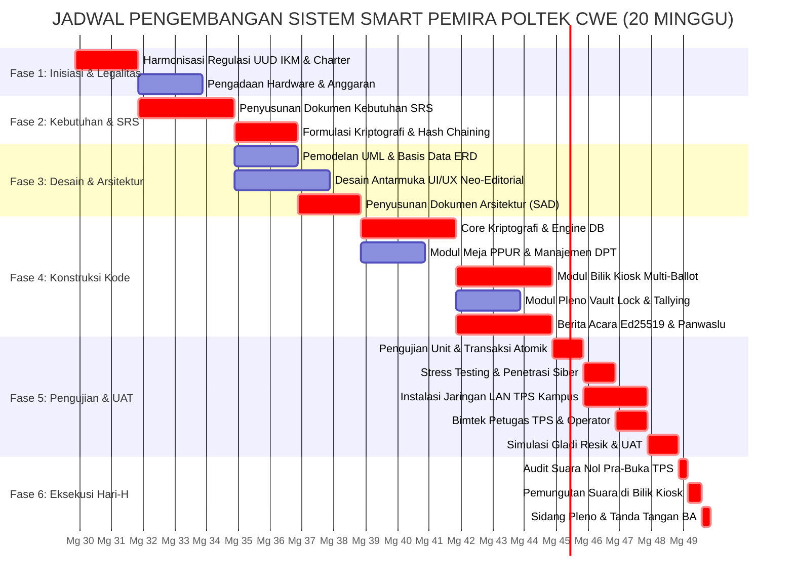

# JADWAL DAN TIMELINE PENGEMBANGAN PROYEK
## SISTEM E-VOTING SMART PEMIRA (SMART PEMILIHAN UMUM RAYA)
### Politeknik Kelapa Sawit Citra Widya Edukasi (Poltek CWE)

---

| Atribut Dokumen | Rincian Dokumen |
| :--- | :--- |
| **Judul Dokumen** | Jadwal Induk Proyek, Analisis Jalur Kritis (CPM), dan Linimasa Linier |
| **Kode Dokumen** | `DOC-PLAN-003` |
| **Versi Dokumen** | `1.0.0` (Definitif / Release Baseline) |
| **Durasi Proyek** | 5 Bulan Kalender (20 Minggu Kerja Terstruktur) |
| **Periode Pelaksanaan** | 01 Agustus 2026 s/d 20 Desember 2026 |
| **Metodologi Manajemen** | Critical Path Method (CPM) & Agile-Scrum Hybrid |
| **Penyusun** | Tim Informasi dan Teknologi Pemira Online (ITPO) Poltek CWE |

---

## DAFTAR ISI
1. [Ringkasan Eksekutif Linimasa 5 Bulan](#1-ringkasan-eksekutif-linimasa-5-bulan)
2. [Tabel Milestone Kunci Proyek (Key Milestones)](#2-tabel-milestone-kunci-proyek-key-milestones)
3. [Daftar Aktivitas & Analisis Jalur Kritis (Critical Path Method - CPM)](#3-daftar-aktivitas--analisis-jalur-kritis-critical-path-method---cpm)
4. [Diagram Gantt Chart Proyek (Mermaid.js)](#4-diagram-gantt-chart-proyek-mermaidjs)
5. [Alokasi Sprint & Siklus Pengembangan Scrum](#5-alokasi-sprint--siklus-pengembangan-scrum)
6. [Manajemen Kontinjensi & Mitigasi Keterlambatan Jadwal](#6-manajemen-kontinjensi--mitigasi-keterlambatan-jadwal)

---

## 1. Ringkasan Eksekutif Linimasa 5 Bulan

Pengembangan sistem **Smart Pemira Poltek CWE** dirancang dalam siklus waktu **5 bulan (20 minggu)**, terhitung sejak inisiasi regulasi kemahasiswaan hingga pelaksanaan pemungutan suara dan sidang pleno penetapan hasil pemira.

Linimasa proyek dibagi menjadi 6 fase terpadu:
* **Fase 1 (Minggu 1 - 3)**: Inisiasi Tata Kelola, Harmonisasi Regulasi Yuridis & Pengesahan Charter.
* **Fase 2 (Minggu 3 - 6)**: Analisis Rekayasa Kebutuhan, Spesifikasi Kriptografi & Penyusunan Dokumen SRS.
* **Fase 3 (Minggu 6 - 9)**: Perancangan Arsitektur Sistem 4+1 View, Pemodelan UML, ERD Basis Data & Desain UI/UX Neo-Editorial.
* **Fase 4 (Minggu 9 - 15)**: Konstruksi Kode Produksi (Core Kripto, Meja PPUR, Bilik Kiosk, Pleno Vault, Berita Acara Ed25519, dan Audit Panwaslu).
* **Fase 5 (Minggu 15 - 18)**: Pengujian Unit/Integrasi, Stress Testing, Audit Keamanan Siber & Gladi Resik Skala Penuh (UAT).
* **Fase 6 (Minggu 18 - 20)**: Instalasi Jaringan LAN TPS Kampus, Bimtek Operator, Hari-H Pemira, Sidang Pleno & Handover.

---

## 2. Tabel Milestone Kunci Proyek (Key Milestones)

Milestone proyek merepresentasikan titik henti kritis (*go/no-go decision gate*) yang mewajibkan peninjauan formal oleh Steering Committee dan DPM:

| ID | Nama Milestone Kunci | Target Waktu (Deadline) | Deliverable Utama yang Disahkan | Pihak Penilai / Verifikator |
| :---: | :--- | :---: | :--- | :--- |
| **M1** | **Project Charter & SRS Approved** | Akhir Minggu ke-5 (04 Sept 2026) | Dokumen Project Charter, WBS, dan SRS Standar IEEE 830 / ISO 29148 ditandatangani. | DPM, KPUM, dan Panwaslu |
| **M2** | **Design & Architecture Sign-Off** | Akhir Minggu ke-9 (02 Okt 2026) | Dokumen Arsitektur (SAD), Diagram UML lengkap, ERD Kamus Data, dan Design System UI/UX. | Tim ITPO & Lead Architect |
| **M3** | **Core Cryptography & DB Verified** | Akhir Minggu ke-12 (23 Okt 2026) | Mesin CSPRNG token, SHA-256 ballot hash chaining, dan transaksi atomik 6-langkah lulus unit test. | Cryptography Specialist |
| **M4** | **Feature Complete (Code Freeze)** | Akhir Minggu ke-15 (13 Nov 2026) | Seluruh 8 modul fungsional (FR-01 s/d FR-08) tuntas diimplementasikan; pembekuan kode (*Code Freeze*). | Lead Developer ITPO |
| **M5** | **UAT & Gladi Resik Lapangan Lulus** | Akhir Minggu ke-18 (04 Des 2026) | Simulasi pemira TPS skala penuh dengan 200+ partisipan dummy sukses; Berita Acara UAT disahkan. | KPUM, Panwaslu, dan Saksi |
| **M6** | **Hari-H Pemira & Sidang Pleno Sukses** | Akhir Minggu ke-20 (18 Des 2026) | Pemungutan suara 100% tuntas, gembok pleno dibuka, Berita Acara C-KWE bertanda tangan Ed25519 terbit. | DPM, KPUM, Panwaslu, Saksi |

---

## 3. Daftar Aktivitas & Analisis Jalur Kritis (Critical Path Method - CPM)

Metode Jalur Kritis (*Critical Path Method / CPM*) digunakan untuk mengidentifikasi urutan aktivitas terpanjang yang secara langsung menentukan tanggal penyelesaian minimum proyek. Setiap penundaan pada aktivitas jalur kritis akan memundurkan jadwal peluncuran Pemira secara keseluruhan.

### 3.1 Atribut Notasi CPM
* **Durasi ($D$)**: Lama pengerjaan dalam satuan minggu kerja.
* **Predecessor**: Aktivitas pendahulu yang wajib selesai sebelum aktivitas dimulai.
* **Early Start ($ES$)**: Waktu paling awal aktivitas dapat dimulai.
* **Early Finish ($EF$)**: Waktu paling awal aktivitas selesai ($EF = ES + D$).
* **Late Start ($LS$)**: Waktu paling lambat aktivitas dapat dimulai tanpa menunda proyek.
* **Late Finish ($LF$)**: Waktu paling lambat aktivitas harus selesai ($LF = LS + D$).
* **Total Float / Slack ($TF$)**: Fleksibilitas keterlambatan yang diperbolehkan ($TF = LS - ES = LF - EF$). Aktivitas pada Jalur Kritis memiliki **$TF = 0$**.

### 3.2 Tabel Analisis Parameter CPM (20 Aktivitas Utama)

| ID | Kode Aktivitas | Uraian Aktivitas | Predecessor | Durasi (Mg) | ES | EF | LS | LF | Total Float | Status Jalur |
| :---: | :---: | :--- | :---: | :---: | :---: | :---: | :---: | :---: | :---: | :---: |
| **A** | `ACT-01` | Inisiasi Proyek & Harmonisasi Yuridis UUD IKM | - | 2 | 0 | 2 | 0 | 2 | 0 | **CRITICAL** |
| **B** | `ACT-02` | Pengadaan Hardware & Penyiapan Anggaran | `ACT-01` | 2 | 2 | 4 | 5 | 7 | 3 | Non-Kritis |
| **C** | `ACT-03` | Analisis Kebutuhan & Penyusunan Dokumen SRS | `ACT-01` | 3 | 2 | 5 | 2 | 5 | 0 | **CRITICAL** |
| **D** | `ACT-04` | Perumusan Formula Matematis Kriptografi | `ACT-03` | 2 | 5 | 7 | 5 | 7 | 0 | **CRITICAL** |
| **E** | `ACT-05` | Perancangan Model UML & Basis Data (ERD) | `ACT-03` | 2 | 5 | 7 | 7 | 9 | 2 | Non-Kritis |
| **F** | `ACT-06` | Perancangan Desain Sistem UI/UX Neo-Editorial | `ACT-03` | 3 | 5 | 8 | 6 | 9 | 1 | Non-Kritis |
| **G** | `ACT-07` | Penyusunan Dokumen Arsitektur Sistem (SAD) | `ACT-04`, `ACT-05` | 2 | 7 | 9 | 7 | 9 | 0 | **CRITICAL** |
| **H** | `ACT-08` | Konstruksi Core Kripto (Token, Chaining, Ed25519) | `ACT-07` | 3 | 9 | 12 | 9 | 12 | 0 | **CRITICAL** |
| **I** | `ACT-09` | Implementasi Modul Meja PPUR & Manajemen DPT | `ACT-07`, `ACT-06` | 2 | 9 | 11 | 10 | 12 | 1 | Non-Kritis |
| **J** | `ACT-10` | Implementasi Modul Kiosk Bilik Suara & Multi-Ballot | `ACT-08`, `ACT-06` | 3 | 12 | 15 | 12 | 15 | 0 | **CRITICAL** |
| **K** | `ACT-11` | Implementasi Modul Pleno Vault Lock & Tallying | `ACT-08` | 2 | 12 | 14 | 13 | 15 | 1 | Non-Kritis |
| **L** | `ACT-12` | Implementasi Modul Berita Acara & Monitor Panwaslu | `ACT-08`, `ACT-06` | 3 | 12 | 15 | 12 | 15 | 0 | **CRITICAL** |
| **M** | `ACT-13` | Pengujian Unit & Integrasi Transaksi Atomik | `ACT-10`, `ACT-11`, `ACT-12` | 1 | 15 | 16 | 15 | 16 | 0 | **CRITICAL** |
| **N** | `ACT-14` | Stress Testing Beban & Uji Penetrasi Keamanan | `ACT-13` | 1 | 16 | 17 | 16 | 17 | 0 | **CRITICAL** |
| **O** | `ACT-15` | Penyiapan Jaringan On-Premise LAN TPS & Server | `ACT-02`, `ACT-13` | 2 | 16 | 18 | 16 | 18 | 0 | **CRITICAL** |
| **P** | `ACT-16` | Bimbingan Teknis & Pelatihan Operator TPS / PPUR | `ACT-14` | 1 | 17 | 18 | 17 | 18 | 0 | **CRITICAL** |
| **Q** | `ACT-17` | Simulasi TPS Skala Penuh (Gladi Resik & UAT) | `ACT-15`, `ACT-16` | 1 | 18 | 19 | 18 | 19 | 0 | **CRITICAL** |
| **R** | `ACT-18` | Audit Integritas Pra-Pemungutan Suara (Suara = 0) | `ACT-17` | 0.3 (2 hr) | 19.0 | 19.3 | 19.0 | 19.3 | 0 | **CRITICAL** |
| **S** | `ACT-19` | Pelaksanaan Hari-H Pemira di Bilik TPS Kampus | `ACT-18` | 0.5 (3-4 hr) | 19.3 | 19.8 | 19.3 | 19.8 | 0 | **CRITICAL** |
| **T** | `ACT-20` | Sidang Pleno, Tallying & Penandatanganan BA Ed25519 | `ACT-19` | 0.2 (1-2 hr) | 19.8 | 20.0 | 19.8 | 20.0 | 0 | **CRITICAL** |

### 3.3 Identifikasi Jalur Kritis (The Critical Path & Concurrent Branches)
Berdasarkan perhitungan matematis *forward pass* dan *backward pass*, total durasi minimum penyelesaian proyek adalah **tepat 20.0 minggu**. 

Jalur kritis utama (*Primary Critical Path*) adalah:
$$\mathbf{ACT\text{-}01} \longrightarrow \mathbf{ACT\text{-}03} \longrightarrow \mathbf{ACT\text{-}04} \longrightarrow \mathbf{ACT\text{-}07} \longrightarrow \mathbf{ACT\text{-}08} \longrightarrow \mathbf{ACT\text{-}10} \longrightarrow \mathbf{ACT\text{-}13} \longrightarrow \mathbf{ACT\text{-}14} \longrightarrow \mathbf{ACT\text{-}16} \longrightarrow \mathbf{ACT\text{-}17} \longrightarrow \mathbf{ACT\text{-}18} \longrightarrow \mathbf{ACT\text{-}19} \longrightarrow \mathbf{ACT\text{-}20}$$

**Cabang Kritis Bersamaan (Concurrent Critical Branches / Dual Critical Paths):**
1. **Cabang Berita Acara & Pengawasan Panwaslu (`ACT-12`)**: Berjalan paralel dengan `ACT-10` selama 3 minggu (Mg 12 - 15) pasca `ACT-08` dan menjadi prasyarat bersama bagi `ACT-13`. Karena durasinya identik ($3\text{ minggu}$), aktivitas `ACT-12` memiliki **$TF = 0$** dan berstatus **CRITICAL**.
2. **Cabang Infrastruktur Jaringan LAN TPS (`ACT-15`)**: Berjalan paralel dengan lintasan `ACT-14 \to ACT-16` selama 2 minggu (Mg 16 - 18) dan menjadi prasyarat bersama bagi `ACT-17`. Karena durasinya identik ($2\text{ minggu}$ vs $1+1\text{ minggu}$), aktivitas `ACT-15` memiliki **$TF = 0$** dan berstatus **CRITICAL**.

Kedua cabang paralel ini tidak memiliki cadangan waktu keterlambatan (nol kelonggaran), sehingga penundaan pada `ACT-12` maupun `ACT-15` akan seketika menggagalkan jadwal pemungutan suara di Hari-H.

---

## 4. Diagram Gantt Chart Proyek (Mermaid.js)



---

## 5. Alokasi Sprint & Siklus Pengembangan Scrum

Implementasi teknis pada Fase 4 (Konstruksi Kode) dieksekusi menggunakan siklus **Agile-Scrum 2 mingguan (Two-Week Sprints)**:

```
+---------------+     +---------------+     +---------------+     +---------------+
|   SPRINT 1    | --> |   SPRINT 2    | --> |   SPRINT 3    | --> |   SPRINT 4    |
| Fondasi Kripto|     |  PPUR & DPT   |     | Kiosk & Multi |     | Pleno Vault & |
|  & Prisma DB  |     | Management    |     | Ballot Wizard |     | Berita Acara  |
+---------------+     +---------------+     +---------------+     +---------------+
  (Mg 9 - 10)           (Mg 11 - 12)          (Mg 13 - 14)          (Mg 14 - 15)
```

### Rincian Target Setiap Sprint:
1. **Sprint 1 (Minggu 9 - 10) — Foundation & Cryptography**:
   - Skema Prisma SQLite/LibSQL diinisialisasi.
   - Generator CSPRNG 6 karakter bebas ambigu (`token-generator.ts`).
   - Engine rantai hash SHA-256 (`ballot-hash-chain.ts`).
2. **Sprint 2 (Minggu 11 - 12) — Voter Registration & Token Issuance**:
   - Halaman Meja PPUR: Parser CSV DPT, pencarian instan nama/NIM.
   - Slip token cetak modal (printer thermal mini 58mm).
   - Pengujian siklus status pemilih: `BELUM_MEMILIH` $\to$ `DALAM_ANTREAN`.
3. **Sprint 3 (Minggu 13 - 14) — Fullscreen Kiosk Experience**:
   - Layar input token alfanumerik keypad sentuh.
   - Wizard 3 surat suara (Presma, DPM, HIMA) dengan validasi prodi ketat di server.
   - Penanganan otomatis calon tunggal vs kotak kosong (UUD IKM Pasal 9 ayat 3).
   - Layar konfirmasi review dan transaksi atomik commit.
4. **Sprint 4 (Minggu 14 - 15) — Tallying, Audit & Vault Security**:
   - Middleware penguncian gembok pleno HTTP `423 Locked`.
   - Modul tanda tangan asimetris Ed25519 dokumen Berita Acara (`ba-signing.ts`).
   - Dashboard monitor Panwaslu mode gelap sinematik (`.theme-pleno-dark`).

---

## 6. Manajemen Kontinjensi & Mitigasi Keterlambatan Jadwal

Apabila terjadi deviasi keterlambatan pengerjaan terhadap garis waktu yang telah ditetapkan, Project Manager menerapkan protokol kompresi jadwal berikut:

### 6.1 Teknik Fast-Tracking (Paralelisasi Pekerjaan)
* Mengerjakan aktivitas non-kritis yang semula berurutan secara paralel. Contoh: Aktivitas `ACT-06` (Desain Antarmuka UI/UX) dikerjakan berbarengan dengan `ACT-04` (Formulasi Kriptografi) segera setelah draf awal SRS selesai.
* Pengadaan perangkat keras (`ACT-02`) langsung dieksekusi tanpa menunggu seluruh dokumen perencanaan selesai ditandatangani.

### 6.2 Teknik Schedule Crashing (Penambahan Alokasi Sumber Daya)
* Jika penyelesaian Modul Kiosk (`ACT-10`) mengalami keterlambatan $> 3$ hari kerja, pengembang dari divisi Meja PPUR (`ACT-09`) dialihkan untuk memperkuat tim Kiosk.
* Penambahan jam kerja intensif (*paired-programming / hackathon session*) pada akhir pekan dengan kompensasi konsumsi dan insentif operasional dari kas tim ITPO.

### 6.3 Buffer Waktu Darurat
* Tersedia cadangan waktu penyangga (*contingency buffer*) selama **5 hari kalender** antara pelaksanaan Gladi Resik (`ACT-17`) dan Hari-H Pemira (`ACT-19`). Waktu penyangga ini didedikasikan murni untuk mitigasi bug tak terduga (*hotfixing*) tanpa menggeser tanggal pemungutan suara resmi kampus.
