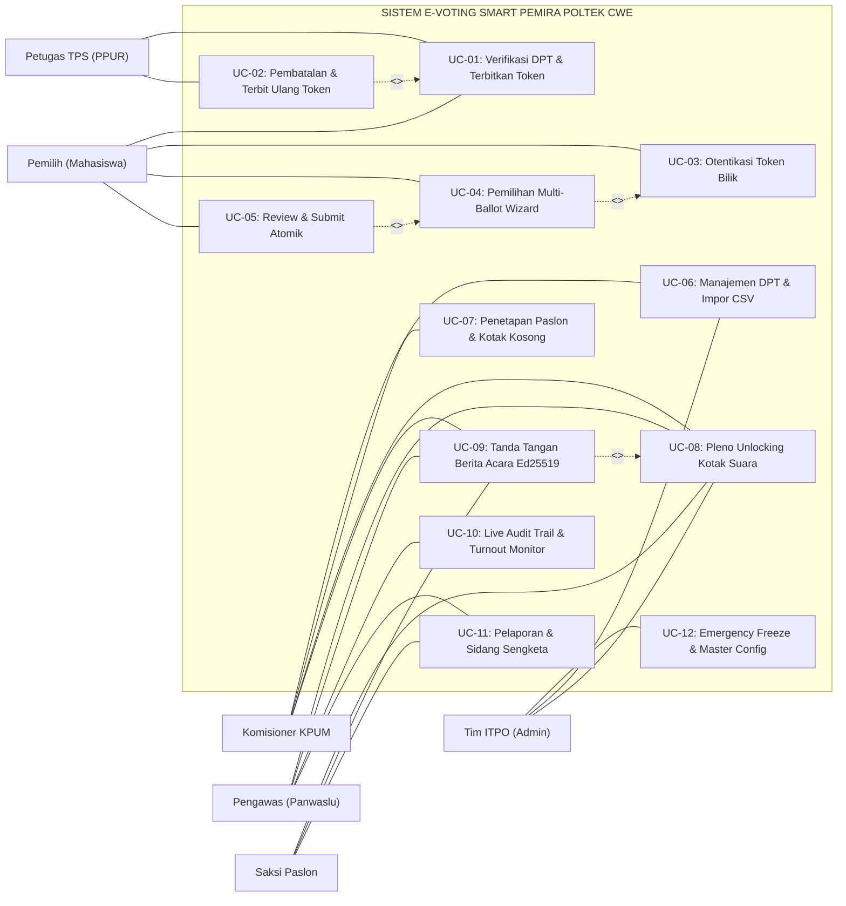

# USE CASE DIAGRAM DAN SPESIFIKASI SKENARIO TERINCI
## SISTEM E-VOTING SMART PEMIRA (SMART PEMILIHAN UMUM RAYA)
### Politeknik Kelapa Sawit Citra Widya Edukasi (Poltek CWE)

---

| Atribut Dokumen | Rincian Dokumen |
| :--- | :--- |
| **Judul Dokumen** | Diagram Use Case Sistem, Identifikasi Aktor, dan 12 Narasi Skenario Terinci |
| **Kode Dokumen** | `DOC-UML-001` |
| **Versi Dokumen** | `1.0.0` (Master Release Baseline) |
| **Klasifikasi Standar** | Standar Unified Modeling Language (UML 2.5) & RUP Specification |
| **Penyusun** | Tim Informasi dan Teknologi Pemira Online (ITPO) Poltek CWE |

---

## DAFTAR ISI
1. [Identifikasi Aktor & Batasan Wewenang Sistem](#1-identifikasi-aktor--batasan-wewenang-sistem)
2. [Diagram Use Case Menyeluruh (Mermaid.js)](#2-diagram-use-case-menyeluruh-mermaidjs)
3. [Daftar 12 Use Case Sistem Smart Pemira](#3-daftar-12-use-case-sistem-smart-pemira)
4. [Spesifikasi Naratif 12 Skenario Use Case Terinci](#4-spesifikasi-naratif-12-skenario-use-case-terinci)
   * 4.1 UC-01: Verifikasi Identitas DPT & Penerbitan Token Meja PPUR
   * 4.2 UC-02: Pembatalan & Penerbitan Ulang Token Kedaluwarsa
   * 4.3 UC-03: Otentikasi Masuk Bilik Suara Kiosk via Token
   * 4.4 UC-04: Pemilihan Kandidat pada Multi-Ballot Wizard
   * 4.5 UC-05: Konfirmasi Pilihan & Transaksi Atomik Submit Suara
   * 4.6 UC-06: Manajemen Master DPT & Impor Berkas BAAK
   * 4.7 UC-07: Manajemen Master Kandidat & Pengaturan Kotak Kosong
   * 4.8 UC-08: Pembukaan Kotak Suara Digital (Pleno Unlocking)
   * 4.9 UC-09: Penandatanganan & Penerbitan Berita Acara Ed25519
   * 4.10 UC-10: Pemantauan Live Audit Trail & Turnout Real-Time
   * 4.11 UC-11: Pelaporan & Penanganan Sengketa Pemira Daring
   * 4.12 UC-12: Aktivasi Emergency Freeze & Konfigurasi Sistem

---

## 1. Identifikasi Aktor & Batasan Wewenang Sistem

Sistem Smart Pemira berinteraksi dengan 6 aktor primer dan sekunder yang mewakili seluruh entitas pemangku kepentingan pemilu di kampus Poltek CWE:

| Aktor | Kategori Aktor | Deskripsi Fungsional & Kewenangan |
| :--- | :--- | :--- |
| **Pemilih (Mahasiswa)** | Aktor Primer Lapangan | Mahasiswa aktif Poltek CWE terdaftar DPT. Menyerahkan identitas di meja PPUR, memasukkan token di bilik Kiosk, mencoblos 3 surat suara bertahap, dan mencelupkan jari ke tinta. |
| **Petugas TPS (PPUR)** | Aktor Primer Administratif | Panitia pelaksana meja registrasi TPS. Melakukan pencarian DPT, memeriksa kecocokan fisik KTM/KRS, menerbitkan slip token bilik (TTL 10 menit), dan melayani terbit ulang token jika kedaluwarsa. |
| **Komisioner KPUM** | Aktor Primer Penyelenggara | Penyelenggara resmi tingkat politeknik. Mengimpor data DPT BAAK, menetapkan nomor urut calon, membuka gembok rekapitulasi pleno, dan menandatangani Berita Acara elektronik. |
| **Panwaslu (Pengawas)** | Aktor Primer Pengawas | Komisioner Badan Pengawas independen. Memantau layar *Live Audit Monitor*, memverifikasi integritas rantai hash, memproses berkas sengketa, dan ikut menandatangani Berita Acara. |
| **Saksi Pasangan Calon** | Aktor Sekunder Verifikator | Utusan resmi paslon bermandat. Menyaksikan uji kotak suara awal nol, memantau pembukaan pleno, mengajukan keberatan resmi, dan menandatangani Berita Acara. |
| **Tim ITPO (Super Admin)**| Aktor Primer Teknis | Teknisi dan arsitek kriptografi sistem. Mengelola konfigurasi server, backup database, aktivasi *Emergency Freeze*, rotasi kunci Ed25519, dan pengarsipan periode pemira. |

---

## 2. Diagram Use Case Menyeluruh (Mermaid.js)

---

## 3. Daftar 12 Use Case Sistem Smart Pemira

1. **UC-01**: Verifikasi Identitas DPT & Penerbitan Token Meja PPUR
2. **UC-02**: Pembatalan & Penerbitan Ulang Token Kedaluwarsa
3. **UC-03**: Otentikasi Masuk Bilik Suara Kiosk via Token
4. **UC-04**: Pemilihan Kandidat pada Multi-Ballot Wizard
5. **UC-05**: Konfirmasi Pilihan & Transaksi Atomik Submit Suara
6. **UC-06**: Manajemen Master DPT & Impor Berkas BAAK
7. **UC-07**: Manajemen Master Kandidat & Pengaturan Kotak Kosong
8. **UC-08**: Pembukaan Kotak Suara Digital (Pleno Unlocking)
9. **UC-09**: Penandatanganan & Penerbitan Berita Acara Ed25519
10. **UC-10**: Pemantauan Live Audit Trail & Turnout Real-Time
11. **UC-11**: Pelaporan & Penanganan Sengketa Pemira Daring
12. **UC-12**: Aktivasi Emergency Freeze & Konfigurasi Sistem

---

## 4. Spesifikasi Naratif 12 Skenario Use Case Terinci

### 4.1 UC-01: Verifikasi Identitas DPT & Penerbitan Token Meja PPUR
* **ID & Nama**: `UC-01` — Verifikasi Identitas DPT & Penerbitan Token Meja PPUR.
* **Aktor**: Petugas TPS (PPUR) [Primer], Pemilih (Mahasiswa) [Sekunder].
* **Deskripsi**: Petugas PPUR mencari data mahasiswa di sistem berdasarkan KTM fisik, memvalidasi bahwa hak suara belum digunakan, dan mencetak slip token acak sekali pakai.
* **Prekondisi**:
  1. Petugas PPUR telah login dengan akun operator yang terikat ke ID TPS bersangkutan.
  2. Tahapan pemungutan suara berstatus `votingOpen = TRUE` dan `emergencyFreeze = FALSE`.
* **Alur Utama (Happy Path)**:
  1. Pemilih mendatangi meja registrasi PPUR dan menunjukkan kartu fisik KTM atau KRS resmi.
  2. Petugas PPUR mengetikkan NIM atau Nama pemilih pada bilah pencarian DPT.
  3. Sistem menampilkan rekaman data pemilih: NIM, Nama Lengkap, Program Studi, Angkatan, dan status kehadiran saat ini (`BELUM_MEMILIH`).
  4. Petugas memeriksa kesesuaian wajah pada foto fisik KTM dengan mahasiswa di hadapannya.
  5. Petugas mengklik tombol **"Verifikasi & Terbitkan Token"**.
  6. Sistem membangkitkan token acak 6 karakter CSPRNG (tanpa karakter ambigu `0/O/1/I`), menghitung nilai `tokenHash` (SHA-256), menetapkan masa berlaku TTL 10 menit, dan menyimpannya ke tabel `voting_tokens`.
  7. Sistem memperbarui status pemilih di tabel `voters` menjadi `status = 'DALAM_ANTREAN'` dan mengikat `pendingTokenHash`.
  8. Sistem mengirimkan perintah cetak ke mini thermal printer 58mm untuk mencetak slip token fisik.
  9. Petugas menyerahkan slip token kepada pemilih dan mengarahkannya menuju bilik Kiosk suara yang kosong.
* **Alur Alternatif**:
  * **2a. Mahasiswa Tidak Ditemukan di DPT**: Sistem menampilkan pesan peringatan *"NIM Tidak Terdaftar dalam DPT"*. Petugas PPUR mengarahkan mahasiswa ke meja verifikasi BAAK/KPUM.
  * **3a. Mahasiswa Telah Menggunakan Hak Pilih**: Sistem menampilkan status `SUDAH_MEMILIH` berwarna hijau dengan timestamp waktu memilih. Tombol terbitkan token dinonaktifkan permanen; petugas menolak penerbitan token ganda.
  * **5a. Kondisi Emergency Freeze Aktif**: Tombol terbitkan token terkunci, muncul peringatan status darurat dari Panwaslu/KPUM.
* **Postkondisi**: Token baru berstatus `ACTIVE` tersimpan di database dengan TTL 10 menit, status pemilih tercatat `DALAM_ANTREAN`, dan log tercatat di `audit_logs`.

---

### 4.2 UC-02: Pembatalan & Penerbitan Ulang Token Kedaluwarsa
* **ID & Nama**: `UC-02` — Pembatalan & Penerbitan Ulang Token Kedaluwarsa.
* **Aktor**: Petugas TPS (PPUR) [Primer], Pemilih (Mahasiswa) [Sekunder].
* **Deskripsi**: Menangani kondisi di mana token bilik suara hangus karena melewati masa berlaku TTL 10 menit sebelum pemilih sempat mencoblos di bilik Kiosk.
* **Prekondisi**:
  1. Pemilih sebelumnya telah diterbitkan token dan berstatus `DALAM_ANTREAN`.
  2. Token lama telah melewati waktu `expiresAt` ($> 10\text{ menit}$) atau pemilih mengalami insiden di antrean.
* **Alur Utama (Happy Path)**:
  1. Pemilih kembali ke meja PPUR melaporkan bahwa tokennya ditolak di bilik Kiosk dengan keterangan kedaluwarsa.
  2. Petugas mencari kembali NIM pemilih pada sistem meja PPUR.
  3. Sistem mendeteksi bahwa token lama pemilih telah berstatus `EXPIRED` dan pemilih belum tercatat `hasVoted = TRUE`.
  4. Petugas mengklik tombol **"Batalkan & Terbitkan Ulang Token"**.
  5. Sistem menampilkan dialog modal yang mewajibkan petugas memilih alasan pembatalan (misal: "Antrean bilik penuh", "Kertas slip hilang", "Malfungsi perangkat bilik").
  6. Petugas memilih alasan dan menekan tombol konfirmasi.
  7. Sistem mengubah status token lama menjadi `REVOKED`, membangkitkan token baru CSPRNG dengan TTL 10 menit baru, dan mencetak slip token baru.
  8. Sistem mencatat kejadian pembatalan dan penerbitan ulang beserta identitas operator ke tabel `audit_logs`.
  9. Petugas menyerahkan slip token baru kepada pemilih.
* **Alur Alternatif**:
  * **3a. Pemilih Tercatat Telah Mengirim Suara (`hasVoted = TRUE`)**: Sistem menolak keras penerbitan ulang dengan pesan galat *"Hak suara untuk NIM ini telah sah tersimpan di kotak suara"*.
* **Postkondisi**: Token lama berstatus `REVOKED`, token baru berstatus `ACTIVE`, dan jejak audit pembatalan tersimpan secara permanen.

---

### 4.3 UC-03: Otentikasi Masuk Bilik Suara Kiosk via Token
* **ID & Nama**: `UC-03` — Otentikasi Masuk Bilik Suara Kiosk via Token.
* **Aktor**: Pemilih (Mahasiswa) [Primer].
* **Deskripsi**: Pemilih memasukkan 6 karakter kode token dari slip meja PPUR ke dalam terminal Kiosk layar penuh untuk membuka hak akses bilik suara.
* **Prekondisi**:
  1. Terminal Kiosk berjalan dalam mode layar penuh terkunci (*fullscreen kiosk*).
  2. Layar berada pada posisi gerbang token (*Token Gate Screen*).
* **Alur Utama (Happy Path)**:
  1. Pemilih berdiri di bilik Kiosk dan melihat layar masukan token berupa 6 kotak karakter dan papan tombol sentuh (*tactile on-screen keypad*).
  2. Pemilih menyentuh tombol karakter pada keypad virtual memasukkan 6 digit token miliknya.
  3. Sistem memvalidasi masukan secara instan:
     - Mengubah masukan menjadi huruf kapital.
     - Menghitung SHA-256 dari token (`hashToken(input)`).
     - Mengirimkan kueri verifikasi ke endpoint backend.
  4. Backend memverifikasi keberadaan token pada tabel `voting_tokens`:
     - Memastikan status token adalah `ACTIVE`.
     - Memastikan `expiresAt` belum terlampaui.
  5. Backend mengembalikan status otentikasi valid bersama data profil surat suara yang berhak diakses (kategori BEM, DPM, dan HIMA sesuai `studyProgramId` token).
  6. Layar Kiosk menampilkan pesan sambutan dan otomatis bertransisi mulus ke Tahap 1: Surat Suara Presma & Wapresma.
* **Alur Alternatif**:
  * **4a. Kode Token Salah / Tidak Ditemukan**: Layar Kiosk menggetarkan kotak input (*shake animation*), menampilkan pesan merah *"Kode Token Tidak Valid"*, dan mengosongkan kotak input setelah 2 detik.
  * **4b. Token Telah Kedaluwarsa (Expired)**: Sistem menampilkan pesan *"Token Anda Telah Kedaluwarsa (> 10 Menit). Silakan Kembali ke Meja Registrasi PPUR"*.
  * **4c. Token Telah Digunakan (Used)**: Sistem menampilkan pesan *"Token ini telah digunakan untuk mencoblos"*.
  * **4d. Terdeteksi Percobaan Brute-Force**: Jika salah input $> 5$ kali dalam 1 menit, layar Kiosk mengunci input selama 60 detik dan mencatat IP ke log audit.
* **Postkondisi**: Sesi Kiosk aktif memuat 3 surat suara yang sah, siap untuk dilakukan proses pemilihan.

---

### 4.4 UC-04: Pemilihan Kandidat pada Multi-Ballot Wizard
* **ID & Nama**: `UC-04` — Pemilihan Kandidat pada Multi-Ballot Wizard.
* **Aktor**: Pemilih (Mahasiswa) [Primer].
* **Deskripsi**: Pemilih melakukan penelaahan dan penentuan pilihan pasangan calon secara bertahap untuk 3 kategori surat suara yang menjadi hak pilihnya.
* **Prekondisi**:
  1. Sesi Kiosk berhasil dibuka melalui UC-03.
  2. Seluruh kandidat terverifikasi telah dimuat ke dalam memori peramban.
* **Alur Utama (Happy Path)**:
  1. **Tahap 1 — Surat Suara Presma-Wapresma (Aksen Tropic Green `#1B7F4E`)**:
     - Layar menyajikan kartu kandidat calon presiden & wakil presiden mahasiswa (Nomor urut, foto resolusi tinggi, nama lengkap, dan tombol ringkasan visi-misi).
     - Pemilih mengetuk salah satu kartu kandidat atau opsi "Suara Kosong".
     - Kartu terpilih memunculkan garis tepi hijau tebal `3px solid #1B7F4E` dan lencana **"✓ PILIHAN ANDA"**.
     - Pemilih menekan tombol **"Lanjut: Surat Suara DPM →"**.
  2. **Tahap 2 — Surat Suara Pimpinan DPM (Aksen Tropic Jade `#0F766E`)**:
     - Layar menyajikan kandidat formatur Dewan Perwakilan Mahasiswa (Ketua Umum, Wakil Ketua I, Wakil Ketua II).
     - Pemilih memilih salah satu kartu kandidat dan menekan tombol **"Lanjut: Surat Suara HIMA →"**.
  3. **Tahap 3 — Surat Suara HIMA Program Studi (Warna Spesifik Prodi)**:
     - Sistem secara otomatis hanya menampilkan pasangan calon Himpunan Mahasiswa Program Studi yang cocok dengan `studyProgramId` token pemilih (misal: aksen Terracotta untuk Prodi Perkebunan TPTP).
     - Apabila prodi tersebut hanya memiliki calon tunggal, sistem otomatis menyajikan kartu penantang **"KOTAK KOSONG"** (Pasal 9 ayat 3 UUD IKM).
     - Pemilih mengetuk kartu paslon pilihannya atau kartu Kotak Kosong.
     - Pemilih menekan tombol **"Tinjau Pilihan Suara →"**.
* **Alur Alternatif**:
  * **1a. Pemilih Ingin Membaca Detail Visi-Misi**: Pemilih menekan tombol "Lihat Visi Misi", sistem membuka modal pop-up yang menyajikan daftar program kerja unggulan tanpa meninggalkan halaman pemilihan.
  * **2a. Pemilih Belum Memilih Calon pada Kategori Aktif**: Pemilih menekan tombol lanjut tanpa memilih salah satu kartu; sistem menampilkan peringatan *"Silakan tentukan pilihan Anda atau pilih opsi Suara Kosong sebelum melanjutkan"*.
  * **3a. Pemilih Ingin Mengubah Pilihan Sebelumnya**: Pemilih dapat mengklik bilah navigasi tahapan di bagian atas untuk mundur ke Surat Suara 1 atau 2.
* **Postkondisi**: Pilihan sementara pemilih pada ketiga kategori tersimpan di state lokal Kiosk, siap menuju tahap peninjauan akhir.

---

### 4.5 UC-05: Konfirmasi Pilihan & Transaksi Atomik Submit Suara
* **ID & Nama**: `UC-05` — Konfirmasi Pilihan & Transaksi Atomik Submit Suara.
* **Aktor**: Pemilih (Mahasiswa) [Primer].
* **Deskripsi**: Pemilih memeriksa ringkasan seluruh pilihannya dan mengeksekusi pengiriman suara ke basis data melalui transaksi atomik 6-langkah yang terisolasi secara kriptografis.
* **Prekondisi**:
  1. Pemilih telah menuntaskan pemilihan pada ketiga kategori surat suara (UC-04).
  2. Layar berada pada status modal *Selection Review*.
* **Alur Utama (Happy Path)**:
  1. Layar menyajikan panel ringkasan 3 pilihan pemilih:
     - Pilihan Surat Suara 1 (Presma & Wapresma).
     - Pilihan Surat Suara 2 (Pimpinan DPM).
     - Pilihan Surat Suara 3 (Ketua HIMA Prodi / Kotak Kosong).
  2. Sistem menampilkan teks penegasan: *"Pastikan pilihan Anda sudah benar. Pilihan suara tidak dapat diubah setelah tombol kirim ditekan."*
  3. Pemilih menekan tombol sentuh besar **"KIRIM SUARA SEKARANG"**.
  4. Sistem Kiosk mengirimkan payload enkripsi ke endpoint backend `/api/vote/submit`.
  5. Backend menjalankan **Transaksi Basis Data Atomik 6-Langkah (DB Transaction)**:
     - *Langkah 1*: Memverifikasi status token `ACTIVE` dan belum melewati TTL.
     - *Langkah 2*: Menjalankan *Server-Side Assertion* kesesuaian prodi pemilih terhadap kandidat HIMA.
     - *Langkah 3*: Menghitung `ballot_hash` berantai SHA-256 dan menyimpan 3 surat suara ke tabel `ballot_boxes` dengan *timestamp jitter* acak.
     - *Langkah 4*: Memperbarui status token menjadi `USED` dan mencatat `usedAt`.
     - *Langkah 5*: Memperbarui data pemilih di tabel `voters` menjadi `hasVoted = TRUE`, `status = 'SUDAH_MEMILIH'`, dan mengosongkan `pendingTokenHash`.
     - *Langkah 6*: Menulis entri log kejadian anonim ke tabel `audit_logs` (tanpa mencantumkan paslon yang dipilih).
  6. Backend melakukan *Commit Transaction* dan mengembalikan respon sukses beserta kode struk digital acak (*Receipt Code*).
  7. Layar Kiosk menampilkan halaman sukses bersuasana tenang dengan ucapan terima kasih dan animasi konfirmasi selama 3 detik.
  8. Sistem Kiosk menghapus seluruh data sesi di memori lokal dan kembali otomatis ke layar masukan token awal (UC-03).
* **Alur Alternatif**:
  * **1a. Pemilih Ingin Mengubah Salah Satu Pilihan**: Pemilih menekan tombol *"← Ubah Pilihan"*, modal tertutup dan pemilih kembali ke surat suara yang bersangkutan.
  * **5a. Kegagalan Transaksi Database (Jaringan Terputus / Rollback)**: Terjadi gangguan jaringan lokal saat transaksi berlangsung; transaksi di-*rollback* utuh oleh database engine. Layar menampilkan pesan *"Terjadi kendala transmisi, suara Anda belum tersimpan. Silakan coba tekan tombol kirim kembali."* Token tetap berstatus `ACTIVE`.
* **Postkondisi**: Suara sah terpecah dan tersimpan anonim di kotak suara digital, integritas rantai hash diperbarui, status token menjadi `USED`, dan pemilih berstatus `SUDAH_MEMILIH`.

---

### 4.6 UC-06: Manajemen Master DPT & Impor Berkas BAAK
* **ID & Nama**: `UC-06` — Manajemen Master DPT & Impor Berkas BAAK.
* **Aktor**: Komisioner KPUM [Primer], Tim ITPO [Pendukung].
* **Deskripsi**: KPUM mengunggah data induk mahasiswa aktif dari BAAK Poltek CWE, memvalidasi duplikasi data, dan mengunci DPT final.
* **Prekondisi**:
  1. Komisioner KPUM telah login dengan hak akses administratif.
  2. Berkas CSV data mahasiswa dari BAAK telah disiapkan sesuai format standar.
* **Alur Utama (Happy Path)**:
  1. Komisioner KPUM membuka menu *"Manajemen DPT"* pada portal administratif.
  2. Mengklik tombol *"Unggah Berkas DPT (CSV)"* dan memilih berkas CSV dari komputer.
  3. Sistem memproses berkas, memvalidasi header kolom (`nim`, `name`, `study_program_id`, `angkatan`, `tps_id`), dan memeriksa keunikan seluruh baris data.
  4. Sistem menampilkan jendela rekapitulasi data: Total baris terbaca, jumlah pemilih per program studi, dan mendeteksi ketiadaan baris galat.
  5. Komisioner mengklik *"Konfirmasi & Simpan DPT"*.
  6. Sistem menyuntikkan seluruh baris ke tabel `voters` dengan status awal `BELUM_MEMILIH` dan `hasVoted = FALSE`.
  7. Komisioner memeriksa rekapitulasi dan menekan tombol *"Kunci DPT (Freeze DPT)"*.
  8. Sistem mengunci master data DPT dari perubahan lebih lanjut dan menerbitkan Berita Acara Penetapan DPT.
* **Alur Alternatif**:
  * **3a. Ditemukan Duplikasi NIM atau Format Kolom Rusak**: Sistem menolak berkas impor, menampilkan tabel rincian nomor baris yang bermasalah, dan membatalkan seluruh operasi impor (*atomic rollback*).
* **Postkondisi**: Master DPT terkunci di database, terpetakan rapi ke 5 program studi dan TPS terkait.

---

### 4.7 UC-07: Manajemen Master Kandidat & Pengaturan Kotak Kosong
* **ID & Nama**: `UC-07` — Manajemen Master Kandidat & Pengaturan Kotak Kosong.
* **Aktor**: Komisioner KPUM [Primer].
* **Deskripsi**: KPUM menginput profil pasangan calon, mengunggah foto resmi, menetapkan nomor urut undian, serta mengonfigurasi skema calon tunggal vs kotak kosong.
* **Prekondisi**:
  1. Tahapan penetapan calon telah dibuka di sistem.
  2. Komisioner KPUM memiliki berkas biodata, berkas foto resmi, dan naskah visi-misi calon.
* **Alur Utama (Happy Path)**:
  1. Komisioner memilih kategori pemilihan (Presma & Wapresma, DPM, atau HIMA Prodi).
  2. Menekan tombol *"Tambah Pasangan Calon Baru"*.
  3. Mengisi formulir: Nomor Urut resmi, Nama Lengkap Calon Ketua & Wakil, mengunggah foto resmi latar belakang polos, menginput visi, butir-butir misi unggulan, serta memilih warna aksen kartu.
  4. Mengklik tombol *"Simpan Kandidat"*.
  5. Sistem memvalidasi data dan menyimpan ke tabel `candidates`.
  6. Sistem mengevaluasi jumlah calon per kategori:
     - Jika kategori hanya memiliki tepat 1 paslon setelah penetapan final ditutup, sistem secara otomatis mengeksekusi *trigger* pembuatan entitas kartu tandingan **"KOTAK KOSONG"** (`isEmptyBox = TRUE`) sesuai mandat Pasal 9 ayat 3 UUD IKM.
  7. Sistem memperbarui pratinjau surat suara di portal publik masa kampanye.
* **Alur Alternatif**:
  * **3a. Format Berkas Foto Melebihi Batas / Resolusi Rendah**: Sistem menampilkan peringatan *"Berkas foto wajib berekstensi .JPG/.PNG dan berukuran di bawah 2MB"*.
* **Postkondisi**: Seluruh profil kandidat dan opsi kotak kosong siap disajikan pada bilik Kiosk dan portal kampanye publik.

---

### 4.8 UC-08: Pembukaan Kotak Suara Digital (Pleno Unlocking)
* **ID & Nama**: `UC-08` — Pembukaan Kotak Suara Digital (Pleno Unlocking).
* **Aktor**: Komisioner KPUM [Primer], Panwaslu [Pendukung], Saksi Paslon [Saksi].
* **Deskripsi**: Membuka gembok enkripsi rekapitulasi (*Pleno Vault Lock HTTP 423*) secara serentak di hadapan para pihak dalam Sidang Pleno terbuka pasca-penutupan TPS.
* **Prekondisi**:
  1. Waktu pemungutan suara telah resmi ditutup oleh KPUM (`votingOpen = FALSE`).
  2. Seluruh bilik Kiosk telah menyelesaikan antrean pemilih terakhir.
  3. Sidang Pleno dihadiri oleh Komisioner KPUM, Panwaslu, dan seluruh Saksi Paslon sah.
* **Alur Utama (Happy Path)**:
  1. Ketua KPUM membuka layar proyektor utama di ruang sidang pleno yang terhubung ke dashboard admin.
  2. Layar proyektor menampilkan status sistem: *Kotak Suara Terkunci (HTTP 423)*, total surat suara masuk di tiap rantai TPS prodi, dan ketiadaan hasil perolehan suara yang bocor.
  3. Petugas menguji keabsahan integritas rantai suara dengan menekan tombol **"Uji Keutuhan Rantai Hash"**.
  4. Sistem mengeksekusi `verifyChain()` atas seluruh blok suara; sistem menampilkan indikator hijau: *"100% Rantai Hash Valid — Nol Manipulasi Data"*.
  5. Ketua KPUM menekan tombol **"Buka Gembok Sidang Pleno (Pleno Unlock)"**.
  6. Sistem memunculkan jendela dialog otorisasi ganda yang meminta input sandi pengesahan Ketua KPUM dan persetujuan Panwaslu.
  7. Setelah sandi tervalidasi, sistem mengubah nilai `plenoUnlocked = TRUE` dan mencatat `plenoUnlockedAt = NOW()`.
  8. Sistem mengeksekusi kueri agregasi tallying instan: membuka perolehan suara masing-masing kandidat di seluruh kategori.
  9. Layar proyektor secara dramatis dan mulus menampilkan diagram batang perolehan suara definitif, persentase keterpilihan, dan status pemenang.
* **Alur Alternatif**:
  * **4a. Ditemukan Hash Rusak / Ketidaksesuaian Rantai**: Sistem menghentikan pembukaan otomatis, menandai nomor blok yang tidak cocok, dan menerbitkan laporan investigasi forensik untuk disidangkan bersama Panwaslu.
* **Postkondisi**: Endpoint hasil suara terbuka resmi, gembok vault non-aktif, dan hasil rekapitulasi siap dituangkan ke dalam Berita Acara.

---

### 4.9 UC-09: Penandatanganan & Penerbitan Berita Acara Ed25519
* **ID & Nama**: `UC-09` — Penandatanganan & Penerbitan Berita Acara Ed25519.
* **Aktor**: Komisioner KPUM [Primer], Panwaslu [Primer], Saksi Paslon [Sekunder].
* **Deskripsi**: Mengompilasi hasil sidang pleno ke dalam dokumen kanonikal resmi Model C-KWE, membubuhkan tanda tangan digital asimetris Ed25519, dan menerbitkan dokumen PDF berstempel QR.
* **Prekondisi**:
  1. Kotak suara digital telah dibuka (UC-08) dan hasil perolehan suara telah disepakati sidang pleno.
* **Alur Utama (Happy Path)**:
  1. Sistem secara otomatis menyusun teks kanonikal Berita Acara Model C-KWE yang memuat:
     - Nomor Surat Keputusan KPUM & Rujukan Hukum (UUD IKM & Ketetapan DPM No. 005).
     - Rincian angka partisipasi pemilih, suara sah, suara kotak kosong, dan suara rusak/abstain.
     - Lima nilai *Head Hash SHA-256* dari masing-masing TPS program studi.
  2. Sistem menandatangani dokumen kanonikal menggunakan kunci privat sistem berbasis algoritma asimetris **Ed25519 (RFC 8032)**.
  3. Tanda tangan digital base64 disimpan permanen ke dalam tabel `ElectionSetting`.
  4. Saksi paslon dan Panwaslu meninjau draf dokumen pada layar portal masing-masing dan membubuhkan persetujuan digital / tanda tangan elektronik para pihak.
  5. Sistem me-render dokumen resmi ke dalam format **PDF Berita Acara Model C-KWE**.
  6. Sistem menyematkan kode QR stempel kriptografis (*QR Cryptographic Seal*) pada halaman tanda tangan dokumen PDF.
  7. Dokumen PDF dicetak untuk arsip fisik basah dan salinan digitalnya dipublikasikan ke portal publik.
* **Alur Alternatif**:
  * **4a. Saksi Mengajukan Catatan Keberatan**: Saksi mengetikkan nota keberatan pada kolom form yang disediakan sistem; teks keberatan secara otomatis disisipkan pada Lampiran Khusus Berita Acara Model C-KWE sebelum ditandatangani.
* **Postkondisi**: Berita Acara resmi berkekuatan hukum diterbitkan, keaslian dokumen dapat diuji publik via verifikasi kunci publik Ed25519.

---

### 4.10 UC-10: Pemantauan Live Audit Trail & Turnout Real-Time
* **ID & Nama**: `UC-10` — Pemantauan Live Audit Trail & Turnout Real-Time.
* **Aktor**: Panwaslu (Pengawas) [Primer].
* **Deskripsi**: Panwaslu mengawasi jalannya pemira secara real-time melalui dashboard proyektor bertema gelap yang menyajikan indikator operasional tanpa membuka pilihan suara pemilih.
* **Prekondisi**:
  1. Komisioner Panwaslu login ke portal `/panwaslu` dengan akun peran `PANWASLU`.
  2. Jam pemungutan suara sedang berlangsung.
* **Alur Utama (Happy Path)**:
  1. Panwaslu mengaktifkan mode proyektor layar penuh dengan tema *Obsidian Forest* (`.theme-pleno-dark`).
  2. Sistem menampilkan 4 kartu Bento KPI utama:
     - *Total Pemilih Terdaftar (DPT)*.
     - *Total Suara Masuk (Voted Count)*.
     - *Persentase Kehadiran Saat Ini (Turnout %)*.
     - *Indikator Status Server & Rantai TPS (Active/Online)*.
  3. Sistem menyajikan grafik garis laju pemilih per interval waktu 60 menit dan grafik batang perolehan kehadiran per program studi.
  4. Panel kanan menyajikan arus *Live Audit Log Feed* (Server-Sent Events) yang mengalirkan setiap transaksi: *"Token terbit di TPS 1"*, *"Suara tersimpan di TPS 2"*, *"Token kedaluwarsa NIM 2023xx"*.
  5. Panwaslu mengamati ketiadaan anomali lonjakan data dan ketiadaan kebocoran nama paslon pada feed audit.
* **Alur Alternatif**:
  * **4a. Terdeteksi Anomali / Aktivitas Mencurigakan**: Panwaslu menekan tombol *"Tandai Insiden Audit"*, sistem menyimpan tangkapan layar log dan membawanya ke formulir sengketa (UC-11).
* **Postkondisi**: Pengawasan berjalan transparan, akuntabel, dan rahasia pilihan pemilih tetap terjaga 100%.

---

### 4.11 UC-11: Pelaporan & Penanganan Sengketa Pemira Daring
* **ID & Nama**: `UC-11` — Pelaporan & Penanganan Sengketa Pemira Daring.
* **Aktor**: Pemilih / Saksi Paslon [Pelapor], Panwaslu [Pemeriksa/Hakim].
* **Deskripsi**: Memfasilitasi mahasiswa atau saksi yang mendapati kecurangan untuk mengajukan pengaduan resmi dan mekanisme sidang yudisial pemira secara digital.
* **Prekondisi**:
  1. Pelapor memiliki identitas mahasiswa Poltek CWE yang sah (NIM aktif).
  2. Pelapor memiliki bukti permulaan yang cukup (foto, dokumen, rekaman).
* **Alur Utama (Happy Path)**:
  1. Pelapor membuka menu *"Pengaduan Sengketa"* pada portal Pemira.
  2. Pelapor mengisi formulir pelaporan: Nama Lengkap, NIM, Kategori Pelanggaran (Kampanye Hitam, Politik Uang, Pelanggaran Netralitas TPS, Gangguan Teknis), Tempat & Waktu Kejadian, Uraian Kronologis, serta mengunggah berkas bukti.
  3. Pelapor menekan tombol *"Kirimkan Laporan Pelanggaran"*.
  4. Sistem menerbitkan **Nomor Tiket Sengketa Unik** (misal: `TKT-2026-004`) dan menyimpan ke tabel `election_incidents` dengan status `SUBMITTED`.
  5. Notifikasi laporan baru muncul secara real-time pada dashboard Panwaslu.
  6. Komisioner Panwaslu menelaah bukti, memanggil pihak terkait, dan mengubah status laporan menjadi `IN_REVIEW`.
  7. Setelah musyawarah pleno pengawas, Panwaslu menginput amar putusan (*verdict*) dan mengubah status menjadi `RESOLVED` atau `REJECTED`.
  8. Jika putusan mewajibkan sanksi pengurangan suara (Pasal 67 RUU Pemira), Panwaslu meneruskan amar putusan kepada KPUM untuk dimasukkan ke modul penyesuaian sanksi Berita Acara.
* **Alur Alternatif**:
  * **2a. Berkas Bukti Kosong**: Sistem menolak pengiriman formulir dengan pesan *"Wajib melampirkan minimal 1 berkas bukti valid"*.
* **Postkondisi**: Berkas sengketa tercatat abadi dalam sistem, status putusan transparan bagi pelapor dan publik.

---

### 4.12 UC-12: Aktivasi Emergency Freeze & Konfigurasi Sistem
* **ID & Nama**: `UC-12` — Aktivasi Emergency Freeze & Konfigurasi Sistem.
* **Aktor**: Tim ITPO (Super Admin) [Primer], Komisioner KPUM [Pendukung].
* **Deskripsi**: Menangani situasi darurat luar biasa (force majeure, kekacauan fisik di TPS, atau perintah resmi Panwaslu) dengan membekukan operasional pemira sementara.
* **Prekondisi**:
  1. Terjadi kondisi kedaruratan yang diakui secara resmi oleh KPUM dan Panwaslu.
  2. ITPO login ke portal sistem administrasi terdalam.
* **Alur Utama (Happy Path)**:
  1. Super Admin ITPO membuka menu *"Master Control & System Settings"*.
  2. Mengaktifkan saklar toggle darurat **"EMERGENCY FREEZE"**.
  3. Sistem memunculkan jendela dialog konfirmasi merah dengan otentikasi ganda (memasukkan sandi admin dan kode 2FA TOTP).
  4. Admin memasukkan kode dan mengonfirmasi aktivasi.
  5. Sistem memperbarui flag `emergencyFreeze = TRUE` di tabel `ElectionSetting`.
  6. *Middleware* sistem global seketika mencegat seluruh request masuk:
     - Menghentikan penerbitan token baru di meja PPUR.
     - Menolak pengiriman suara baru di seluruh bilik Kiosk.
     - Menampilkan banner peringatan darurat berkedip pada seluruh monitor TPS: *"SISTEM PEMIRA DIBEKUKAN SEMENTARA ATAS PERINTAH PANWASLU/KPUM"*.
  7. Transaksi database yang sedang berjalan diselesaikan secara aman tanpa korupsi data.
  8. Setelah situasi kondusif, ITPO menonaktifkan freeze kembali dengan prosedur otentikasi yang sama.
* **Alur Alternatif**:
  * **4a. Kode 2FA TOTP Salah**: Sistem menolak aktivasi freeze dan mencatat insiden otentikasi gagal ke log audit keamanan.
* **Postkondisi**: Sistem berhasil dibekukan dan dipulihkan kembali tanpa kehilangan 1 bit pun data suara sah.
