# DIAGRAM UML LENGKAP SISTEM SMART PEMIRA
## SISTEM E-VOTING SMART PEMIRA (SMART PEMILIHAN UMUM RAYA)
### Politeknik Kelapa Sawit Citra Widya Edukasi (Poltek CWE)

---

| Atribut Dokumen | Rincian Dokumen |
| :--- | :--- |
| **Judul Dokumen** | Suite Pemodelan Diagram UML Lengkap (Struktural, Perilaku, Interaksi, dan Deployment) |
| **Kode Dokumen** | `DOC-UML-002` |
| **Versi Dokumen** | `1.0.0` (Master Release Baseline) |
| **Klasifikasi Standar** | Standar Unified Modeling Language (UML 2.5) |
| **Penyusun** | Tim Informasi dan Teknologi Pemira Online (ITPO) Poltek CWE |

---

## DAFTAR ISI
1. [Class Diagram (Model Domain Basis Data, Core Services & Cryptographic Modules)](#1-class-diagram)
2. [Sequence Diagrams (Empat Alur Interaksi Kritis)](#2-sequence-diagrams)
   * 2.1 Alur Registrasi Pemilih & Penerbitan Token di Meja PPUR
   * 2.2 Alur Pemungutan Suara di Bilik Kiosk (Transaksi Atomik 6-Langkah)
   * 2.3 Alur Sidang Pleno Unlocking & Penandatanganan Berita Acara Ed25519
   * 2.4 Alur Pelaporan & Penanganan Sengketa Panwaslu
3. [Activity Diagrams (Alur Aktivitas Pemilih & Rekapitulasi)](#3-activity-diagrams)
   * 3.1 Alur Perjalanan Pemilih: Dari Meja Registrasi hingga Celup Tinta
   * 3.2 Alur Rekapitulasi Suara & Verifikasi Rantai Hash Kriptografis
4. [State Machine Diagrams (Siklus Hidup Status Entitas Kunci)](#4-state-machine-diagrams)
   * 4.1 Siklus Hidup Status Token Pemilih (`VotingToken`)
   * 4.2 Siklus Hidup Status Kehadiran Pemilih (`Voter`)
   * 4.3 Siklus Hidup Gembok Sidang Pleno (`PlenoVault`)
5. [Deployment Diagram (Arsitektur Dual-Mode On-Premise LAN vs Cloud)](#5-deployment-diagram)

---

## 1. Class Diagram

Class diagram berikut memodelkan arsitektur berorientasi objek sistem Smart Pemira, memisahkan entitas data persistensi Prisma, layanan bisnis transaksi inti (*Core Services*), dan modul utilitas kriptografi.

> **Penegasan Arsitektural Hukum 1 (Zero-Knowledge Isolation):**  
> Perhatikan ketiadaan relasi struktural (*no relationship / foreign key*) antara kelas `Voter` dengan kelas `BallotBox`. Identitas pemilih terputus secara mutlak dari data rekaman pilihan suara.

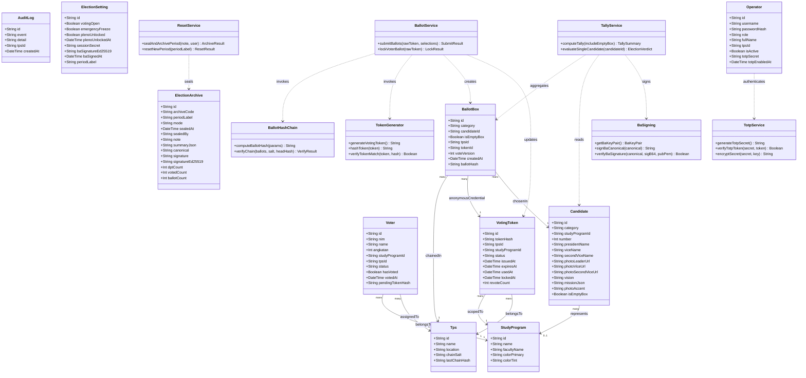

---

## 2. Sequence Diagrams

### 2.1 Alur Registrasi Pemilih & Penerbitan Token di Meja PPUR
Diagram interaksi berikut memodelkan proses verifikasi fisik identitas mahasiswa di meja registrasi TPS kampus dan penerbitan slip token sekali pakai:

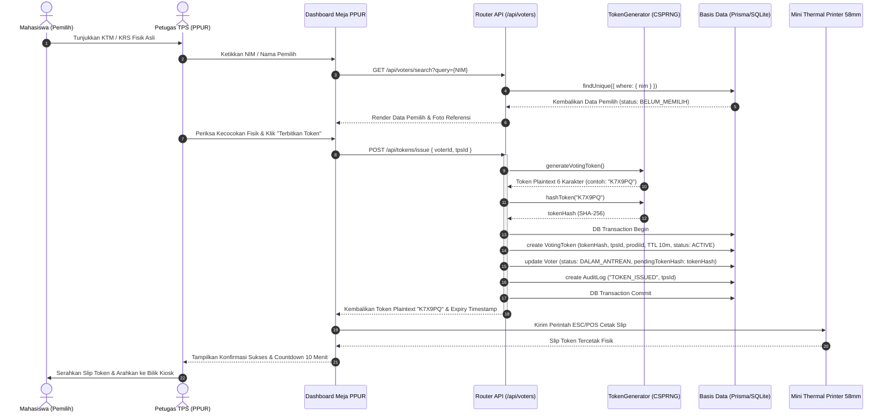

---

### 2.2 Alur Pemungutan Suara di Bilik Kiosk (Transaksi Atomik 6-Langkah)
Diagram interaksi berikut memodelkan eksekusi pemilihan di bilik suara hingga penyimpanan atomik 6-langkah pada basis data:

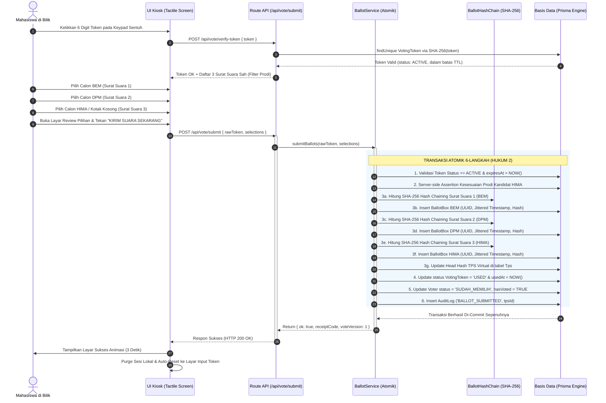

---

### 2.3 Alur Sidang Pleno Unlocking & Penandatanganan Berita Acara Ed25519
Diagram interaksi berikut memodelkan pembukaan kotak suara terkunci dan pengesahan Berita Acara resmi Model C-KWE:

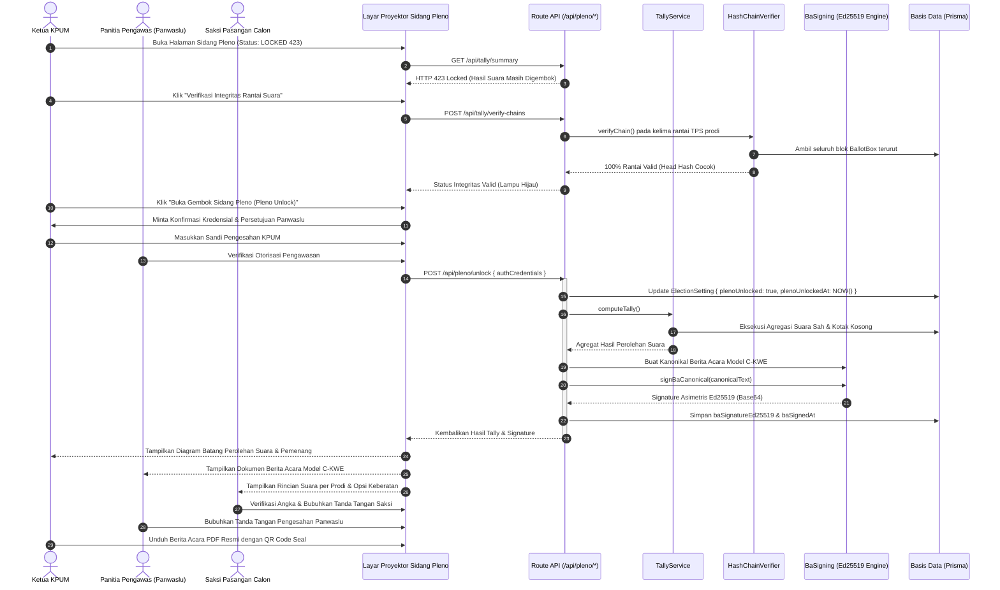

---

### 2.4 Alur Pelaporan & Penanganan Sengketa Panwaslu
Diagram interaksi berikut memodelkan penanganan laporan pelanggaran pemira secara daring:

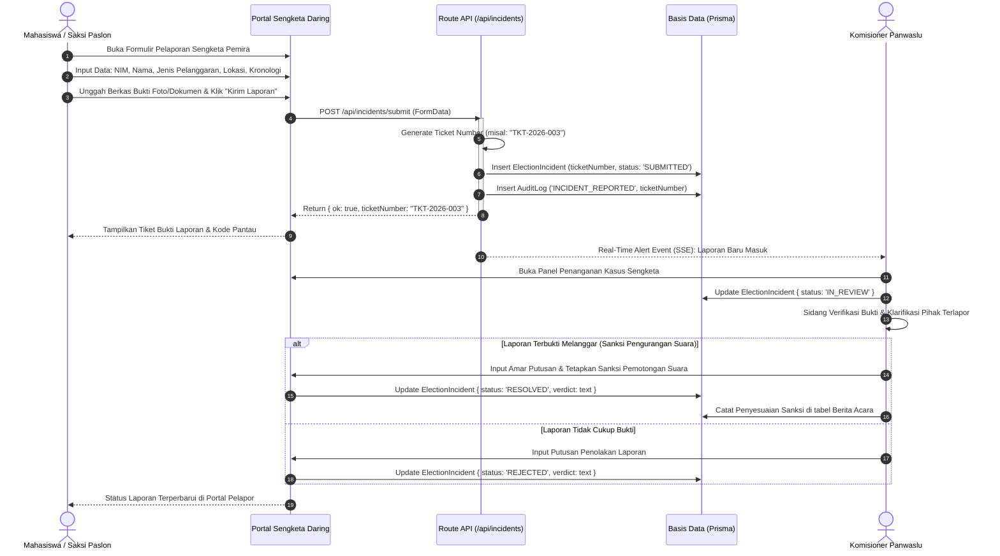

---

## 3. Activity Diagrams

### 3.1 Alur Perjalanan Pemilih: Dari Meja Registrasi hingga Celup Tinta
Diagram aktivitas berikut menggambarkan alur langkah operasional pemilih sejak tiba di TPS kampus hingga selesai menggunakan hak pilihnya:

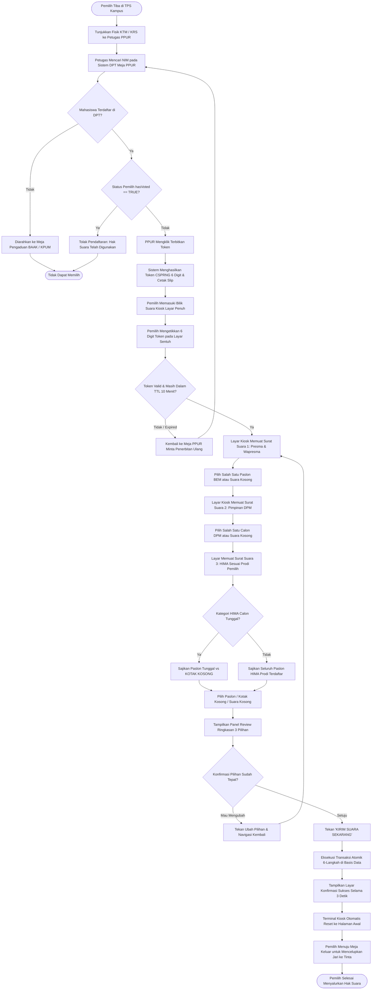

---

### 3.2 Alur Rekapitulasi Suara & Verifikasi Rantai Hash Kriptografis
Diagram aktivitas berikut memodelkan prosedur penutupan TPS, audit rantai kriptografi, dan penghitungan suara pada Sidang Pleno terbuka:

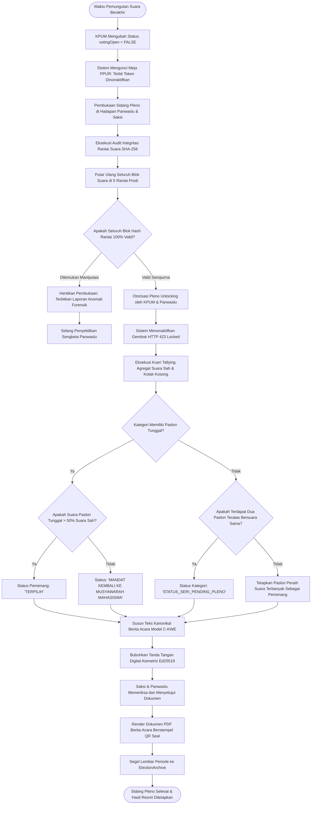

---

## 4. State Machine Diagrams

### 4.1 Siklus Hidup Status Token Pemilih (`VotingToken`)
Diagram mesin status (*State Machine*) berikut memodelkan transisi status token dari saat diterbitkan hingga dimusnahkan:

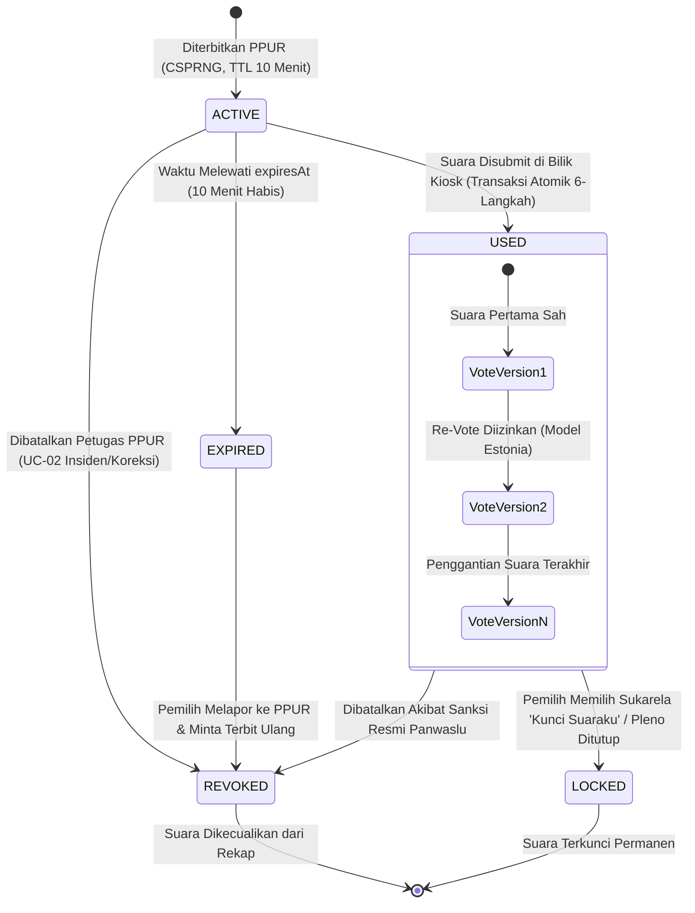

---

### 4.2 Siklus Hidup Status Kehadiran Pemilih (`Voter`)
Diagram mesin status berikut memodelkan perubahan status mahasiswa di dalam Daftar Pemilih Tetap (DPT):

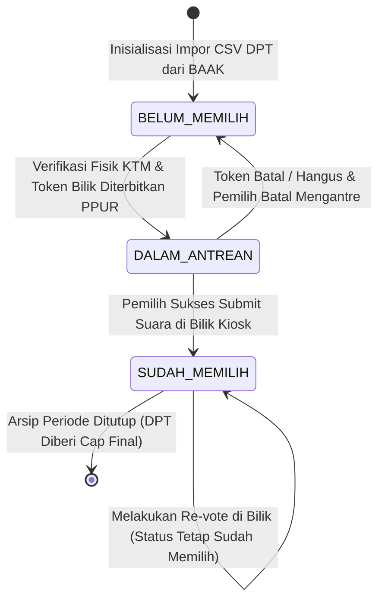

---

### 4.3 Siklus Hidup Gembok Sidang Pleno (`PlenoVault`)
Diagram mesin status berikut memodelkan status keterbukaan data perolehan suara:

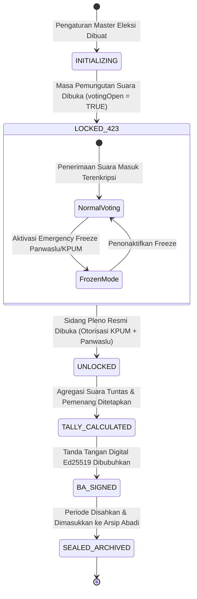

---

## 5. Deployment Diagram

Diagram penyebaran (*Deployment Diagram*) berikut memetakan arsitektur penyebaran sistem dalam model ganda (*Dual-Mode Architecture*): Mode Utama On-Premise LAN Tertutup di Kampus Poltek CWE dan Mode Sekunder Cloud Serverless.

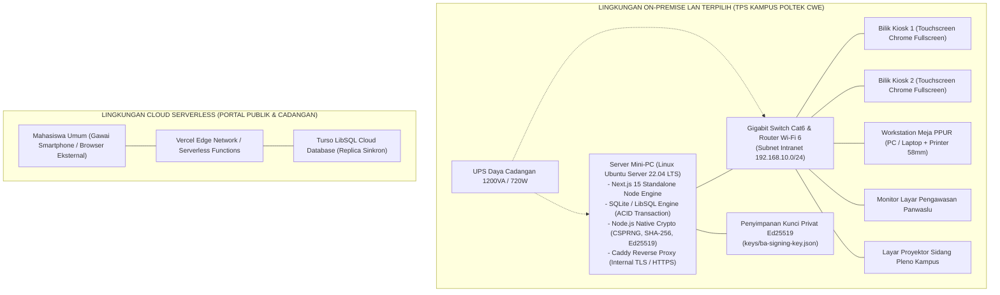
