# DOKUMEN DESAIN BASIS DATA: ENTITY RELATIONSHIP DIAGRAM (ERD) & KAMUS DATA ZERO-KNOWLEDGE

## SISTEM E-VOTING SMART PEMIRA — POLITEKNIK KELAPA SAWIT CITRA WIDYA EDUKASI
**Dokumen Referensi**: SP-CWE-DOC-04  
**Klasifikasi**: Rekayasa Perangkat Lunak / Spesifikasi Teknis Basis Data  
**Versi**: 1.0.0 (Baseline Akademik & Produksi)  
**Status**: Disahkan oleh Tim Informasi dan Teknologi Pemira Online (ITPO)  
**Dasar Yuridis**: UUD IKM Poltek CWE & Ketetapan DPM No. 005/DPM-CWE/KEP/VII/2024  

---

## DAFTAR ISI
1. [Pendahuluan & Doktrin Kriptografis Zero-Knowledge](#1-pendahuluan--doktrin-kriptografis-zero-knowledge)
2. [Conceptual Data Model (CDM)](#2-conceptual-data-model-cdm)
3. [Diagram ERD Lengkap (Mermaid.js)](#3-diagram-erd-lengkap-mermaidjs)
4. [Physical Data Model (PDM) & Strategi Penyimpanan](#4-physical-data-model-pdm--strategi-penyimpanan)
5. [Kamus Data Komprehensif (Data Dictionary)](#5-kamus-data-komprehensif-data-dictionary)
   - 5.1 [Entitas `StudyProgram` (Program Studi)](#51-entitas-studyprogram-program-studi)
   - 5.2 [Entitas `Tps` (TPS Virtual Rantai Suara)](#52-entitas-tps-tps-virtual-rantai-suara)
   - 5.3 [Entitas `Voter` (Daftar Pemilih Tetap)](#53-entitas-voter-daftar-pemilih-tetap)
   - 5.4 [Entitas `VotingToken` (Token Bilik Suara Ephemeral & Sesi Re-vote)](#54-entitas-votingtoken-token-bilik-suara-ephemeral--sesi-re-vote)
   - 5.5 [Entitas `BallotBox` (Surat Suara Anonim & Hash Chaining)](#55-entitas-ballotbox-surat-suara-anonim--hash-chaining)
   - 5.6 [Entitas `Candidate` (Master Data Paslon & Calon Tunggal)](#56-entitas-candidate-master-data-paslon--calon-tunggal)
   - 5.7 [Entitas `AuditLog` (Catatan Kejadian Append-Only)](#57-entitas-auditlog-catatan-kejadian-append-only)
   - 5.8 [Entitas `ElectionIncident` (Laporan Pelanggaran & Sengketa)](#58-entitas-electionincident-laporan-pelanggaran--sengketa)
   - 5.9 [Entitas `ElectionSetting` (Konfigurasi Global & Pleno Vault Gate)](#59-entitas-electionsetting-konfigurasi-global--pleno-vault-gate)
   - 5.10 [Entitas `ElectionArchive` (Kapsul Segel Periode & Snapshot)](#510-entitas-electionarchive-kapsul-segel-periode--snapshot)
   - 5.11 [Entitas `Operator` (Otentikasi Petugas RBAC & 2FA TOTP)](#511-entitas-operator-otentikasi-petugas-rbac--2fa-totp)
6. [Analisis Keamanan Data & Bukti Ketiadaan Jembatan Rekonstruksi](#6-analisis-keamanan-data--bukti-ketiadaan-jembatan-rekonstruksi)
7. [Integritas Transaksional (ACID) & Aturan Bisnis Basis Data](#7-integritas-transaksional-acid--aturan-bisnis-basis-data)

---

## 1. Pendahuluan & Doktrin Kriptografis Zero-Knowledge

### 1.1 Latar Belakang & Asas Kerahasiaan Konstitusional
Dalam pemilihan umum konvensional, asas **Rahasia** dijamin secara mekanis melalui bilik suara tertutup dan kotak suara fisik yang mengocok kertas suara tanpa identitas pemilih. Ketika sistem bertransformasi menjadi sistem digital (e-voting) di lingkungan Politeknik Kelapa Sawit Citra Widya Edukasi (Poltek CWE), tantangan mendasar rekayasa perangkat lunak adalah: **Bagaimana membuktikan bahwa seseorang telah menggunakan hak suaranya secara sah (mencegah pemungutan ganda), namun pada saat yang sama mustahil merekonstruksi pilihan calon yang dicoblos oleh orang tersebut?**

Mayoritas kegagalan sistem e-voting amatir terjadi karena pengembang meletakkan relasi kunci asing `voter_id` atau `nim` ke dalam tabel perolehan suara. Bahkan jika kolom tersebut dienkripsi secara asimetris, pengelola basis data (Database Administrator) yang memegang kunci privat atau memiliki akses audit log tetap dapat mendekripsinya dan mengetahui preferensi politik mahasiswa. Hal ini melanggar secara fatal **Pasal 27 ayat (1) UUD IKM Poltek CWE** mengenai asas LUBER JURDIL.

### 1.2 Doktrin Pemisahan Mutlak (Hukum 1 Arsitektur Data)
Arsitektur basis data Smart Pemira mengadopsi doktrin **Zero-Knowledge Ballot Isolation**:
1. **Pemisahan Fisik Domain Identitas dan Domain Suara**:
   Tabel `Voter` (DPT) berdiri secara independen di sisi verifikasi hak pilih. Tabel `BallotBox` (Kotak Suara) berdiri secara independen di sisi agregasi suara. Antara kedua tabel ini, **TIDAK ADA** relasi *Foreign Key*, korelasi indeks, maupun jembatan data langsung.
2. **Kredensial Ephemeral Bertingkat (Two-Tier Authentication Token)**:
   Meja PPUR menerbitkan token acak 6-karakter yang dihasilkan melalui *Cryptographically Secure Pseudo-Random Number Generator* (CSPRNG). Basis data hanya menyimpan representasi hash SHA-256 (`tokenHash`) di dalam tabel `VotingToken`. Token ini berfungsi sebagai tiket masuk bilik suara (*ballot authorization*), bukan identitas orang.
3. **Pembersihan Jembatan Transien (`pendingTokenHash`)**:
   Untuk mencegah satu pemilih menerbitkan lebih dari satu token aktif secara bersamaan, tabel `Voter` memiliki kolom transien `pendingTokenHash`. Kolom ini **wajib dikosongkan (di-NULL-kan)** secara atomik seketika pemilih mengirimkan surat suaranya di bilik suara, sehingga jembatan waktu transien terhapus permanen dari basis data.
4. **Pencegahan Korelasi Waktu (Side-Channel Timing Attack Mitigation)**:
   Waktu penyimpanan baris suara pada `BallotBox` (`createdAt`) dimodifikasi dengan *cryptographic time jitter* (pengacakan mikrodetik/detik) dan baris data dibuat menggunakan UUIDv4 murni, sehingga analisis urutan waktu (*temporal ordering analysis*) antara waktu check-in di PPUR dan waktu rekaman suara tidak dapat dikaitkan.
5. **Adopsi Model Re-vote Estonia (Latest-Ballot-Wins)**:
   Untuk meniadakan paksaan fisik (coercion resistance), pemilih berhak masuk kembali ke bilik selama masa pemungutan belum ditutup untuk mengubah pilihannya. Tabel `BallotBox` mencatat nomor urut versi suara (`voteVersion`). Saat perhitungan suara (tallying), hanya blok dengan `voteVersion` tertinggi dari token yang sama yang dihitung sebagai suara sah. Relasi antara `BallotBox` dan `VotingToken` adalah relasi ke kredensial anonim tanpa identitas pemilih.

---

## 2. Conceptual Data Model (CDM)

Model Konseptual Data (CDM) Smart Pemira memetakan entitas bisnis, batasan integritas, dan aturan semantik tingkat tinggi ke dalam 5 domain modular:

```
+---------------------------------------------------------------------------------------------------+
|                                  CONCEPTUAL DATA DOMAINS                                          |
+---------------------------------------------------------------------------------------------------+
|  [ DOMAIN PEMILIH (DPT) ]       [ DOMAIN TOKEN BILIK ]        [ DOMAIN KOTAK SUARA ANONIM ]       |
|  - Voter                        - VotingToken                 - BallotBox                         |
|  - StudyProgram                 (Kredensial Anonim TTL)       - Candidate                         |
|  - Tps (Virtual 100% Online)                                                                      |
|                                                                                                   |
|  ============================== ZERO-KNOWLEDGE BARRIER =======================================  |
|  (Terisolasi secara kriptografis: Tidak ada Foreign Key voter_id pada VotingToken dan BallotBox)  |
|                                                                                                   |
|  [ DOMAIN AUDIT & PENGAWASAN ]                                [ DOMAIN TATA KELOLA & ARSIP ]      |
|  - AuditLog (Immutable Append-Only)                           - ElectionSetting (Vault Gate)      |
|  - ElectionIncident (Sengketa Panwaslu)                       - ElectionArchive (Segel Periode)   |
|                                                               - Operator (RBAC & 2FA TOTP)        |
+---------------------------------------------------------------------------------------------------+
```

### 2.1 Matriks Entitas & Kardinalitas Konseptual

| Entitas Asal | Kardinalitas | Entitas Tujuan | Relasi Bisnis | Batasan Konseptual |
| :--- | :---: | :--- | :--- | :--- |
| `StudyProgram` | $1 : N$ | `Voter` | Memiliki anggota pemilih | Setiap pemilih wajib terdaftar pada 1 Program Studi legal di BAAK. |
| `StudyProgram` | $1 : N$ | `Candidate` | Memiliki calon pimpinan Hima | Kandidat kategori `HIMA` terikat pada 1 Prodi; kategori `PRESMA`/`DPM` bernilai NULL (lintas prodi). |
| `StudyProgram` | $1 : N$ | `VotingToken` | Memfilter surat suara Hima | Token bilik mewarisi hak prodi untuk menjamin pemilih hanya melihat calon himpunannya. |
| `Tps` | $1 : N$ | `Voter` | Mengelompokkan antrean prodi | Pemira online Poltek CWE membagi TPS virtual berbasis 5 rantai suara prodi. |
| `Tps` | $1 : N$ | `VotingToken` | Mengotorisasi rantai TPS | Token diterbitkan untuk TPS prodi tertentu. |
| `Tps` | $1 : N$ | `BallotBox` | Membentuk rantai hash mandiri | Setiap TPS virtual memelihara rantai hash SHA-256 suara independen. |
| `VotingToken` | $1 : N$ | `BallotBox` | Menampung versi suara (Re-vote) | Relasi anonim. Menampung 3 surat suara (Presma, DPM, Hima) per revisi pilihan. |
| `Candidate` | $1 : N$ | `BallotBox` | Menerima coblosan suara sah | Dapat bernilai NULL apabila pemilih mencoblos opsi `is_empty_box = TRUE`. |
| `Tps` | $0 : N$ | `AuditLog` | Mencatat jejak audit per TPS | Audit log merekam aktivitas sistem tanpa memuat pilihan kandidat pemilih. |
| `ElectionSetting`| $1 : 1$ | *System State* | Konfigurasi tunggal | Baris tunggal (`id = 'main'`) pengendali status darurat dan pembukaan kunci pleno. |
| `ElectionArchive`| $1 : N$ | *Period History* | Rekaman segel historis | Snapshot tidak dapat diubah (*read-only*) berisi BA digital ber-signature Ed25519. |
| `Operator` | $0 : N$ | `Tps` | Penugasan meja registrasi | Operator role `PPUR` terikat pada 1 TPS; role `KPUM`/`ITPO`/`PANWASLU` berwenang global. |

---

## 3. Diagram ERD Lengkap (Mermaid.js)

Berikut adalah diagram relasi entitas lengkap yang menegaskan batas isolasi Zero-Knowledge. Perhatikan bahwa **garis pembatas kriptografis** memisahkan tabel `Voter` dari tabel `BallotBox` dan `VotingToken`.

```mermaid
erDiagram
    %% =========================================================================
    %% DOMAIN 1: PROGRAM STUDI & TPS VIRTUAL
    %% =========================================================================
    StudyProgram ||--o{ Voter : "memiliki pemilih"
    StudyProgram ||--o{ Candidate : "menaungi kandidat hima"
    StudyProgram ||--o{ VotingToken : "menentukan filter ballot"
    
    Tps ||--o{ Voter : "menampung antrean"
    Tps ||--o{ VotingToken : "menerbitkan sesi"
    Tps ||--o{ BallotBox : "memelihara rantai hash"
    Tps ||--o{ AuditLog : "lokasi audit"
    Tps ||--o{ Operator : "penugasan meja ppur"

    %% =========================================================================
    %% DOMAIN 2: PEMILIH (IDENTITAS MAHASISWA)
    %% CATATAN: Terisolasi mutlak dari BallotBox!
    %% =========================================================================
    Voter {
        string id PK "UUIDv4"
        string nim UK "Nomor Induk Mahasiswa BAAK"
        string name "Nama Lengkap Mahasiswa"
        int angkatan "Tahun Masuk (2023-2026)"
        string studyProgramId FK "TPTP / TPHP / MANLOG / BD / TRPL"
        string tpsId FK "TPS Virtual Pemilih"
        string status "BELUM_MEMILIH, DALAM_ANTREAN, SUDAH_MEMILIH"
        boolean hasVoted "Flag Status Penggunaan Hak Pilih"
        datetime votedAt "Waktu Verifikasi Check-in Selesai"
        string pendingTokenHash "Hash Token Aktif (DIHAPUS SAAT SUBMIT)"
        datetime createdAt "Waktu Perekaman DPT"
    }

    %% =========================================================================
    %% DOMAIN 3: TOKEN OTORISASI BILIK (ANONIM / EPHEMERAL)
    %% HUKUM 1: Tidak menyimpan voter_id atau nim!
    %% =========================================================================
    VotingToken ||--o{ BallotBox : "mengotorisasi suara anonim"
    VotingToken {
        string id PK "UUIDv4"
        string tokenHash UK "SHA-256 dari Plaintext Token 6 Karakter"
        string tpsId FK "Rantai TPS Virtual"
        string studyProgramId FK "Filter Surat Suara Hima"
        string status "ACTIVE, USED, EXPIRED, REVOKED"
        datetime issuedAt "Waktu Terbit di Meja Registrasi"
        datetime expiresAt "Batas Masuk Bilik Pertama (TTL 10 Menit)"
        datetime usedAt "Waktu Penggunaan Pertama di Kiosk"
        datetime lockedAt "Waktu Finalisasi Mandiri (Kunci Suaraku)"
        int revoteCount "Jumlah Pergantian Suara (0=Sekali Vote)"
    }

    %% =========================================================================
    %% DOMAIN 4: KOTAK SUARA ANONIM & KANDIDAT
    %% =========================================================================
    Candidate ||--o{ BallotBox : "menerima coblosan"
    Candidate {
        string id PK "UUIDv4"
        string category "PRESMA, DPM, HIMA"
        string studyProgramId FK "NULL jika Presma/DPM; Terisi jika Hima"
        int number "Nomor Urut Paslon / Calon"
        string presidentName "Nama Calon Presma / Ketum DPM / Ketua Hima"
        string viceName "Nama Calon Wapresma / Ketua 1 / Wakil Hima"
        string secondViceName "Khusus DPM: Nama Calon Ketua 2"
        string photoLeaderUrl "URL Foto Pemimpin Utama"
        string photoViceUrl "URL Foto Wakil Pemimpin"
        string photoSecondViceUrl "URL Foto Wakil Kedua (DPM)"
        string vision "Pernyataan Visi Calon"
        string missionJson "Daftar Misi Calon (Array of String JSON)"
        string photoAccent "Kode Hex Aksen Kartu Kandidat"
        boolean isEmptyBox "Penanda Opsi Kotak Kosong"
    }

    BallotBox {
        string id PK "UUIDv4 Acak Murni"
        string category "PRESMA, DPM, HIMA"
        string candidateId FK "ID Calon Terpilih (NULL jika Kotak Kosong)"
        boolean isEmptyBox "Flag Pemilih Memilih Kotak Kosong"
        string tpsId FK "Rantai Hash TPS Terkait"
        string tokenId FK "ID Token Anonim (Untuk Logika Latest-Wins)"
        int voteVersion "Versi Suara: 1=Asli, 2+=Hasil Re-vote"
        datetime createdAt "Waktu Simpan dengan Jitter Kriptografis"
        string ballotHash "SHA-256 Hash Rantai Integritas"
    }

    %% =========================================================================
    %% DOMAIN 5: MASTER PRODI & TPS
    %% =========================================================================
    StudyProgram {
        string id PK "TPTP / TPHP / MANLOG / BD / TRPL"
        string name "Nama Lengkap Program Studi"
        string facultyName "Fakultas / Jurusan Induk"
        string colorPrimary "Warna Aksen Primer Hex"
        string colorTint "Warna Background Tint Hex"
    }

    Tps {
        string id PK "TPTP / TPHP / MANLOG / BD / TRPL"
        string name "Nama Rantai TPS Virtual"
        string location "Keterangan Pemungutan Suara Online"
        string chainSalt UK "Garam Kriptografis Rantai Suara"
        string lastChainHash "Head Hash Rantai Suara Terkini"
    }

    %% =========================================================================
    %% DOMAIN 6: AUDIT, SENGKETA, ARSIP & TATA KELOLA
    %% =========================================================================
    AuditLog {
        string id PK "UUIDv4"
        string event "TOKEN_ISSUED, BALLOT_SUBMITTED, PLENO_UNLOCK"
        string detail "Deskripsi Log Bebas Pilihan Suara"
        string tpsId "ID TPS Terkait (Opsional)"
        datetime createdAt "Waktu Kejadian Presisi Server"
    }

    ElectionIncident {
        string id PK "UUIDv4"
        string ticketNumber UK "INC-2026-XXXX"
        string reporterName "Nama Lengkap Pelapor"
        string reporterNim "NIM Pelapor Terverifikasi"
        string incidentType "PELANGGARAN_KAMPANYE, KECURANGAN, MALFUNGSI"
        string location "Lokasi Fisik / Modul Digital Kejadian"
        string description "Uraian Fakta Kronologis Kejadian"
        string status "SUBMITTED, IN_REVIEW, RESOLVED, REJECTED"
        string verdict "Amar Putusan Sidang Panwaslu / DKPPR"
        datetime createdAt "Waktu Masuk Laporan"
    }

    ElectionSetting {
        string id PK "Tunggal: 'main'"
        boolean votingOpen "Status Global Pembukaan Bilik Suara"
        boolean emergencyFreeze "Status Pembekuan Darurat Pemira"
        boolean plenoUnlocked "Status Pembukaan Brankas Suara Pleno"
        datetime plenoUnlockedAt "Waktu Sidang Pleno Buka Hasil"
        string sessionSecret "Rahasia Kunci Sesi & Turunan Kunci 2FA"
        string baSignatureEd25519 "Tanda Tangan Digital Kanonikal BA (Base64)"
        datetime baSignedAt "Waktu Pembubuhan Tanda Tangan Pleno"
        string periodLabel "Label Periode Pemira Aktif"
        datetime periodStartedAt "Waktu Lembar Suara Periode Dibuka"
        datetime updatedAt "Waktu Pembaruan Konfigurasi"
    }

    ElectionArchive {
        string id PK "UUIDv4"
        string archiveCode UK "ARS-2026-XXXX"
        string periodLabel "Label Periode yang Disegel"
        string mode "DEMO, NEW_PERIOD"
        datetime sealedAt "Waktu Penyegelan Permanen"
        string sealedBy "Username ITPO Eksekutor Penyegelan"
        string note "Catatan Berita Acara Penutupan Periode"
        string summaryJson "Rekap Perolehan Suara & Integritas Rantai"
        string canonical "Teks Kanonikal Berita Acara C-KWE"
        string signature "SHA-256 Digest Kanonikal"
        string signatureEd25519 "Digital Signature Asimetris Ed25519"
        string auditLogJson "Snapshot Lengkap Audit Log Periode"
        string incidentsJson "Snapshot Seluruh Laporan Sengketa"
        string candidatesJson "Snapshot Data Master Kandidat"
        string chainHeadsJson "Snapshot 5 Head Rantai Hash TPS"
        int dptCount "Total Pemilih Terdaftar"
        int votedCount "Total Pemilih Menggunakan Hak"
        int ballotCount "Total Suara Masuk Terhitung"
    }

    Operator {
        string id PK "UUIDv4"
        string username UK "Identitas Login Petugas"
        string passwordHash "scrypt Salted Password Hash"
        string role "KPUM, PPUR, PANWASLU, SAKSI, ITPO"
        string fullName "Nama Lengkap Petugas Terdaftar"
        string tpsId FK "TPS Khusus Petugas PPUR (Nullable)"
        boolean isActive "Status Akun Aktif"
        boolean mustChangePassword "Wajib Ganti Sandi Saat Login Perdana"
        string totpPendingSecret "Secret TOTP Base32 Belum Terkonfirmasi"
        string totpSecret "Secret TOTP Terenkripsi AES-256-GCM"
        datetime totpEnabledAt "Waktu Pengaktifan 2FA TOTP"
        string backupCodesJson "Array Hash scrypt Kode Cadangan Sekali Pakai"
        datetime lastLoginAt "Waktu Terakhir Berhasil Login"
        datetime createdAt "Waktu Pendaftaran Akun Petugas"
    }
```



---

## 4. Physical Data Model (PDM) & Strategi Penyimpanan

### 4.1 Mesin Basis Data Dual-Mode: SQLite Lokal & Turso LibSQL Cloud
Smart Pemira dirancang dengan pola *Dual-Mode Architecture*:
1. **Mode LAN Terisolasi (On-Premise Offline)**: Berjalan di atas SQLite lokal dengan berkas biner basis data di `./prisma/dev.db` atau volume NVMe lokal. Mode ini digunakan pada bilik TPS tanpa akses internet publik untuk menjamin kekebalan dari serangan siber eksternal (DDoS/Remote Exploit).
2. **Mode Edge Cloud Terdistribusi**: Menggunakan *Turso LibSQL* berbasis protokol WebSocket/HTTPS (`libsql://...`), memungkinkan sinkronisasi transaksi terdistribusi antar gedung kampus dengan replikasi *read-replica* instan.

### 4.2 Skema Partisi Logis Rantai Hash per TPS (TPS Virtual)
Berdasarkan ketetapan musyawarah teknis 2026-10-20, sistem tidak menggunakan bilik fisik yang mencampuradukkan prodi, melainkan **5 rantai hash suara virtual mandiri**:
$$\text{Chains} = \{\texttt{TPTP}, \texttt{TPHP}, \texttt{MANLOG}, \texttt{BD}, \texttt{TRPL}\}$$
Setiap rantai memiliki `chainSalt` acak unik 32-byte heksadesimal yang diinisialisasi saat *seeding*. Ketika suara masuk ke `BallotBox`, fungsi hash berantai dipanggil:
$$H_i = \text{SHA-256}(H_{i-1} \parallel \text{ballotId} \parallel \text{category} \parallel \text{candidateId} \parallel \text{isEmptyBox} \parallel \text{ISO-Timestamp} \parallel \text{tpsSalt})$$
Nilai $H_i$ kemudian disimpan ke kolom `ballotHash` pada baris suara baru, dan kolom `lastChainHash` pada tabel `Tps` diperbarui secara atomik.

### 4.3 Reduksi Serangan Analisis Waktu (Cryptographic Timestamp Jitter)
Jika pemilih tercatat di meja registrasi pada pukul `09:14:22` dan satu suara terekam di `BallotBox` pada `09:14:45`, penyerang yang memiliki akses langsung ke basis data dapat mencocokkan waktu keduanya. Untuk menepis serangan ini:
* Aplikasi menambahkan *jitter waktu acak* (antara $\pm 3000$ hingga $\pm 8000$ milidetik) pada kolom `createdAt` di `BallotBox`.
* Seluruh 3 surat suara (Presma, DPM, Hima) disisipkan dengan selisih waktu acak independen.
* Urutan penyimpanan dalam transaksi sengaja diacak secara probabilistik.

---

## 5. Kamus Data Komprehensif (Data Dictionary)

Berikut adalah definisi struktur data terperinci untuk seluruh 11 entitas basis data Smart Pemira:

> **Catatan Konvensi Penamaan Fisik**:  
> Pada mesin SQLite default Prisma tanpa direktif `@@map`, tabel fisik di basis data tersimpan dan diakses menggunakan nama model PascalCase persis (`StudyProgram`, `Tps`, `Voter`, `VotingToken`, `BallotBox`, `Candidate`, `AuditLog`, `ElectionIncident`, `ElectionSetting`, `ElectionArchive`, `Operator`). Bagian ini mencantumkan konvensi relasional snake_case standar industri sekaligus pemetaan PascalCase aktualnya.

### 5.1 Entitas `StudyProgram` (Program Studi)
* **Tujuan Entitas**: Menyimpan master data program studi vokasi perkebunan kelapa sawit di Poltek CWE sebagai acuan pembagian hak suara Himpunan Mahasiswa (Hima) dan identitas visual antarmuka.
* **Tabel Fisik**: `study_programs` (dipetakan ke `StudyProgram` di Prisma SQLite)

| Nama Atribut | Tipe Data Fisik | Keys & Index | Nullable | Nilai Default | Batasan & Format (Constraint) | Deskripsi Fungsional & Aturan Bisnis |
| :--- | :--- | :--- | :---: | :---: | :--- | :--- |
| `id` | `VARCHAR(32)` | **PK** | Tidak | - | `TPTP` \| `TPHP` \| `MANLOG` \| `BD` \| `TRPL` (alias: `BKS`, `LOGISTIK`) | Kode singkatan unik prodi sesuai SK Direktur Poltek CWE. |
| `name` | `VARCHAR(128)` | - | Tidak | - | Panjang 5 - 128 karakter | Nama resmi lengkap program studi (e.g., "Budidaya Kelapa Sawit"). |
| `facultyName` | `VARCHAR(128)` | - | Tidak | - | Panjang 5 - 128 karakter | Nama jurusan/departemen penaung akademik. |
| `colorPrimary`| `VARCHAR(7)` | - | Tidak | - | Regex: `^#[0-9A-Fa-f]{6}$` | Kode HEX warna primer aksen surat suara Hima (e.g., `#D95338`). |
| `colorTint` | `VARCHAR(7)` | - | Tidak | - | Regex: `^#[0-9A-Fa-f]{6}$` | Kode HEX warna soft background tint surat suara (e.g., `#FCECE8`). |

---

### 5.2 Entitas `Tps` (TPS Virtual Rantai Suara)
* **Tujuan Entitas**: Merepresentasikan unit tempat pemungutan suara virtual per prodi yang memelihara rantai hash kriptografis independen.
* **Tabel Fisik**: `tps` (dipetakan ke `Tps` di Prisma)

| Nama Atribut | Tipe Data Fisik | Keys & Index | Nullable | Nilai Default | Batasan & Format (Constraint) | Deskripsi Fungsional & Aturan Bisnis |
| :--- | :--- | :--- | :---: | :---: | :--- | :--- |
| `id` | `VARCHAR(32)` | **PK** | Tidak | - | `TPTP` \| `TPHP` \| `MANLOG` \| `BD` \| `TRPL` | Kode identitas TPS virtual, identik dengan prodi pemilih. |
| `name` | `VARCHAR(128)` | - | Tidak | - | Format: "TPS ONLINE — [KODE]" | Nama penanda resmi TPS untuk Berita Acara C-KWE. |
| `location` | `VARCHAR(255)` | - | Tidak | - | Panjang 5 - 255 karakter | Keterangan lokasi logis (e.g., "Pemungutan Online — TRPL"). |
| `chainSalt` | `VARCHAR(64)` | **UK** | Tidak | - | Hexadecimal 64-karakter (32 byte) | Garam kriptografis unik pembentuk rantai hash SHA-256. |
| `lastChainHash`| `VARCHAR(64)`| - | Tidak | `""` (Kosong) | Hexadecimal 64-karakter SHA-256 | Hash puncak (*head*) rantai suara saat ini; string kosong = genesis. |

---

### 5.3 Entitas `Voter` (Daftar Pemilih Tetap)
* **Tujuan Entitas**: Menyimpan data induk mahasiswa aktif yang berhak memberikan suara berdasarkan verifikasi BAAK, serta memvalidasi apakah hak suara telah digunakan.
* **Tabel Fisik**: `voters` (dipetakan ke `Voter` di Prisma)
* **Catatan Kritis**: **DILARANG KERAS** menambahkan foreign key ke `ballot_boxes` pada tabel ini!

| Nama Atribut | Tipe Data Fisik | Keys & Index | Nullable | Nilai Default | Batasan & Format (Constraint) | Deskripsi Fungsional & Aturan Bisnis |
| :--- | :--- | :--- | :---: | :---: | :--- | :--- |
| `id` | `VARCHAR(36)` | **PK** | Tidak | `uuid()` | Format UUIDv4 standar | Kunci identitas internal record pemilih. |
| `nim` | `VARCHAR(20)` | **UK**, Index | Tidak | - | 8 - 12 Karakter Alfanumerik | Nomor Induk Mahasiswa resmi BAAK Poltek CWE. |
| `name` | `VARCHAR(150)` | - | Tidak | - | Huruf kapital standar | Nama lengkap mahasiswa sesuai identitas KTM/KRS. |
| `angkatan` | `INTEGER` | Index | Tidak | - | Rentang 2020 - 2026 | Tahun angkatan perkuliahan mahasiswa. |
| `studyProgramId`| `VARCHAR(32)` | **FK** | Tidak | - | References `StudyProgram.id` | Program studi mahasiswa; menentukan hak surat suara Hima. |
| `tpsId` | `VARCHAR(32)` | **FK** | Tidak | - | References `Tps.id` | Alokasi TPS virtual tempat pemilih terdaftar. |
| `status` | `VARCHAR(32)` | Index | Tidak | `'BELUM_MEMILIH'` | `BELUM_MEMILIH` \| `DALAM_ANTREAN` \| `SUDAH_MEMILIH` | Siklus status kehadiran mahasiswa di TPS. |
| `hasVoted` | `BOOLEAN` | Index | Tidak | `false` | Nilai boolean | Menandai apakah mahasiswa telah menuntaskan pemungutan suara. |
| `votedAt` | `DATETIME` | - | **Ya** | `NULL` | Timestamp ISO-8601 | Waktu saat pemilih diverifikasi check-in di meja PPUR. |
| `pendingTokenHash`| `VARCHAR(64)` | Index | **Ya** | `NULL` | SHA-256 hash | Sesi token aktif yang dipegang pemilih. **Wajib di-NULL-kan seketika suara terkirim**. |
| `createdAt` | `DATETIME` | - | Tidak | `CURRENT_TIMESTAMP` | Timestamp ISO-8601 | Waktu data pemilih diimpor dan disahkan ke dalam DPT. |

---

### 5.4 Entitas `VotingToken` (Token Bilik Suara Ephemeral & Sesi Re-vote)
* **Tujuan Entitas**: Menyimpan kredensial akses bilik suara jangka pendek (TTL 10 menit) yang anonim. Mengadopsi model Estonia, token ini menampung revisi pilihan (*re-vote*) hingga pemilih mengunci suaranya secara sukarela atau pemungutan ditutup.
* **Tabel Fisik**: `voting_tokens` (dipetakan ke `VotingToken` di Prisma)
* **Catatan Kritis**: **TIDAK MENYIMPAN `voter_id` ATAU `nim`**.

| Nama Atribut | Tipe Data Fisik | Keys & Index | Nullable | Nilai Default | Batasan & Format (Constraint) | Deskripsi Fungsional & Aturan Bisnis |
| :--- | :--- | :--- | :---: | :---: | :--- | :--- |
| `id` | `VARCHAR(36)` | **PK** | Tidak | `uuid()` | Format UUIDv4 standar | Kredensial anonim internal pengait ke `BallotBox`. |
| `tokenHash` | `VARCHAR(64)` | **UK**, Index | Tidak | - | Hexadecimal SHA-256 (64 hex) | Hasil hash dari token plaintext 6 karakter acak (e.g. `X7K9P2`). |
| `tpsId` | `VARCHAR(32)` | **FK** | Tidak | - | References `Tps.id` | Rantai TPS tempat token ini diterbitkan. |
| `studyProgramId`| `VARCHAR(32)` | **FK** | Tidak | - | References `StudyProgram.id` | Menentukan filter surat suara Hima prodi di sisi server. |
| `status` | `VARCHAR(20)` | Index | Tidak | `'ACTIVE'` | `ACTIVE` \| `USED` \| `EXPIRED` \| `REVOKED` | Status operasional token bilik. |
| `issuedAt` | `DATETIME` | - | Tidak | `CURRENT_TIMESTAMP` | Timestamp ISO-8601 | Waktu token digenerate dan dicetak/ditampilkan. |
| `expiresAt` | `DATETIME` | Index | Tidak | - | `issuedAt + 10 Menit` | Batas kedaluwarsa untuk memasuki bilik PERTAMA kali. |
| `usedAt` | `DATETIME` | - | **Ya** | `NULL` | Timestamp ISO-8601 | Waktu saat token pertama kali disubmit di Kiosk. |
| `lockedAt` | `DATETIME` | - | **Ya** | `NULL` | Timestamp ISO-8601 | Waktu pemilih menekan "Kunci Suaraku" (menutup hak re-vote). |
| `revoteCount` | `INTEGER` | - | Tidak | `0` | Nilai integer $\ge 0$ | Berapa kali suara diganti (0 = suara pertama). |

---

### 5.5 Entitas `BallotBox` (Surat Suara Anonim & Hash Chaining)
* **Tujuan Entitas**: Menampung pilihan suara pemilih dalam keadaan anonim mutlak. Dilengkapi dengan nomor versi suara untuk mekanisme *latest-ballot-wins* serta tanda integritas berantai *SHA-256 hash chaining*.
* **Tabel Fisik**: `ballot_boxes` (dipetakan ke `BallotBox` di Prisma)

| Nama Atribut | Tipe Data Fisik | Keys & Index | Nullable | Nilai Default | Batasan & Format (Constraint) | Deskripsi Fungsional & Aturan Bisnis |
| :--- | :--- | :--- | :---: | :---: | :--- | :--- |
| `id` | `VARCHAR(36)` | **PK** | Tidak | `uuid()` | Format UUIDv4 acak murni | ID acak surat suara, di-generate tanpa relasi urutan. |
| `category` | `VARCHAR(20)` | Index | Tidak | - | `PRESMA` \| `DPM` \| `HIMA` | Kategori tingkatan surat suara yang dicoblos. |
| `candidateId` | `VARCHAR(36)` | **FK**, Index | **Ya** | `NULL` | References `Candidate.id` | ID paslon terpilih; NULL jika pemilih memilih Kotak Kosong. |
| `isEmptyBox` | `BOOLEAN` | Index | Tidak | `false` | Nilai boolean | Bernilai `true` jika pemilih mencoblos opsi penantang Kotak Kosong. |
| `tpsId` | `VARCHAR(32)` | **FK**, Index | Tidak | - | References `Tps.id` | Mengaitkan suara ke rantai hash TPS virtual terkait. |
| `tokenId` | `VARCHAR(36)` | **FK**, Index | **Ya** | `NULL` | References `VotingToken.id` | Kredensial anonim untuk mengelompokkan revisi re-vote. |
| `voteVersion` | `INTEGER` | Index | Tidak | `1` | Integer positif ($\ge 1$) | Nomor versi suara (1 = orisinal, 2+ = hasil pergantian suara). |
| `createdAt` | `DATETIME` | Index | Tidak | `CURRENT_TIMESTAMP` | Waktu dengan jitter $\pm 3-8$ dtk | Waktu penyimpanan yang diautentikasi dengan pengacakan mikrodetik. |
| `ballotHash` | `VARCHAR(64)` | Index | Tidak | - | Hexadecimal SHA-256 (64 hex) | Hash kriptografis berantai: $H_i = \text{SHA256}(H_{i-1} \parallel \dots)$. |

---

### 5.6 Entitas `Candidate` (Master Data Paslon & Calon Tunggal)
* **Tujuan Entitas**: Menyimpan data calon pemimpin eksekutif dan legislatif yang telah diverifikasi dan disahkan oleh KPUM Poltek CWE.
* **Tabel Fisik**: `candidates` (dipetakan ke `Candidate` di Prisma)

| Nama Atribut | Tipe Data Fisik | Keys & Index | Nullable | Nilai Default | Batasan & Format (Constraint) | Deskripsi Fungsional & Aturan Bisnis |
| :--- | :--- | :--- | :---: | :---: | :--- | :--- |
| `id` | `VARCHAR(36)` | **PK** | Tidak | `uuid()` | Format UUIDv4 standar | Identitas kandidat. |
| `category` | `VARCHAR(20)` | Index | Tidak | - | `PRESMA` \| `DPM` \| `HIMA` | Kategori kepemimpinan pemilihan mahasiswa. |
| `studyProgramId`| `VARCHAR(32)` | **FK**, Index | **Ya** | `NULL` | References `StudyProgram.id` | Wajib terisi untuk kategori HIMA; NULL untuk PRESMA & DPM. |
| `number` | `INTEGER` | Index | Tidak | - | Nilai integer $\ge 0$ | Nomor urut resmi hasil pengundian rapat pleno KPUM. |
| `presidentName`| `VARCHAR(150)` | - | Tidak | - | Teks nama lengkap | Nama Calon Presma / Ketum DPM / Ketua Hima. |
| `viceName` | `VARCHAR(150)` | - | **Ya** | `NULL` | Teks nama lengkap | Nama Calon Wapresma / Wakil Ketua 1 DPM / Wakil Ketua Hima. |
| `secondViceName`| `VARCHAR(150)`| - | **Ya** | `NULL` | Teks nama lengkap | Khusus DPM: Nama Calon Wakil Ketua 2 (sesuai UUD IKM). |
| `photoLeaderUrl`| `VARCHAR(255)`| - | **Ya** | `NULL` | Format URL / Path lokal | Berkas foto resmi pemimpin di `/public/candidates/...`. |
| `photoViceUrl` | `VARCHAR(255)`| - | **Ya** | `NULL` | Format URL / Path lokal | Berkas foto resmi wakil pemimpin. |
| `photoSecondViceUrl`|`VARCHAR(255)`| - | **Ya** | `NULL` | Format URL / Path lokal | Berkas foto resmi wakil kedua DPM. |
| `vision` | `TEXT` | - | Tidak | - | Panjang minimal 10 karakter | Pernyataan visi kandidat dalam masa kampanye. |
| `missionJson` | `TEXT` | - | Tidak | - | Valid JSON Array of Strings | Butir-butir misi calon (tersimpan format JSON string). |
| `photoAccent` | `VARCHAR(7)` | - | Tidak | `"#1B7F4E"` | Hex color code | Warna aksen bingkai kartu kandidat di Kiosk Bilik Suara. |
| `isEmptyBox` | `BOOLEAN` | Index | Tidak | `false` | Nilai boolean | Penanda entitas sistem untuk penantang Calon Tunggal. |

---

### 5.7 Entitas `AuditLog` (Catatan Kejadian Append-Only)
* **Tujuan Entitas**: Mencatat seluruh peristiwa operasional sistem secara kronologis (*tamper-evident log*) untuk keperluan pengawasan Panwaslu dan audit forensik ITPO.
* **Tabel Fisik**: `audit_logs` (dipetakan ke `AuditLog` di Prisma)
* **Prinsip**: Append-only (tidak diizinkan UPDATE maupun DELETE pada tabel ini). **Dilarang mencatat pilihan calon pemilih**.

| Nama Atribut | Tipe Data Fisik | Keys & Index | Nullable | Nilai Default | Batasan & Format (Constraint) | Deskripsi Fungsional & Aturan Bisnis |
| :--- | :--- | :--- | :---: | :---: | :--- | :--- |
| `id` | `VARCHAR(36)` | **PK** | Tidak | `uuid()` | Format UUIDv4 standar | Identitas baris log audit. |
| `event` | `VARCHAR(50)` | Index | Tidak | - | `TOKEN_ISSUED` \| `BALLOT_SUBMITTED` \| `TOKEN_EXPIRED` \| `PLENO_UNLOCK` \| dsb. | Nama tipe kejadian sistem yang terstandarisasi. |
| `detail` | `TEXT` | - | Tidak | - | String deskripsi bebas | Keterangan konteks peristiwa (e.g. "Token diterbitkan di Meja TPS TRPL"). |
| `tpsId` | `VARCHAR(32)` | Index | **Ya** | `NULL` | References `Tps.id` | Lokasi TPS virtual kejadian (jika relevan). |
| `createdAt` | `DATETIME` | Index | Tidak | `CURRENT_TIMESTAMP` | Timestamp server presisi tinggi | Waktu mutlak terjadinya peristiwa pada server. |

---

### 5.8 Entitas `ElectionIncident` (Laporan Pelanggaran & Sengketa)
* **Tujuan Entitas**: Menampung formulir pelaporan pelanggaran pemira secara daring oleh mahasiswa/saksi sesuai amanat Pasal 65 RUU Pemira untuk disidangkan oleh Panwaslu.
* **Tabel Fisik**: `election_incidents` (dipetakan ke `ElectionIncident` di Prisma)

| Nama Atribut | Tipe Data Fisik | Keys & Index | Nullable | Nilai Default | Batasan & Format (Constraint) | Deskripsi Fungsional & Aturan Bisnis |
| :--- | :--- | :--- | :---: | :---: | :--- | :--- |
| `id` | `VARCHAR(36)` | **PK** | Tidak | `uuid()` | Format UUIDv4 standar | Identitas laporan insiden. |
| `ticketNumber`| `VARCHAR(32)` | **UK**, Index | Tidak | - | Format: `INC-2026-[0-9]{4}` | Nomor tiket aduan publik untuk tracking penanganan sengketa. |
| `reporterName`| `VARCHAR(150)` | - | Tidak | - | Huruf standar | Nama lengkap mahasiswa/saksi pelapor. |
| `reporterNim` | `VARCHAR(20)` | Index | Tidak | - | 8 - 12 Karakter Alfanumerik | NIM mahasiswa pelapor (diverifikasi terdaftar di DPT). |
| `incidentType`| `VARCHAR(40)` | Index | Tidak | - | `PELANGGARAN_KAMPANYE` \| `KECURANGAN_TPS` \| `MALFUNGSI_SISTEM` \| `LAINNYA` | Klasifikasi yuridis materi laporan pelanggaran. |
| `location` | `VARCHAR(150)` | - | Tidak | - | Keterangan lokasi | Lokasi fisik atau modul URL digital tempat insiden terjadi. |
| `description` | `TEXT` | - | Tidak | - | Minimal 20 karakter | Kronologi lengkap fakta kejadian yang dilaporkan. |
| `status` | `VARCHAR(20)` | Index | Tidak | `'SUBMITTED'` | `SUBMITTED` \| `IN_REVIEW` \| `RESOLVED` \| `REJECTED` | Status tahapan penanganan sengketa oleh Panwaslu. |
| `verdict` | `TEXT` | - | **Ya** | `NULL` | Teks amar putusan | Putusan musyawarah Panwaslu/DKPPR atas laporan ini. |
| `createdAt` | `DATETIME` | Index | Tidak | `CURRENT_TIMESTAMP` | Timestamp server | Waktu pelaporan masuk ke sistem. |

---

### 5.9 Entitas `ElectionSetting` (Konfigurasi Global & Pleno Vault Gate)
* **Tujuan Entitas**: Mengatur parameter operasional global, status pembekuan darurat (*Emergency Freeze*), serta gerbang penguncian brankas perolehan suara (*Pleno Vault Lock*).
* **Tabel Fisik**: `election_settings` (dipetakan ke `ElectionSetting` di Prisma)
* **Struktur Khusus**: Tabel *singleton* yang hanya berisi tepat 1 baris rekaman dengan `id = 'main'`.

| Nama Atribut | Tipe Data Fisik | Keys & Index | Nullable | Nilai Default | Batasan & Format (Constraint) | Deskripsi Fungsional & Aturan Bisnis |
| :--- | :--- | :--- | :---: | :---: | :--- | :--- |
| `id` | `VARCHAR(16)` | **PK** | Tidak | `'main'` | Nilai konstan: `'main'` | Pengunci singleton record konfigurasi. |
| `votingOpen` | `BOOLEAN` | - | Tidak | `true` | Nilai boolean | Menentukan apakah bilik suara Kiosk dapat menerima suara. |
| `emergencyFreeze`| `BOOLEAN` | - | Tidak | `false` | Nilai boolean | Penghenti darurat seluruh sistem jika terdeteksi anomali parah. |
| `plenoUnlocked`| `BOOLEAN` | Index | Tidak | `false` | Nilai boolean | Kunci brankas suara (Hukum 5). True = Sidang Pleno telah dibuka. |
| `plenoUnlockedAt`|`DATETIME` | - | **Ya** | `NULL` | Timestamp ISO-8601 | Waktu saat Ketua KPUM membuka brankas pleno secara sah. |
| `sessionSecret`| `VARCHAR(255)`| - | Tidak | `""` | Kunci simetris acak tinggi | Kunci master penandatanganan HMAC sesi & enkripsi 2FA. |
| `baSignatureEd25519`|`TEXT` | - | **Ya** | `NULL` | Base64 Ed25519 Signature | Tanda tangan asimetris digital atas teks kanonikal Berita Acara. |
| `baSignedAt` | `DATETIME` | - | **Ya** | `NULL` | Timestamp ISO-8601 | Waktu pembubuhan tanda tangan digital resmi pleno. |
| `periodLabel` | `VARCHAR(100)` | - | Tidak | `'Pemira Poltek CWE 2026'` | Label periode teks | Nama gelombang/periode pemira yang sedang berjalan. |
| `periodStartedAt`|`DATETIME` | - | **Ya** | `CURRENT_TIMESTAMP`| Timestamp ISO-8601 | Waktu inisialisasi lembaran periode aktif. |
| `updatedAt` | `DATETIME` | - | Tidak | `CURRENT_TIMESTAMP` | Auto-update timestamp | Waktu modifikasi parameter terakhir kali. |

---

### 5.10 Entitas `ElectionArchive` (Kapsul Segel Periode & Snapshot)
* **Tujuan Entitas**: Menyimpan arsip permanen (*sealed archive*) saat proses "Segel & Reset" dieksekusi oleh Tim ITPO. Menjamin prinsip *append-only* di mana data periode lama tetap utuh, terverifikasi, dan tidak hilang saat periode baru dibuka.
* **Tabel Fisik**: `election_archives` (dipetakan ke `ElectionArchive` di Prisma)

| Nama Atribut | Tipe Data Fisik | Keys & Index | Nullable | Nilai Default | Batasan & Format (Constraint) | Deskripsi Fungsional & Aturan Bisnis |
| :--- | :--- | :--- | :---: | :---: | :--- | :--- |
| `id` | `VARCHAR(36)` | **PK** | Tidak | `uuid()` | Format UUIDv4 standar | Identitas biner arsip segel. |
| `archiveCode` | `VARCHAR(32)` | **UK**, Index | Tidak | - | Format: `ARS-2026-[0-9]{4}` | Kode registrasi arsip resmi untuk penomoran dokumen BAAK. |
| `periodLabel` | `VARCHAR(100)` | - | Tidak | - | Teks nama periode | Nama periode pemilihan yang disegel dan ditutup. |
| `mode` | `VARCHAR(20)` | - | Tidak | - | `DEMO` \| `NEW_PERIOD` | Klasifikasi penutupan (gladi bersih ulang vs suksesi periode). |
| `sealedAt` | `DATETIME` | Index | Tidak | `CURRENT_TIMESTAMP` | Timestamp ISO-8601 | Waktu eksekusi penyegelan brankas dilakukan. |
| `sealedBy` | `VARCHAR(50)` | - | Tidak | - | Username ITPO | Akun administrator penanggung jawab penyegelan. |
| `note` | `TEXT` | - | Tidak | - | Keterangan berita acara | Catatan resmi penutupan pemira. |
| `summaryJson` | `TEXT` | - | Tidak | - | Valid JSON Object | Rekapitulasi penuh perolehan suara sah & kalkulasi persentase. |
| `canonical` | `TEXT` | - | Tidak | - | Teks kanonikal deterministik | Naskah kanonikal Berita Acara Format C-KWE. |
| `signature` | `VARCHAR(64)` | - | Tidak | - | SHA-256 Hex Digest | Nilai hash integritas teks kanonikal. |
| `signatureEd25519`|`TEXT` | - | **Ya** | `NULL` | Base64 Ed25519 Signature | Tanda tangan kunci privat atas kanonikal arsip periode. |
| `auditLogJson`| `TEXT` | - | Tidak | - | Valid JSON Array | Snapshot penuh seluruh riwayat log audit selama pemilihan. |
| `incidentsJson`| `TEXT` | - | Tidak | - | Valid JSON Array | Snapshot seluruh berkas laporan sengketa dan putusannya. |
| `candidatesJson`|`TEXT` | - | Tidak | - | Valid JSON Array | Snapshot kandidat paslon peserta pemilihan. |
| `chainHeadsJson`|`TEXT` | - | Tidak | - | Valid JSON Object | Hash puncak terakhir kelima rantai TPS virtual saat disegel. |
| `dptCount` | `INTEGER` | - | Tidak | - | Integer $\ge 0$ | Jumlah total pemilih terdaftar pada periode tersebut. |
| `votedCount` | `INTEGER` | - | Tidak | - | Integer $\ge 0$ | Jumlah total mahasiswa yang menggunakan hak suaranya. |
| `ballotCount` | `INTEGER` | - | Tidak | - | Integer $\ge 0$ | Jumlah lembar suara sah yang tersimpan di brankas suara. |

---

### 5.11 Entitas `Operator` (Otentikasi Petugas RBAC & 2FA TOTP)
* **Tujuan Entitas**: Mengelola akun petugas penyelenggara pemilihan (KPUM, PPUR, Panwaslu, Saksi, ITPO) dengan pengamanan kata sandi modern (*scrypt salted hash*) dan autentikasi dua faktor (*Two-Factor Authentication TOTP* berbasis RFC 6238).
* **Tabel Fisik**: `operators` (dipetakan ke `Operator` di Prisma)
* **Prinsip**: Operator **TIDAK MEMILIKI** hubungan relasi data ke suara pemilih di `BallotBox`.

| Nama Atribut | Tipe Data Fisik | Keys & Index | Nullable | Nilai Default | Batasan & Format (Constraint) | Deskripsi Fungsional & Aturan Bisnis |
| :--- | :--- | :--- | :---: | :---: | :--- | :--- |
| `id` | `VARCHAR(36)` | **PK** | Tidak | `uuid()` | Format UUIDv4 standar | Identitas unik akun operator. |
| `username` | `VARCHAR(50)` | **UK**, Index | Tidak | - | 4 - 50 Karakter Alfanumerik | Nama pengguna untuk proses login di sistem. |
| `passwordHash`| `VARCHAR(255)`| - | Tidak | - | Format: `salt:hash` (scrypt hex) | Hash kata sandi berkekuatan tinggi menggunakan algoritma scrypt. |
| `role` | `VARCHAR(20)` | Index | Tidak | - | `KPUM` \| `PPUR` \| `PANWASLU` \| `SAKSI` \| `ITPO` | Hak akses otorisasi berbasis peran (RBAC). |
| `fullName` | `VARCHAR(150)` | - | Tidak | - | Nama lengkap petugas | Nama panitia yang dicantumkan pada Berita Acara. |
| `tpsId` | `VARCHAR(32)` | **FK**, Index | **Ya** | `NULL` | References `Tps.id` | Meja TPS khusus petugas PPUR; NULL untuk peran lainnya. |
| `isActive` | `BOOLEAN` | Index | Tidak | `true` | Nilai boolean | Penanda apakah akun operator berstatus aktif. |
| `mustChangePassword`|`BOOLEAN` | - | Tidak | `false` | Nilai boolean | Mengharuskan pergantian kata sandi saat pertama login. |
| `totpPendingSecret`|`VARCHAR(64)` | - | **Ya** | `NULL` | Base32 string (32 karakter) | Secret TOTP sementara sebelum diverifikasi kode perdananya. |
| `totpSecret` | `TEXT` | - | **Ya** | `NULL` | Format: `iv:tag:ciphertext` | Secret TOTP aktif terenkripsi simetris AES-256-GCM. |
| `totpEnabledAt`| `DATETIME` | - | **Ya** | `NULL` | Timestamp ISO-8601 | Waktu resmi 2FA diaktifkan pada akun operator. |
| `backupCodesJson`| `TEXT` | - | **Ya** | `NULL` | Valid JSON Array of scrypt hash| 8 kode cadangan sekali pakai format `XXXX-XXXX` ter-hash scrypt. |
| `lastLoginAt` | `DATETIME` | - | **Ya** | `NULL` | Timestamp ISO-8601 | Catatan waktu terakhir kali operator berhasil login. |
| `createdAt` | `DATETIME` | - | Tidak | `CURRENT_TIMESTAMP` | Timestamp ISO-8601 | Waktu pendaftaran akun petugas ke dalam sistem. |

---

## 6. Analisis Keamanan Data & Bukti Ketiadaan Jembatan Rekonstruksi

### 6.1 Bukti Kriptografis Ketiadaan Jembatan Rekonstruksi (Zero-Knowledge Isolation)
Secara formal sistematis, kita buktikan bahwa tidak ada pihak (termasuk ITPO atau DBA) yang dapat menghubungkan pemilih $V \in \text{Voter}$ dengan surat suara $B \in \text{BallotBox}$:

1. **Keadaan Awal (Registrasi di PPUR)**:
   Pemilih $V$ dengan NIM terdaftar diverifikasi. Sistem menghasilkan token acak $T_{\text{plain}} \in \{A-Z0-9\}^6$ dari CSPRNG.
   Hash dari token dihitung:
   $$T_{\text{hash}} = \text{SHA-256}(T_{\text{plain}})$$
   Tabel `Voter` menyimpan sementara $V.\texttt{pendingTokenHash} = T_{\text{hash}}$, dan tabel `VotingToken` menyimpan $TK.\texttt{tokenHash} = T_{\text{hash}}$. Pada titik ini, pemilih memegang slip fisik berisi $T_{\text{plain}}$.
2. **Keadaan Transisi (Bilik Suara Kiosk)**:
   Pemilih mengetikkan $T_{\text{plain}}$ di layar sentuh Kiosk. Sistem mencari record `VotingToken` yang memiliki $\text{SHA-256}(T_{\text{plain}}) = TK.\texttt{tokenHash}$. Kiosk menampilkan antarmuka surat suara sesuai $TK.\texttt{studyProgramId}$.
3. **Keadaan Akhir (Pengiriman Suara / Atomic Commit)**:
   Saat tombol "Kirim Suara" ditekan, server mengeksekusi satu transaksi atomik:
   * Record surat suara disisipkan ke `BallotBox` dengan referensi ke $TK.\text{id}$ (kredensial anonim), nilai timestamp dengan *jitter*, dan perhitungan $H_{\text{chain}}$.
   * Record `Voter` yang memiliki $\texttt{pendingTokenHash} = T_{\text{hash}}$ diubah menjadi:
     $$\texttt{hasVoted} = \text{true}, \quad \texttt{status} = \text{'SUDAH\_MEMILIH'}, \quad \texttt{pendingTokenHash} = \textbf{NULL}$$
4. **Analisis Pasca-Voting (Ketiadaan Informasi Sisa)**:
   Setelah transaksi selesai, record `Voter` tidak lagi memiliki referensi apapun ke $T_{\text{hash}}$ maupun $TK.\text{id}$. Record `VotingToken` hanya menyimpan hash token, status `USED`, dan waktu kedaluwarsa. Di dalam basis data tidak tersisa relasi langsung maupun tidak langsung antara baris pada `Voter` dan baris pada `BallotBox`.

$$\forall V \in \text{Voter}, \quad \forall B \in \text{BallotBox}, \quad P(B \text{ berasal dari } V) = \frac{1}{|\text{Voters TPS } T|}$$
Distribusi probabilitas pilihan adalah seragam sempurna (*perfect secrecy* dalam kelompok TPS).

### 6.2 Analisis Entropi Token Acak 6 Karakter
Token bilik suara disusun dari alfabet alfanumerik bebas ambiguitas (menghilangkan angka `0`, huruf `O`, angka `1`, dan huruf `I` guna mencegah kesalahan ketik manual pemilih):
$$\Sigma = \{\texttt{2, 3, 4, 5, 6, 7, 8, 9, A, B, C, D, E, F, G, H, J, K, L, M, N, P, Q, R, S, T, U, V, W, X, Y, Z}\}, \quad |\Sigma| = 32$$
Ruang pencarian kunci untuk token 6 karakter adalah:
$$N = 32^6 = 2^{30} = 1.073.741.824 \text{ kombinasi}$$
Dengan asumsi rata-rata pemilih per TPS adalah 300 mahasiswa, probabilitas tebakan acak (*brute-force blind guessing*) dalam 1 kali percobaan adalah:
$$P(\text{Tebakan Benar}) = \frac{300}{1.073.741.824} \approx 2.79 \times 10^{-7}$$
Ditambah dengan implementasi *rate limiter* (maksimal 5 kali kegagalan input token per menit per IP bilik suara), serangan tebakan token mustahil dieksekusi dalam jendela waktu TTL 10 menit.

---

## 7. Integritas Transaksional (ACID) & Aturan Bisnis Basis Data

### 7.1 Transaksi Atomik Pengiriman Suara (Atomicity Guarantee)
Seluruh operasi pengiriman suara di bilik Kiosk wajib dibungkus dalam blok transaksi database tunggal:

```typescript
// Pseudocode Transaksi Atomik Prisma Client
await db.$transaction(async (tx) => {
  // 1. Validasi status token aktif dan belum kadaluwarsa
  const token = await tx.votingToken.findUnique({
    where: { tokenHash: inputTokenHash }
  });
  if (!token || token.status !== "ACTIVE" || token.expiresAt < new Date()) {
    throw new Error("TOKEN_INVALID_OR_EXPIRED");
  }

  // 2. Baca head hash terkini dari TPS virtual terkait (dengan row-level lock)
  const tps = await tx.tps.findUnique({ where: { id: token.tpsId } });
  let currentHead = tps.lastChainHash;

  // 3. Masukkan 3 surat suara (Presma, DPM, Hima) & hitung hash berantai
  for (const ballot of submittedBallots) {
    const ballotId = crypto.randomUUID();
    const jitteredTime = applyCryptographicJitter(new Date());
    const newHash = computeBallotHash({
      prevChainHash: currentHead,
      ballotId,
      category: ballot.category,
      candidateId: ballot.candidateId,
      isEmptyBox: ballot.isEmptyBox,
      timestamp: jitteredTime,
      tpsSalt: tps.chainSalt
    });

    await tx.ballotBox.create({
      data: {
        id: ballotId,
        category: ballot.category,
        candidateId: ballot.candidateId,
        isEmptyBox: ballot.isEmptyBox,
        tpsId: tps.id,
        tokenId: token.id,
        voteVersion: token.revoteCount + 1,
        createdAt: jitteredTime,
        ballotHash: newHash
      }
    });

    currentHead = newHash; // Perbarui pointer rantai lokal
  }

  // 4. Perbarui head hash rantai di TPS
  await tx.tps.update({
    where: { id: tps.id },
    data: { lastChainHash: currentHead }
  });

  // 5. Ubah status token menjadi USED dan catat waktu
  await tx.votingToken.update({
    where: { id: token.id },
    data: {
      status: "USED",
      usedAt: token.usedAt ?? new Date(),
      revoteCount: { increment: 1 }
    }
  });

  // 6. Putuskan jembatan identitas pada record Voter
  await tx.voter.updateMany({
    where: { pendingTokenHash: inputTokenHash },
    data: {
      hasVoted: true,
      status: "SUDAH_MEMILIH",
      pendingTokenHash: null // PENGHAPUSAN JEMBATAN IDENTITAS MUTLAK
    }
  });

  // 7. Catat audit log kejadian tanpa membocorkan pilihan calon
  await tx.auditLog.create({
    data: {
      event: "BALLOT_SUBMITTED",
      detail: `Suara sah berhasil direkam pada rantai TPS ${tps.id} (versi ${token.revoteCount + 1})`,
      tpsId: tps.id
    }
  });
});
```

### 7.2 Logika Perhitungan Suara (Tallying & Latest-Ballot-Wins)
Pada saat brankas pleno dibuka (`plenoUnlocked = true`), modul rekapitulasi mengeksekusi kueri agregasi suara:
1. Mengabaikan seluruh suara yang terkait dengan token berstatus `REVOKED` (token yang dicabut secara resmi karena pembatalan registrasi).
2. Dari seluruh surat suara dalam satu kategori pemilihan untuk satu `tokenId`, pilih baris dengan nilai `voteVersion` tertinggi:
   $$\text{ValidBallot}(TK, C) = \arg\max_{B \in \text{BallotBox}(TK, C)} (B.\texttt{voteVersion})$$
3. Menghitung akumulasi suara per kandidat dan per kotak kosong.
4. Menentukan keterpilihan berdasarkan regulasi UUD IKM Pasal 9 ayat (3):
   * Jika calon tunggal: $\text{Suara} > 50\% \implies \text{TERPILIH}$, selain itu $\text{MANDAT KEMBALI KE MUSYAWARAH MAHASISWA}$.
   * Jika calon jamak: Peraih suara terbanyak mutlak dinyatakan $\text{TERPILIH}$. Jika seri: $\text{STATUS SERI PENDING PLENO}$.

---

## 8. Ringkasan & Persetujuan Teknis

Dokumen ERD dan Kamus Data Zero-Knowledge ini menjadi acuan mutlak implementasi skema ORM Prisma (`prisma/schema.prisma`), migrasi basis data, dan integritas transaksi pada proyek **Smart Pemira Poltek CWE**. Segala bentuk penambahan relasi atau perubahan skema yang berpotensi membocorkan identitas pemilih ke dalam surat suara dilarang keras tanpa persetujuan tertulis dari Tim ITPO dan Komisioner KPUM Poltek CWE.

---
*Dokumen ini disusun dan diverifikasi oleh:*  
**Tim Informasi dan Teknologi Pemira Online (ITPO) Poltek CWE**  
*Bekasi, Jawa Barat — Kampus Politeknik Kelapa Sawit Citra Widya Edukasi.*
