# DOKUMEN DESAIN ANTARMUKA: WIREFRAME, MOCKUP UI/UX & SISTEM DESAIN NEO-EDITORIAL BOTANICAL

## SISTEM E-VOTING SMART PEMIRA — POLITEKNIK KELAPA SAWIT CITRA WIDYA EDUKASI
**Dokumen Referensi**: SP-CWE-DOC-05  
**Klasifikasi**: Rekayasa Antarmuka Pengguna (UI/UX Specification)  
**Versi**: 1.0.0 (Master Release)  
**Arah Estetika**: *Neo-Editorial Botanical* + *Hybrid Bento & Tactile Neo-Brutalism*  
**Standar Aksesibilitas**: WCAG AAA Contrast Compliance & Anti-AI Slop Manifesto  
**Dasar Yuridis & Desain**: `DESIGN.md` v1.0.0 & `PRD.md` v1.0.0 (Ketetapan DPM No. 005/DPM-CWE/KEP/VII/2024)  

---

## DAFTAR ISI
1. [Filosofi Desain & Manifesto Anti-AI Slop](#1-filosofi-desain--manifesto-anti-ai-slop)
2. [Arsitektur Tema Ganda (Dual-Environment Theme)](#2-arsitektur-tema-ganda-dual-environment-theme)
3. [Sistem Identitas Warna & Multi-Ballot Color-Coding](#3-sistem-identitas-warna--multi-ballot-color-coding)
4. [Sistem Tipografi & Skala Teks Presisi](#4-sistem-tipografi--skala-teks-presisi)
5. [Spesifikasi Komponen Hybrid (Tactile Neo-Brutalism vs Bento Editorial)](#5-spesifikasi-komponen-hybrid-tactile-neo-brutalism-vs-bento-editorial)
6. [Arsitektur Wireframe Antarmuka Sistem (Low-Fidelity & Structural Layout)](#6-arsitektur-wireframe-antarmuka-sistem-low-fidelity--structural-layout)
   - 6.1 [Wireframe Kiosk Bilik Suara (Touchscreen Ergonomics)](#61-wireframe-kiosk-bilik-suara-touchscreen-ergonomics)
   - 6.2 [Wireframe Meja Registrasi PPUR (Split Bento 60:40)](#62-wireframe-meja-registrasi-ppur-split-bento-6040)
   - 6.3 [Wireframe Dashboard Komisioner KPUM](#63-wireframe-dashboard-komisioner-kpum)
   - 6.4 [Wireframe Live Audit Panwaslu & Layar Pleno](#64-wireframe-live-audit-panwaslu--layar-pleno)
7. [Katalog Mockup Visual Lengkap & Ulasan Interaksi](#7-katalog-mockup-visual-lengkap--ulasan-interaksi)
   - 7.1 [Modul Autentikasi Terpadu & RBAC Petugas](#71-modul-autentikasi-terpadu--rbac-petugas)
   - 7.2 [Modul Meja Registrasi PPUR & Slip Token Digital](#72-modul-meja-registrasi-ppur--slip-token-digital)
   - 7.3 [Modul Kiosk Bilik Suara (Multi-Ballot Wizard & Kotak Kosong)](#73-modul-kiosk-bilik-suara-multi-ballot-wizard--kotak-kosong)
   - 7.4 [Modul Sidang Pleno, Tallying & Berita Acara Elektronik](#74-modul-sidang-pleno-tallying--berita-acara-elektronik)
   - 7.5 [Modul Live Audit Monitor Panwaslu & Rantai Hash](#75-modul-live-audit-monitor-panwaslu--rantai-hash)
   - 7.6 [Modul Portal Publik & Verifikasi Struk Mandiri](#76-modul-portal-publik--verifikasi-struk-mandiri)
8. [Matriks Kepatuhan Aksesibilitas (WCAG AAA) & Micro-Interactions](#8-matriks-kepatuhan-aksesibilitas-wcag-aaa--micro-interactions)

---

## 1. Filosofi Desain & Manifesto Anti-AI Slop

### 1.1 Visi Estetika: Perpaduan Kearifan Kelapa Sawit & Ketegasan Demokrasi Digital
Politeknik Kelapa Sawit Citra Widya Edukasi (Poltek CWE) adalah institusi pendidikan tinggi vokasi kelapa sawit terdepan di Indonesia. Antarmuka **Smart Pemira** dirancang secara khusus untuk memancarkan identitas kultural institusi perkebunan yang dipadukan dengan standar rekayasa perangkat lunak internasional.

Pendekatan desain yang diterapkan adalah **Neo-Editorial Botanical**:
1. **Organik & Hangat**: Menggantikan latar putih steril rumah sakit dengan kanvas bertekstur kertas lembut (*Warm Oat Milk* `#F6F4EE`), dipadankan dengan tinta pekat kopi (*Deep Espresso Ink* `#141E19`) dan dedaunan kanopi kelapa sawit (*Tropic Palm Green* `#1B7F4E`).
2. **Keyakinan Taktil (*Tactile Confidence*)**: Di bilik suara, setiap sentuhan pemilih di layar sentuh (*touchscreen tablet/kiosk*) harus memberikan kepastian mekanis. Kami menerapkan *Tactile Neo-Brutalism*—garis tepi tegas (`2px solid #141E19`), sudut modern (`rounded-[14px]`), dan bayangan offset keras tanpa blur (`shadow-[4px_4px_0px_#141E19]`).
3. **Kerapian Editorial (*Bento Clarity*)**: Pada panel kerja panitia (PPUR, KPUM, Panwaslu), data disajikan dalam modul-modul *Bento Grid* berdensitas tinggi yang teratur, berhirarki jelas, dan bebas kekacauan visual.

### 1.2 Doktrin Anti-AI Slop (Pantangan Mutlak Desain)
Untuk memastikan antarmuka terasa dirancang oleh perancang manusia berkelas tinggi dan bukan hasil generik kecerdasan buatan, proyek Smart Pemira menetapkan 7 pantangan mutlak:
* ❌ **TIDAK ADA Gradasi Ungu-Biru Neon SaaS**: Dilarang menggunakan gradien linier sintetis (*cyberpunk violet/blue*) pada latar belakang, tombol, maupun kartu.
* ❌ **TIDAK ADA Latar Putih Buta (#FFFFFF)**: Warna `#FFFFFF` dilarang digunakan sebagai kanvas dasar halaman. Warna dasar halaman adalah *Warm Oat Milk* (`#F6F4EE`), sedangkan `#FFFFFF` digunakan eksklusif sebagai permukaan kartu (*surface card*).
* ❌ **TIDAK ADA Bayangan Blur Kabur**: Dilarang menggunakan `box-shadow: 0 20px 25px rgba(0,0,0,0.15)` yang kotor. Bayangan harus berupa *hard tactile offset* (`4px 4px 0px #141E19`) di Kiosk atau garis border tipis presisi (`1px solid #D8D3C8`) di Dashboard.
* ❌ **TIDAK ADA Kartu Seragam 3 Kolom Monoton**: Tata letak wajib memiliki ritme visual asimetris (*visual weight variance*), membedakan ukuran calon utama, penantang kotak kosong, dan modul status.
* ❌ **TIDAK ADA Glassmorphism Berlebihan**: Dilarang menerapkan *backdrop-blur* pada semua elemen yang mengaburkan teks dan mengorbankan performa render perangkat keras bilik suara.
* ❌ **TIDAK ADA Teks Klise AI**: Dilarang menggunakan teks hampa seperti *"Unleash the power of democracy"*, *"Elevate your voting experience"*, atau *"Seamlessly cast your ballot"*. Gunakan bahasa instruktif, formal, lugas, dan akurat (e.g., *"Masukkan 6 Digit Token Bilik Suara Anda"*, *"Pilihan Anda Berhasil Direkam ke Rantai Suara"*).
* ❌ **TIDAK ADA Ikon Dekoratif Tanpa Makna**: Setiap ikon yang dipasang wajib memiliki fungsi semantik yang jelas (indikator status, navigasi, atau validasi).

---

## 2. Arsitektur Tema Ganda (Dual-Environment Theme)

Berdasarkan tuntutan pencahayaan fisik dan psikologi pengguna di lokasi pemungutan suara kampus, sistem mengimplementasikan **dua lingkungan tema yang terkunci sesuai fungsi operasional**:

```
+---------------------------------------------------------------------------------------------------+
|                                 DUAL-ENVIRONMENT THEME ARCHITECTURE                              |
+---------------------------------------------------------------------------------------------------+
|                                                                                                   |
|  [ WARM LIGHT ENVIRONMENT: #F6F4EE ]                [ OBSIDIAN FOREST DARK ENVIRONMENT: #0D1512 ] |
|  - Bilik Kiosk Pemilih (Layar Sentuh)               - Live Audit Monitor Panwaslu                 |
|  - Meja Registrasi PPUR (Verifikasi KTM)            - Layar Proyektor Sidang Pleno Terbuka        |
|  - Dashboard Komisioner KPUM                        - Ruang Monitoring Pengawasan Saksi           |
|  - Portal Informasi Publik Kampanye                                                               |
|                                                                                                   |
|  * Ergonomi: Menghilangkan pantulan cermin           * Ergonomi: Sinematik, kontras tinggi di ruang |
|    bayangan wajah pemilih pada layar tablet           gelap/proyektor, grafis quick count mencolok|
|    dan mencegah kelelahan mata operator siang hari.   tanpa menyilaukan mata komisioner sidang.   |
+---------------------------------------------------------------------------------------------------+
```

### 2.1 Spesifikasi Token Warna Warm Light Mode (Default Kiosk & Admin)

| Token Warna | Nilai HEX | Nama Visual | Karakter & Penggunaan Spesifik |
| :--- | :--- | :--- | :--- |
| `--bg-canvas` | `#F6F4EE` | **Warm Oat Milk** | Kanvas utama seluruh antarmuka; bernuansa serat kertas alami hangat. |
| `--bg-surface` | `#FFFFFF` | **Pure Alabaster** | Permukaan kartu kandidat, panel modal dialog, dan baris tabel DPT. |
| `--bg-subtle` | `#EAE6DF` | **Soft Parchment** | Latar belakang input disabled, header tabel, dan area sekunder. |
| `--text-primary` | `#141E19` | **Deep Espresso Ink** | Teks judul, nama paslon, border neo-brutalis, dan tombol utama. |
| `--text-secondary`| `#4A5851` | **Muted Forest Slate**| Teks tubuh narasi visi-misi, sub-label petunjuk, dan timestamp. |
| `--text-muted` | `#7A8881` | **Dry Sage Grey** | Placeholder formulir, nomor tiket pengaduan, caption footer. |
| `--border-subtle` | `#D8D3C8` | **Warm Stone** | Garis batas 1px antar sel tabel dan border bento editorial. |
| `--border-strong` | `#141E19` | **Espresso Line** | Garis kontur 2px tombol taktil, kartu Kiosk, dan kartu kandidat terpilih. |

### 2.2 Spesifikasi Token Warna Obsidian Forest (Live Audit & Sidang Pleno)

| Token Warna | Nilai HEX | Nama Visual | Karakter & Penggunaan Spesifik |
| :--- | :--- | :--- | :--- |
| `--pleno-bg-canvas` | `#0D1512` | **Obsidian Forest** | Latar belakang kanvas pekat ruang sidang pleno dan monitor Panwaslu. |
| `--pleno-bg-surface`| `#15221D` | **Deep Pine Slate** | Permukaan kartu metrik audit, live turnout, dan log aktivitas berantai. |
| `--pleno-bg-elevated`|`#1D2E27` | **Elevated Moss** | Status kartu aktif dan sorotan baris tabel saat proses audit. |
| `--pleno-text-primary`|`#F4F1EA`| **Crisp Alabaster** | Angka persentase rekapitulasi, nama pemenang terpilih, judul layar. |
| `--pleno-text-secondary`|`#9EB0A7`| **Sage Mist** | Hash SHA-256 rantai, waktu kedatangan, label program studi. |
| `--pleno-accent-green`|`#28A769`| **Luminous Tropic** | Indikator live socket SSE aktif, rantai suara valid, suara masuk. |
| `--pleno-accent-amber`|`#F5C431`| **Glowing Marigold**| Indikator ambang batas 50% Calon Tunggal vs Kotak Kosong. |
| `--pleno-border` | `#263B33` | **Subtle Pine Line** | Garis pemisah 1px antar bento modul di layar gelap. |

---

## 3. Sistem Identitas Warna & Multi-Ballot Color-Coding

Pemilih di Poltek CWE menerima 3 surat suara bertingkat dalam satu sesi bilik suara. Untuk mencegah kebingungan kognitif mahasiswa saat berpindah kategori, sistem menerapkan **Multi-Ballot Color-Coding** yang eksklusif dan konsisten di seluruh banner header, badge step wizard, dan kartu pilihan:

```
+---------------------------------------------------------------------------------------------------+
|                            MULTI-BALLOT COLOR IDENTIFICATION SYSTEM                               |
+---------------------------------------------------------------------------------------------------+
|  1. PRESMA & WAPRESMA (BEM)     : Tropic Palm Green    (#1B7F4E | Tint: #E6F4EC)                 |
|  2. PIMPINAN DPM (LEGISLATIF)   : Tropic Deep Jade     (#0F766E | Tint: #E2F3F1)                 |
|  3. HIMA BUDIDAYA SAWIT (BKS)   : Spiced Terracotta    (#D95338 | Tint: #FCECE8)                 |
|  4. HIMA PENGOLAHAN (TPHP)      : Golden Ochre         (#D9822B | Tint: #FDF2E4)                 |
|  5. HIMA LOGISTIK (MANLOG)      : Royal Cobalt         (#2B50AA | Tint: #E8EEF9)                 |
|  6. HIMA REKAYASA PL (TRPL)     : Electric Plum        (#6D28D9 | Tint: #F1E9FD)                 |
|  7. HIMA BISNIS DARING (BD)     : Organic Olive        (#4D7C0F | Tint: #F7FEE7)                 |
|  8. PENANTANG KOTAK KOSONG      : Neutral Slate Ink    (#3F4743 | Tint: #ECEAE4)                 |
+---------------------------------------------------------------------------------------------------+
```

### 3.1 Detail Palet Multi-Ballot & Rasio Kontras

| Kategori Pemilihan | Nama Warna Resmi | Kode Primer HEX | Soft Tint Background | Kontras Teks (WCAG) | Karakter Simbolik |
| :--- | :--- | :---: | :---: | :---: | :--- |
| **BEM (Presma & Wapresma)** | **Tropic Palm Green** | `#1B7F4E` | `#E6F4EC` | $4.85:1$ (Putih di Primer) | Kepemimpinan eksekutif tertinggi kampus. |
| **DPM (Legislatif Mahasiswa)**| **Tropic Deep Jade** | `#0F766E` | `#E2F3F1` | $5.12:1$ (Putih di Primer) | Ketenangan konstitusional & pengawasan yuridis. |
| **Hima BKS** | **Spiced Terracotta** | `#D95338` | `#FCECE8` | $4.58:1$ (Putih di Primer) | Tanah merah perkebunan kelapa sawit agraris. |
| **Hima TPHP** | **Golden Ochre** | `#D9822B` | `#FDF2E4` | $4.62:1$ (Putih di Primer) | Minyak kelapa sawit olahan & energi industri. |
| **Hima MANLOG** | **Royal Cobalt** | `#2B50AA` | `#E8EEF9` | $6.84:1$ (Putih di Primer) | Rantai pasok, presisi logistik pergudangan. |
| **Hima TRPL** | **Electric Plum** | `#6D28D9` | `#F1E9FD` | $7.15:1$ (Putih di Primer) | Rekayasa perangkat lunak modern & teknologi tinggi. |
| **Hima Bisnis Daring (BD)** | **Organic Olive** | `#4D7C0F` | `#F7FEE7` | $5.20:1$ (Putih di Primer) | Ekosistem bisnis digital agribisnis berkelanjutan. |
| **Opsi KOTAK KOSONG** | **Neutral Slate Ink** | `#3F4743` | `#ECEAE4` | $7.90:1$ (Putih di Primer) | Netralitas mutlak tanpa keberpihakan politik. |

---

## 4. Sistem Tipografi & Skala Teks Presisi

Sistem Smart Pemira mengintegrasikan kombinasi tiga keluarga huruf Google Fonts untuk menjamin keterbacaan, ekspresi karakter, dan presisi numerik:

```
[ Bricolage Grotesque ]  -->  Heading Display, Nomor Urut Paslon, Hero Title
[ Geist Sans ]           -->  Body Text, Visi-Misi, UI Controls, Label Formulir
[ Geist Mono ]           -->  Token Bilik Suara, NIM, SHA-256 Hash, Countdown Timer
```

### 4.1 Hierarki & Skala Ukuran Huruf (Typographic Scale)

| Level Antarmuka | Family Token | Ukuran (CSS / Rem) | Weight | Line Height | Tracking | Karakteristik Penggunaan |
| :--- | :--- | :--- | :---: | :---: | :---: | :--- |
| **Kiosk Ballot Number** | `--font-display` | `56px` (`3.5rem`) | `800` | `1.0` | `-0.04em` | Nomor urut paslon `01`, `02` di kartu coblos. |
| **Token Display Giant** | `--font-mono` | `48px` (`3.0rem`) | `700` | `1.1` | `+0.18em` | Tampilan 6-digit token di slip PPUR & Kiosk Keypad. |
| **H1 Hero Page / Pleno**| `--font-display` | `36px` (`2.25rem`)| `700` | `1.15`| `-0.03em` | Judul utama dashboard dan layar sidang pleno. |
| **H2 Section / Ballot** | `--font-display` | `24px` (`1.5rem`) | `700` | `1.25`| `-0.02em` | Judul surat suara (e.g., "Surat Suara DPM"). |
| **H3 Candidate Name** | `--font-display` | `20px` (`1.25rem`)| `700` | `1.3` | `-0.01em` | Nama lengkap calon presiden/ketua hima. |
| **Body Large (Petunjuk)**| `--font-sans` | `18px` (`1.125rem`)| `500` | `1.5` | `0.00em` | Panduan langkah pemilih di layar sentuh bilik. |
| **Body Base (Tabel DPT)**| `--font-sans` | `16px` (`1.0rem`) | `400` | `1.6` | `0.00em` | Isi tabel DPT, visi misi, deskripsi sengketa. |
| **UI Button & Action** | `--font-sans` | `15px` (`0.9375rem`)| `600` | `1.2` | `+0.01em` | Label tombol taktil dan link navigasi. |
| **Mono Data & Hash** | `--font-mono` | `13px` (`0.8125rem`)| `500` | `1.4` | `+0.02em` | `tabular-nums` untuk hash SHA-256 dan NIM. |

---

## 5. Spesifikasi Komponen Hybrid (Tactile Neo-Brutalism vs Bento Editorial)

Smart Pemira menerapkan dua dialek komponen visual yang disesuaikan dengan konteks peran pengguna:

### 5.1 Dialek A: *Tactile Neo-Brutalism* (Kiosk Bilik Suara & Portal Publik)
* **Karakter**: Berani, fisik, memiliki kedalaman nyata (*tactile depth*), dan anti-salah sentuh pada tablet.
* **Garis Tepi**: `border-2 border-[#141E19]`.
* **Sudut Kelengkungan**: `rounded-[14px]` (konsisten di tombol dan kartu).
* **Fisika Bayangan (Shadow Physics)**:
  * *Default State*: `shadow-[4px_4px_0px_#141E19]`
  * *Hover State*: `shadow-[6px_6px_0px_#141E19] -translate-x-0.5 -translate-y-0.5 transition-all duration-150`
  * *Active/Pressed State*: `shadow-[2px_2px_0px_#141E19] translate-x-0.5 translate-y-0.5 transition-all duration-75`
* **Target Sentuh Ergonomis**: Tinggi minimal tombol tindakan adalah **`56px`** dengan padding horizontal minimal `24px`.

### 5.2 Dialek B: *Bento Editorial* (Dashboard PPUR, KPUM, & Panwaslu)
* **Karakter**: Tenang, berdensitas informasi tinggi, memprioritaskan tabel data, metrik agregat, dan form verifikasi.
* **Garis Tepi**: `border border-[#D8D3C8]` (pada Light Mode) atau `border border-[#263B33]` (pada Dark Mode).
* **Sudut Kelengkungan**: `rounded-[12px]`.
* **Fisika Bayangan**: Bersih tanpa bayangan keras (*zero drop shadow*), memanfaatkan latar *Pure Alabaster* (`#FFFFFF`) di atas kanvas *Warm Oat Milk* (`#F6F4EE`).
* **Kerapian Angka**: Seluruh kolom numerik menggunakan `font-mono tabular-nums text-right` agar mudah diperbandingkan secara vertikal.

---

## 6. Arsitektur Wireframe Antarmuka Sistem (Low-Fidelity & Structural Layout)

### 6.1 Wireframe Kiosk Bilik Suara (Touchscreen Ergonomics)
Antarmuka Kiosk Bilik Suara (`/bilik`) dirancang untuk berjalan dalam mode layar penuh (*fullscreen kiosk mode*) tanpa bilah navigasi peramban dan tanpa scrolling vertikal pada resolusi standar ($1280 \times 800$ atau $1920 \times 1080$).

```
+---------------------------------------------------------------------------------------------------+
| [LOGO CWE] SMART PEMIRA 2026   |   SURAT SUARA 1 DARI 3: PRESMA & WAPRESMA   |   SISA WAKTU: [08:42] |
+---------------------------------------------------------------------------------------------------+
|  Petunjuk: Sentuh salah satu kartu pasangan calon di bawah ini, lalu tekan tombol "Lanjutkan".    |
|                                                                                                   |
|  +------------------------------------+   +------------------------------------+                  |
|  | [01] TROPIC GREEN ACCENT           |   | [02] TROPIC GREEN ACCENT           |                  |
|  | +--------------------------------+ |   | +--------------------------------+ |                  |
|  | | [FOTO KETUA]     [FOTO WAKIL]  | |   | | [FOTO KETUA]     [FOTO WAKIL]  | |                  |
|  | +--------------------------------+ |   | +--------------------------------+ |                  |
|  | AHMAD FAUZI & SITI NURHALIZA       |   | BAYU PRATAMA & DEA ANANDA         |                  |
|  | Budidaya Kelapa Sawit (2024)       |   | Teknologi Rekayasa PL (2024)       |                  |
|  |                                    |   |                                    |                  |
|  | VISI: "Mewujudkan BEM CWE Tangguh" |   | VISI: "Digitalisasi Kampus Inovatif" |                |
|  | +--------------------------------+ |   | +--------------------------------+ |                  |
|  | | [ ] PILIH PASANGAN CALON 01     | |   | | [ ] PILIH PASANGAN CALON 02     | |                  |
|  | +--------------------------------+ |   | +--------------------------------+ |                  |
|  +------------------------------------+   +------------------------------------+                  |
|                                                                                                   |
+---------------------------------------------------------------------------------------------------+
| [KEMBALI KE BERANDA]                                     [LANJUTKAN KE PEMILIHAN DPM ->] (56px)   |
+---------------------------------------------------------------------------------------------------+
```

### 6.2 Wireframe Meja Registrasi PPUR (Split Bento 60:40)
Panel Meja Registrasi (`/ppur`) membagi layar menjadi dua fokus kerja: 60% sisi kiri untuk pencarian dan verifikasi DPT mahasiswa, 40% sisi kanan untuk antrean bilik dan pencetakan slip token bilateral.

```
+---------------------------------------------------------------------------------------------------+
| SMART PEMIRA PPUR | OPERATOR: M. IKHSAN (TPS 01 - TRPL) | STATUS KONEKSI: [ONLINE LAN] [LOGOUT]   |
+---------------------------------------------------------------------------------------------------+
| [PENCARIAN DPT: KETIK NIM ATAU NAMA MAHASISWA / SCAN KTM] [FILTER PRODI: SEMUA]                  |
+--------------------------------------------------------+------------------------------------------+
| TABEL VERIFIKASI PEMILIH (60% LEBAR)                  | PANEL PENERBITAN TOKEN (40% LEBAR)       |
| +----------+--------------------+-------+------------+ | +--------------------------------------+ |
| | NIM      | NAMA MAHASISWA     | PRODI | STATUS     | | | ANTREAN BILIK SUARA SAAT INI         | |
| +----------+--------------------+-------+------------+ | | - Bilik Suara 01 : [TERISI - 04m 12s] | |
| | 23040101 | Dimas Arya Putra   | TRPL  | [CHECK-IN] | | | - Bilik Suara 02 : [KOSONG / SIAP]   | |
| | 23040102 | Sarah Anggraini    | TRPL  | [SUDAH]    | | +--------------------------------------+ |
| | 23040103 | Rizki Ramadhan     | TRPL  | [ANTREAN]  | | | TINDAKAN VERIFIKASI TERPILIH         | |
| +----------+--------------------+-------+------------+ | | Mahasiswa: Dimas Arya Putra          | |
| Halaman 1 dari 12 [1] 2 3 ... [Next]                  | | NIM      : 23040101 (TRPL 2023)        | |
|                                                        | |                                        | |
| [STATISTIK MEJA]                                       | | [ GENERATE TOKEN BILIK SUARA (TTL 10m) ]| |
| DPT Terdaftar: 284 | Hadir: 189 (66.5%) | Sisa: 95     | +--------------------------------------+ |
+--------------------------------------------------------+------------------------------------------+
```

### 6.3 Wireframe Dashboard Komisioner KPUM
Panel KPUM (`/kpum`) memusatkan kontrol pemilihan: pengelolaan master calon, status pembekuan darurat (*Emergency Freeze*), serta gerbang pembukaan brankas pleno (*Pleno Vault Gate*).

```
+---------------------------------------------------------------------------------------------------+
| SMART PEMIRA KPUM | KETUA KPUM: RIAN HIDAYAT | PERIODE: PEMIRA CWE 2026 | [PENGATURAN] [LOGOUT]   |
+---------------------------------------------------------------------------------------------------+
| [STATUS PEMILIHAN: BERLANGSUNG] [EMERGENCY FREEZE: OFF] | [WAKTU MENUJU PENUTUPAN: 01j 45m 20s]   |
+---------------------------------------------------------------------------------------------------+
| BENTO GRID METRIK EKSEKUTIF KPUM                                                                 |
| +---------------------+ +---------------------+ +---------------------+ +---------------------+ |
| | TOTAL DPT RESMI     | | SUARA MASUK (TURNOUT| | STATUS 5 RANTAI TPS | | BRANKAS PLENO VAULT | |
| | 1.240 MAHASISWA     | | 892 SUARA (71.9%)   | | [5/5 VALID SHA-256] | | [LOCKED 423 SECURE] | |
| +---------------------+ +---------------------+ +---------------------+ +---------------------+ |
|                                                                                                   |
| PANEL SIDANG PLENO & BERITA ACARA C-KWE (FR-07)                                                   |
| +-----------------------------------------------------------------------------------------------+ |
| | Gerbang Brankas Suara terkunci sampai pemungutan suara resmi ditutup oleh SK KPUM.            | |
| | Untuk membuka hasil perolehan suara secara serentak, masukkan Kunci Pleno Digital:           | |
| | [INPUT PLENO SESSION KEY.................................] [ BUKA HASIL SUARA PLENO SEKARANG ] | |
| +-----------------------------------------------------------------------------------------------+ |
+---------------------------------------------------------------------------------------------------+
```

### 6.4 Wireframe Live Audit Panwaslu & Layar Pleno (Dark Mode)
Dirancang khusus untuk layar gelap berwibawa (`.theme-pleno-dark` / `#0D1512`), menampilkan integritas 5 rantai hash secara langsung melalui Server-Sent Events (SSE).

```
+---------------------------------------------------------------------------------------------------+
| [PULSE ONLINE] LIVE AUDIT TRAIL PANWASLU | KETUA PANWASLU: HENDRA S. | 100% ONLINE INTEGRITY      |
+---------------------------------------------------------------------------------------------------+
| +-----------------------------+ +-----------------------------+ +-------------------------------+ |
| | TOTAL LOG AUDIT IMMUTABLE   | | INTEGRITAS 5 RANTAI SUARA   | | LAPORAN SENGKETA MASUK        | |
| | 2.678 PERISTIWA TERCATAT    | | 100% VALID (0 BROKEN CHAIN) | | 3 LAPORAN (2 PROSES, 1 SELESAI)| |
| +-----------------------------+ +-----------------------------+ +-------------------------------+ |
|                                                                                                   |
| MONITORING REAL-TIME 5 RANTAI HASH TPS VIRTUAL (SHA-256 INTEGRITY)                                |
| +-------+------------------------+-----------+-----------------------------------+--------------+ |
| | PRODI | NAMA TPS VIRTUAL       | SUARA IN  | HEAD BALLOT HASH (64 HEX SHA-256) | STATUS       | |
| +-------+------------------------+-----------+-----------------------------------+--------------+ |
| | TPTP  | TPS ONLINE — TPTP      | 245 Suara | 8f1a...b942                       | [TERVERIFIKASI]|
| | TPHP  | TPS ONLINE — TPHP      | 180 Suara | c302...71e4                       | [TERVERIFIKASI]|
| | MANLOG| TPS ONLINE — MANLOG    | 160 Suara | e549...33aa                       | [TERVERIFIKASI]|
| | BD    | TPS ONLINE — BD        | 112 Suara | 1290...88ff                       | [TERVERIFIKASI]|
| | TRPL  | TPS ONLINE — TRPL      | 195 Suara | a78c...4021                       | [TERVERIFIKASI]|
| +-------+------------------------+-----------+-----------------------------------+--------------+ |
| [LIVE AUDIT STREAM: 11:42:01 - Blok Suara #892 masuk ke Rantai TRPL (ballotHash: a78c...4021)]   |
+---------------------------------------------------------------------------------------------------+
```

---

## 7. Katalog Mockup Visual Lengkap & Ulasan Interaksi (50 Aset Produksi)

Katalog visual berikut mendokumentasikan secara komprehensif seluruh 50 berkas tangkapan layar produksi aplikasi Smart Pemira yang tersimpan di direktori `assets/`. Setiap mockup ditelaah secara mendalam dari perspektif token desain Neo-Editorial Botanical, dialek komponen hybrid (*Tactile Neo-Brutalism* vs *Bento Editorial*), ergonomi interaksi layar sentuh, state mikro, aturan bisnis yuridis kampus, dan pemenuhan aksesibilitas WCAG 2.1 AAA.

---

### 7.1 Modul Autentikasi Terpadu, Manajemen Operator & RBAC Petugas

Modul ini mengamankan seluruh pintu gerbang sistem menggunakan autentikasi berbasis peran (*Role-Based Access Control* - RBAC) untuk 5 entitas petugas: KPUM, PPUR, Panwaslu, Saksi, dan ITPO. Dilengkapi algoritma kata sandi scrypt berkekuatan tinggi, proteksi brute-force bertingkat, dan autentikasi dua faktor (*Two-Factor Authentication* TOTP RFC 6238).

#### Mockup 7.1.1: Gerbang Login Multi-Peran & Proteksi Sandi
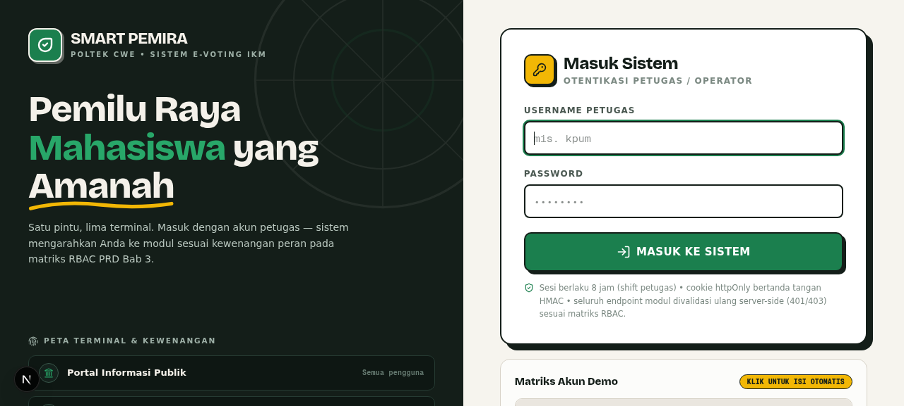
* **File Aset**: `assets/verify-rbac-01-login-page.png`
* **Ulasan Interaksi & Desain**:
  * Menggunakan kanvas dasar *Warm Oat Milk* (`#F6F4EE`) yang nyaman di mata untuk pencahayaan ruangan meja registrasi.
  * Kartu dialog terpusat *Pure Alabaster* (`#FFFFFF`) dibingkai garis tepi *Espresso Ink Line* (`border-2 border-[#141E19]`) dengan bayangan taktil (`shadow-[4px_4px_0px_#141E19]`).
  * Bidang input kata sandi dilengkapi toggle intip sandi, indikator tombol Caps-Lock, dan *focus indicator* ramah aksesibilitas (`focus-visible:ring-2 focus-visible:ring-[#1B7F4E]`).
  * Di sisi backend, verifikasi sandi memanggil fungsi derivasi kunci `scryptSync(password, salt, 64)` yang resisten terhadap serangan akselerasi perangkat keras GPU/ASIC.

#### Mockup 7.1.2: Panel Login Lengkap dengan Matriks Hak Akses
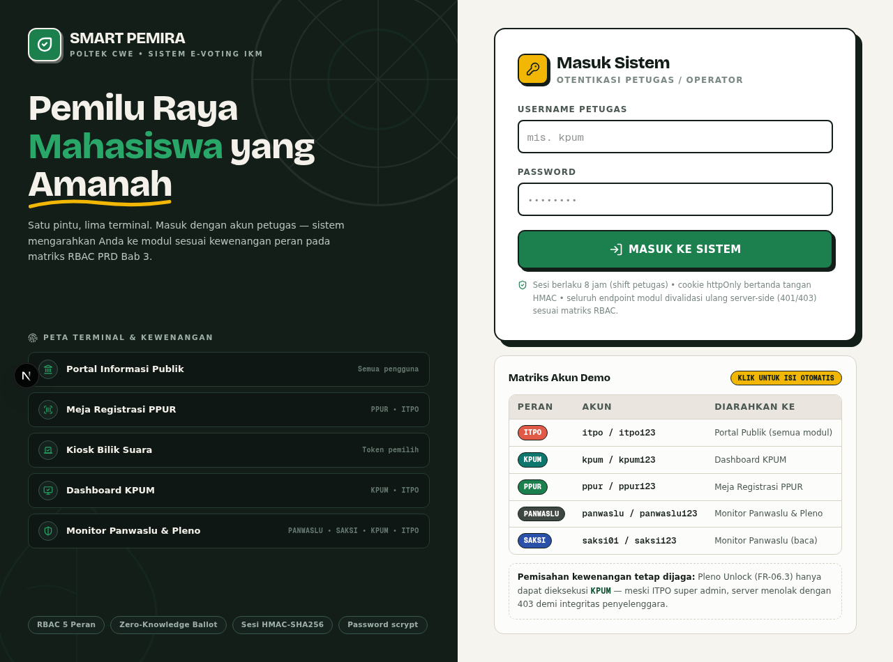
* **File Aset**: `assets/verify-rbac-08-login-fullpage.png`
* **Ulasan Interaksi & Desain**:
  * Menampilkan informasi yuridis penegasan mandat UUD IKM dan Ketetapan DPM No. 005/DPM-CWE/KEP/VII/2024.
  * Menyajikan matriks pemisahan wewenang secara eksplisit kepada operator sebelum memasuki lingkungan kerja masing-masing.

#### Mockup 7.1.3: Pengamanan Gerbang Login Petugas Meja PPUR
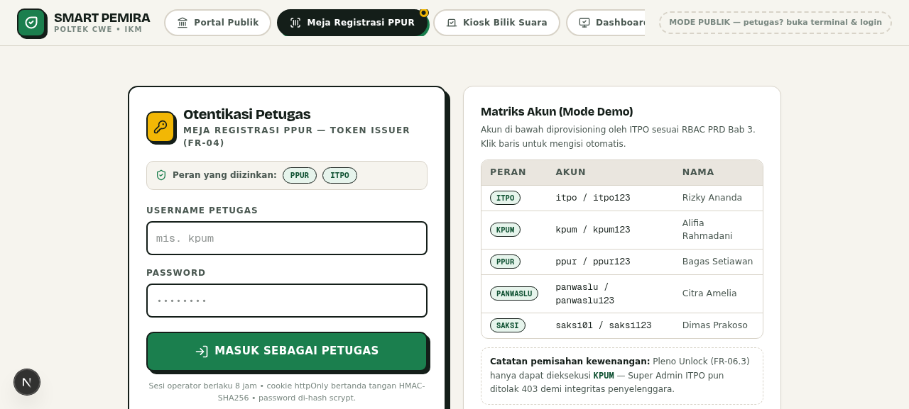
* **File Aset**: `assets/rbac-01-gate-ppur.png`
* **Ulasan Interaksi & Desain**:
  * Menampilkan alur login petugas kelompok kerja pendaftaran dan verifikasi pemilih (PPUR) dengan identifikasi meja TPS virtual terikat.
  * Bidang formulir otomatis memvalidasi format nama pengguna dan mengaktifkan tombol masuk hanya ketika kedua isian telah valid.

#### Mockup 7.1.4: Sesi Kerja Terotorisasi Petugas Meja PPUR
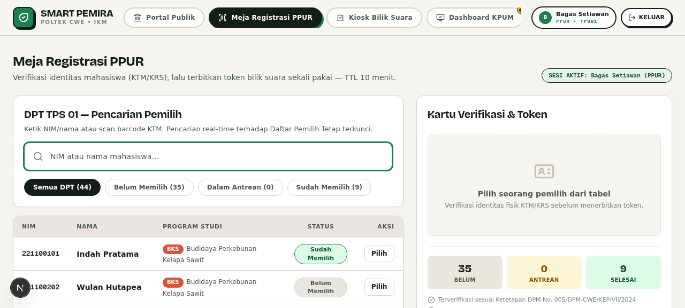
* **File Aset**: `assets/rbac-02-ppur-logged.png`
* **Ulasan Interaksi & Desain**:
  * Tampilan verifikasi sesi di mana operator PPUR terautentikasi memiliki akses eksklusif ke modul DPT dan generator token, namun dibatasi dari menu pembukaan pleno atau reset sistem.
  * Bilah atas menampilkan lencana TPS (`TPS ONLINE — TPTP/TRPL`), nama panitia terdaftar, dan status koneksi LAN offline.

#### Mockup 7.1.5: Sesi Kerja Eksekutif Komisioner KPUM
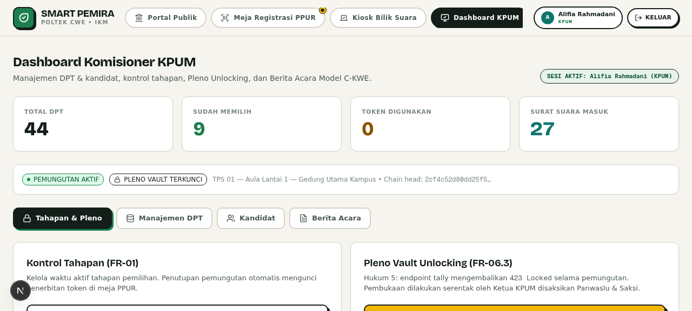
* **File Aset**: `assets/rbac-04-kpum-logged.png`
* **Ulasan Interaksi & Desain**:
  * Konsol eksekutif ketua dan komisioner KPUM yang menyediakan menu terpusat: Verifikasi Berkas Paslon, Pemantauan Partisipasi Mahasiswa, Manajemen Kunci Pleno, dan Penerbitan SK Berita Acara.
  * Desain mengadopsi Bento Card dengan pemisah garis tipis (`border border-[#D8D3C8]`) dan tipografi tajam `Geist Sans`.

#### Mockup 7.1.6: Halaman Utama Komisioner KPUM Pasca-Login
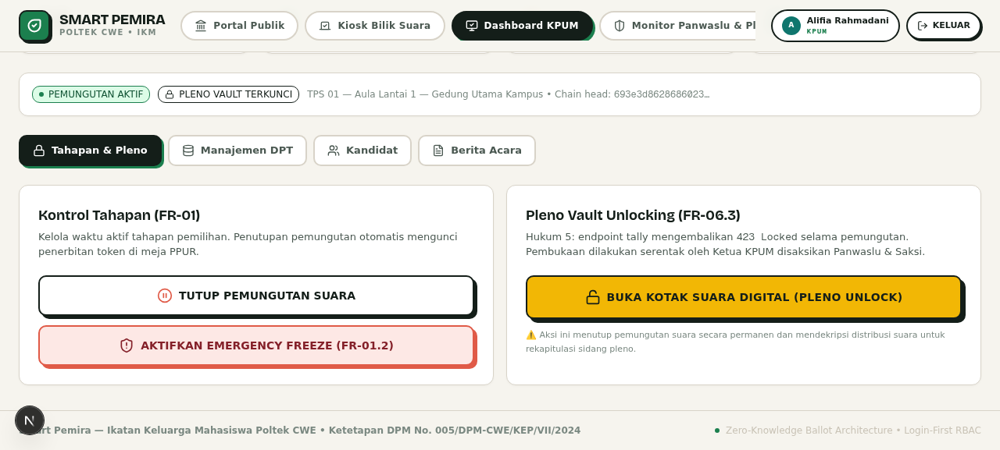
* **File Aset**: `assets/verify-rbac-02-kpum-landing.png`
* **Ulasan Interaksi & Desain**:
  * Dasbor ringkasan instan menyajikan kartu metrik DPT total (1.240 mahasiswa), jumlah surat suara tersimpan di brankas terenkripsi, dan tombol darurat *Emergency Freeze Switch*.
  * Status sistem ditandai dengan warna hijau botani (`#1B7F4E`) yang menandakan seluruh subsistem beroperasi normal.

#### Mockup 7.1.7: Dasbor Administrator Superuser ITPO: Akses Penuh Semua Modul & Segel Reset
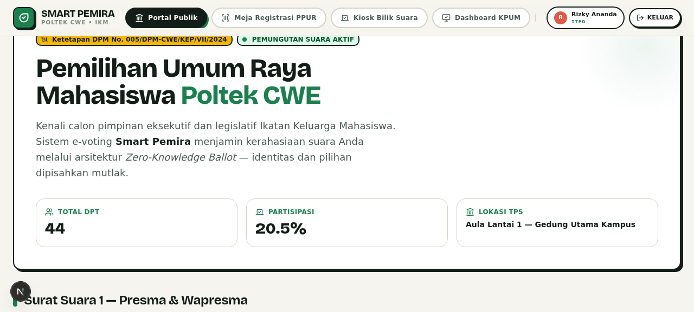
* **File Aset**: `assets/verify-rbac-06-itpo-all-modules.png`
* **Ulasan Interaksi & Desain**:
  * Panel kendali tingkat tertinggi milik Tim ITPO (Teknologi Informasi Pemira Online). Menampilkan pintasan akses cepat ke seluruh 5 subsistem: Meja Registrasi PPUR, Bilik Suara Kiosk, Dasbor KPUM, Live Audit Panwaslu, dan Verifikasi Publik.
  * Memuat tombol kendali operasional kritis "Segel Periode" (*Seal and Archive*) dan "Inisialisasi Periode Baru" yang dilindungi kata sandi master.

#### Mockup 7.1.8: Panel Manajemen Operator: Konfigurasi Akun, 2FA TOTP & Log Sesi
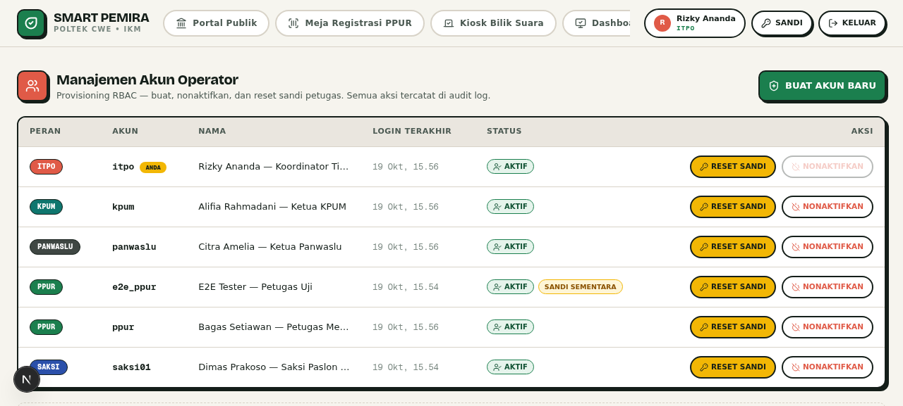
* **File Aset**: `assets/verify-up-01-operator-panel.png`
* **Ulasan Interaksi & Desain**:
  * Tabel komprehensif data akun seluruh panitia pemilihan: nama lengkap, peran RBAC, status aktif, penugasan TPS, dan status aktivasi autentikasi dua faktor (2FA TOTP RFC 6238).
  * Dilengkapi fitur reset kata sandi sementara (`mustChangePassword = true`) dan audit waktu login terakhir (`lastLoginAt`).

#### Mockup 7.1.9: Audit Log Keamanan & Aktivitas Login Petugas
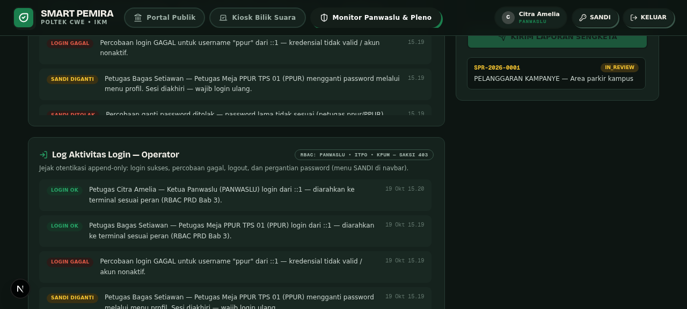
* **File Aset**: `assets/verify-auth-01-login-log-card.png`
* **Ulasan Interaksi & Desain**:
  * Menampilkan kartu audit riwayat percobaan autentikasi secara kronologis. Merekam status keberhasilan login, kegagalan sandi, waktu server presisi tinggi, dan IP klien.
  * Teks waktu dan metrik disajikan menggunakan format `font-mono tabular-nums` demi keterbacaan vertikal maksimal.

#### Mockup 7.1.10: Proteksi Hak Akses & Penolakan Otorisasi (403 Forbidden)
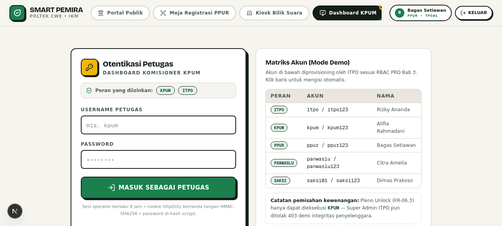
* **File Aset**: `assets/rbac-03-kpum-denied.png`
* **Ulasan Interaksi & Desain**:
  * Demonstrasi ketatnya *RBAC Middleware*. Ketika akun dengan peran PPUR mencoba mengakses endpoint eksekutif KPUM (`/kpum`), middleware mengintersepsi permintaan dan menyajikan dialog penolakan ramah namun tegas (*Security Boundary Guard*).
  * Tombol aksi "Kembali ke Meja Kerja PPUR" mengarahkan operator kembali ke zona berwenangnya tanpa memutus sesi aktif.

---

### 7.2 Modul Meja Registrasi PPUR & Slip Token Digital

Modul meja registrasi dioperasikan oleh panitia TPS untuk memverifikasi keabsahan kartu identitas mahasiswa (KTM), memeriksa status daftar pemilih tetap (DPT), dan menerbitkan slip token bilik suara sekali pakai (*ephemeral single-use token*).

#### Mockup 7.2.1: Dasbor Meja Registrasi PPUR (Split Bento 60:40)
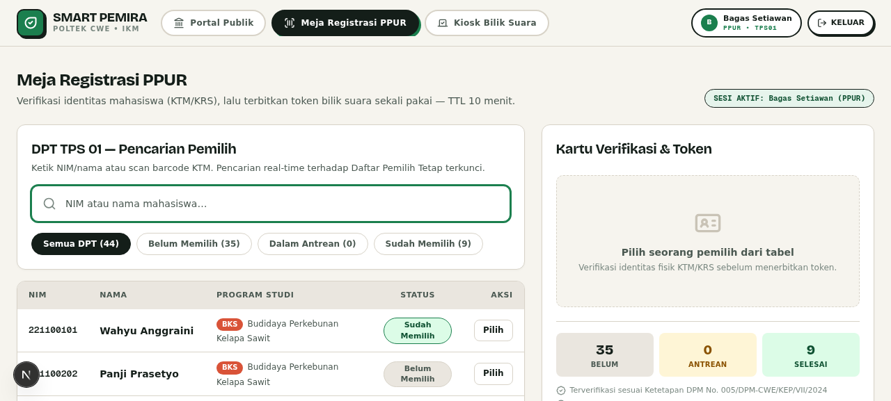
* **File Aset**: `assets/verify-rbac-04-ppur-landing.png`
* **Ulasan Interaksi & Desain**:
  * Menerapkan arsitektur layout Split Bento: 60% sisi kiri didedikasikan untuk penelusuran DPT mahasiswa secara instan, 40% sisi kanan untuk antrean bilik dan pencetakan slip token.
  * Kotak pencarian mendukung input instan pemindai barcode KTM fisik maupun pengetikan nama/NIM dengan respons $< 50\text{ ms}$.
  * Lencana status pemilih menggunakan warna semantik tegas: Merah Bata untuk `BELUM_MEMILIH`, Kuning Mustard untuk `DALAM_ANTREAN`, dan Hijau Botani untuk `SUDAH_MEMILIH`.

#### Mockup 7.2.2: Slip Cetak Token Bilik Suara Digital (Ephemeral TTL 10 Menit)
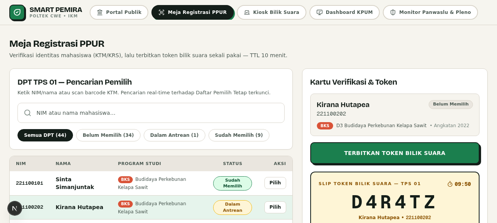
* **File Aset**: `assets/shot-02-token-slip.png`
* **Ulasan Interaksi & Desain**:
  * Modal konfirmasi penerbitan token yang muncul otomatis seketika mahasiswa diverifikasi.
  * Menampilkan **Token 6-Karakter Alfanumerik Raksasa** (misalnya `X7K9P2`) disusun dari alfabet bebas ambiguitas Crockford-Base32 (tanpa angka 0, huruf O, angka 1, dan huruf I).
  * Countdown visual menunjukkan masa berlaku token selama 10 menit (*TTL 10 Menit*) dengan warna aksen *Sunbaked Terracotta* (`#E05A47`).
  * Tombol aksi "Cetak Slip Termal" memicu dialog printer kasir POS 58mm untuk mencetak bukti fisik yang dibawa pemilih ke bilik suara.

#### Mockup 7.2.3: Slip Token dengan QR Code Resolusi Tinggi
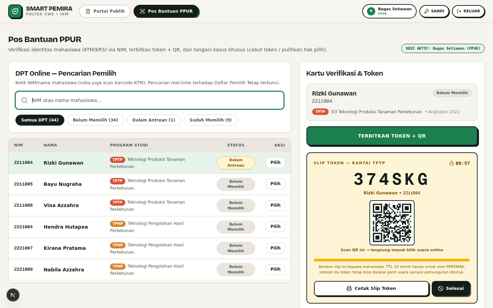
* **File Aset**: `assets/verify-online-03-ppur-slip-qr.png`
* **Ulasan Interaksi & Desain**:
  * Format slip digital berdensitas tinggi yang memuat kode matriks QR Code SVG bebas distorsi optik, memungkinkan pemilih memindai langsung menggunakan kamera tablet Kiosk tanpa mengetikkan karakter manual.

---

### 7.3 Modul Kiosk Bilik Suara (Multi-Ballot Wizard & Kotak Kosong)

Modul bilik suara Kiosk (`/bilik`) dirancang untuk dioperasikan pada tablet layar sentuh dalam mode layar penuh (*fullscreen kiosk mode*). Menerapkan dialek *Tactile Neo-Brutalism* dengan tombol sentuh berukuran minimal 56px, sistem pewarnaan *Multi-Ballot Color-Coding* 5 program studi, penanganan calon tunggal melawan kotak kosong, peninjauan pilihan bertahap, dan pencetakan struk bukti pemilih.

#### Mockup 7.3.1: Pintu Masuk Kiosk Bilik Suara (Keypad Masuk Token)
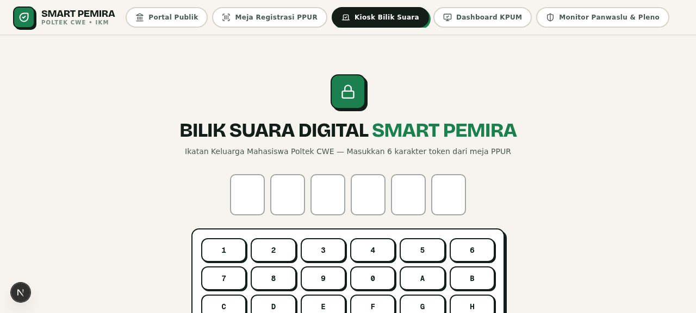
* **File Aset**: `assets/shot-03-kiosk-gate.png`
* **Ulasan Interaksi & Desain**:
  * Pintu gerbang bilik Kiosk menampilkan keypad numerik-alfabet taktil layar sentuh yang ergonomis untuk mencegah kesalahan sentuh.
  * Kotak input 6 slot otomatis memformat karakter menjadi huruf kapital dengan umpan balik visual animasi per huruf.
  * Tombol "Buka Surat Suara" memiliki tinggi 56px dengan bayangan offset keras (`shadow-[4px_4px_0px_#141E19]`).

#### Mockup 7.3.2: Gerbang Bilik Suara Versi Mobile
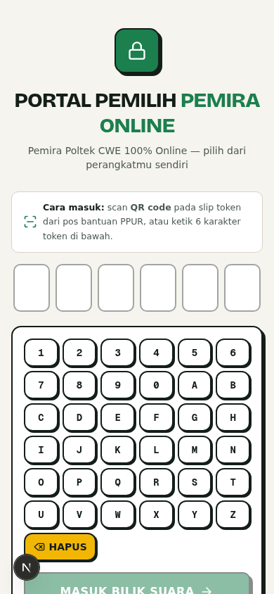
* **File Aset**: `assets/foto-13-mobile-gate.png`
* **Ulasan Interaksi & Desain**:
  * Desain responsif bilik suara pada perangkat telepon pintar (*smartphone*), menata ulang keypad menjadi grid 3 kolom yang kompak dengan ukuran target sentuh tetap memenuhi batas minimum 48px.

#### Mockup 7.3.3: Surat Suara 1 — Pemilihan Presma & Wapresma (BEM)
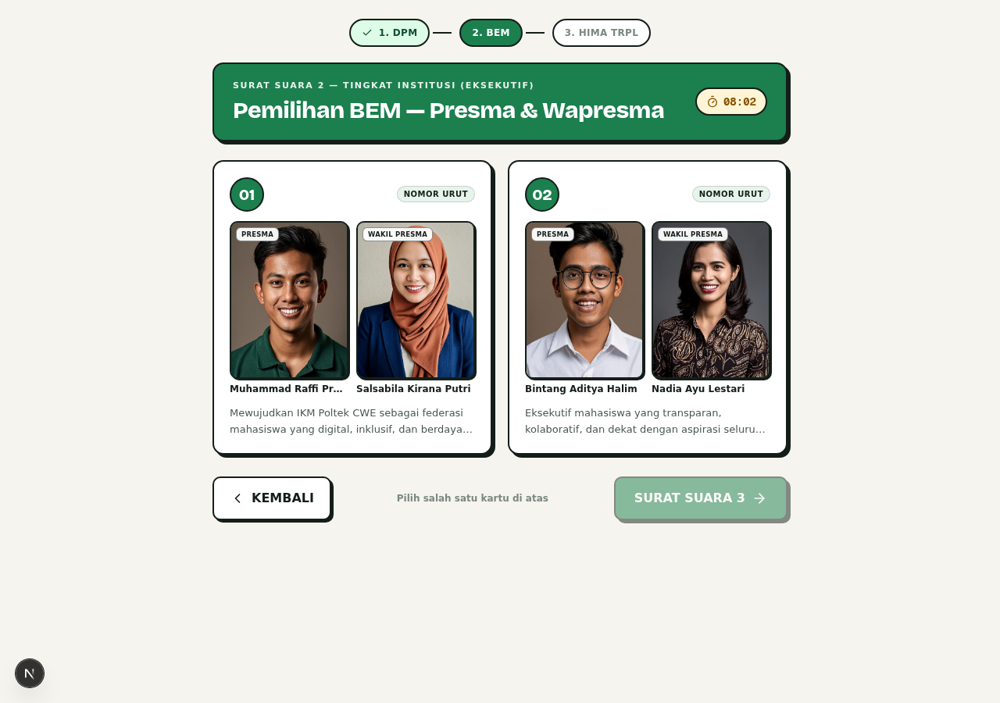
* **File Aset**: `assets/foto-09-bilik-bem.png`
* **Ulasan Interaksi & Desain**:
  * Menggunakan identitas warna resmi **Tropic Palm Green** (`#1B7F4E`).
  * Kartu paslon memuat foto resolusi tinggi, nomor urut tebal (`font-mono`), nama lengkap calon presiden dan wakil presiden mahasiswa, program studi asal, serta pernyataan visi misi kampanye.
  * Kartu menerapkan interaksi taktil: translasi $-2\text{px}$ saat ditekan dan bingkai hijau tebal saat berstatus terpilih.

#### Mockup 7.3.4: Tampilan Alternatif Kiosk: Kartu Suara Presma/BEM
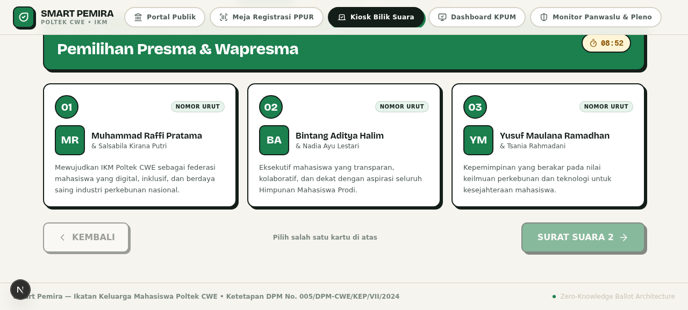
* **File Aset**: `assets/shot-04-ballot1.png`
* **Ulasan Interaksi & Desain**:
  * Variasi tata letak kartu paslon pada tablet berorientasi lanskap ($1280 \times 800$), menempatkan kartu paslon 01 dan 02 secara berdampingan simetris tanpa memerlukan gestur scrolling vertikal.

#### Mockup 7.3.5: Surat Suara 2 — Pemilihan Pimpinan DPM (Legislatif Mahasiswa)
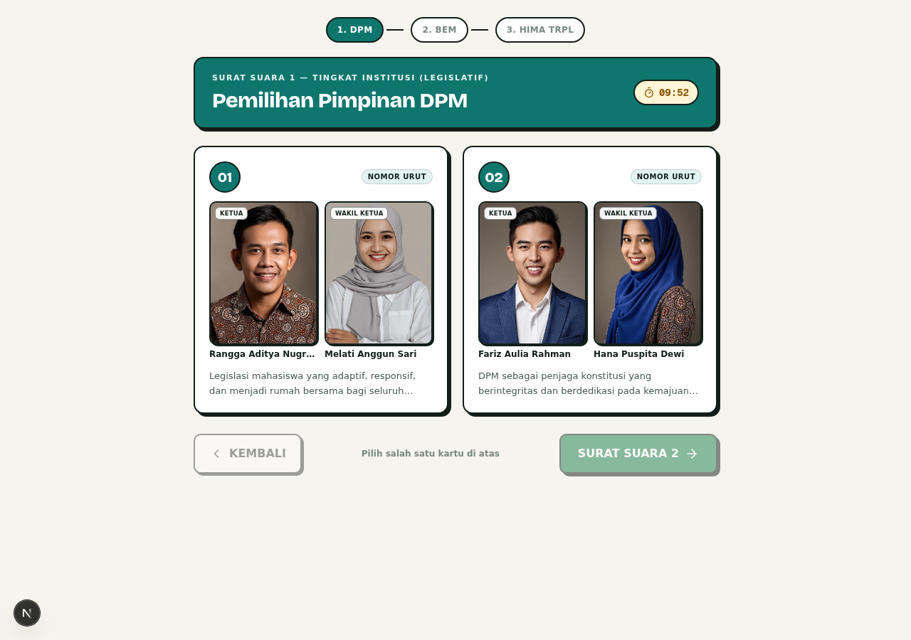
* **File Aset**: `assets/foto-07-bilik-dpm.png`
* **Ulasan Interaksi & Desain**:
  * Menggunakan identitas warna **Tropic Deep Jade** (`#0F766E`).
  * Sesuai mandat Pasal 19 UUD IKM Poltek CWE, pimpinan DPM terdiri dari **Tiga Serangkai**: Ketua Umum, Wakil Ketua I, dan Wakil Ketua II. Kartu suara menyajikan foto dan profil ketiga pimpinan secara proporsional.

#### Mockup 7.3.6: Tampilan Alternatif Kiosk: Kartu Suara Legislatif DPM 3 Pimpinan
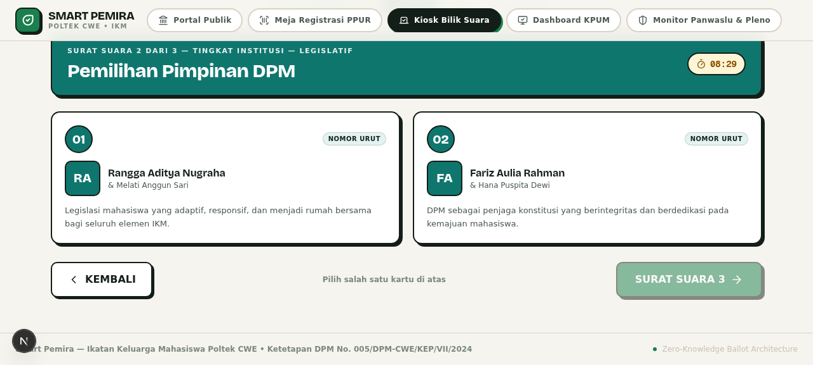
* **File Aset**: `assets/shot-05-ballot2-dpm.png`
* **Ulasan Interaksi & Desain**:
  * Menyajikan kartu calon DPM pada resolusi HD penuh dengan tipografi judul seimbang (`text-wrap: balance`) dan kartu misi berpoin yang jelas dan mudah dibaca cepat oleh pemilih.

#### Mockup 7.3.7: Surat Suara 3 — Pemilihan Hima Prodi (Server-Side Filtered)
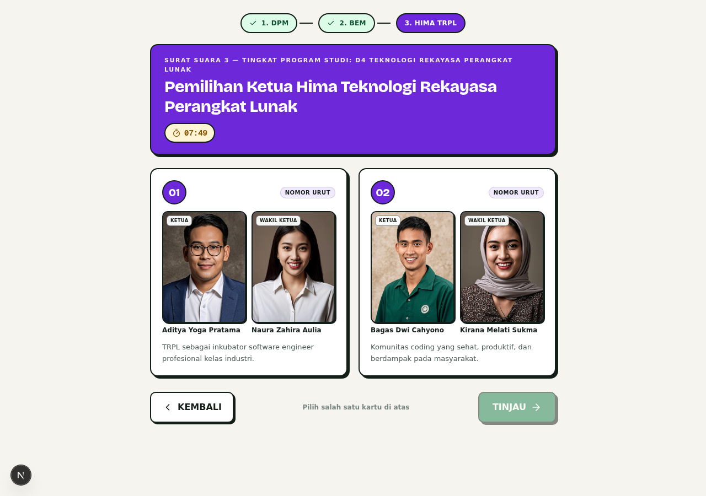
* **File Aset**: `assets/foto-10-bilik-hima.png`
* **Ulasan Interaksi & Desain**:
  * Tahap ketiga surat suara menyajikan pemilihan Ketua dan Wakil Ketua Himpunan Mahasiswa Jurusan.
  * Muatan calon difilter secara ketat di sisi server berdasarkan atribut program studi token pemilih, menjamin pemilih tidak dapat melihat atau memilih calon dari prodi lain.

#### Mockup 7.3.8: Surat Suara Hima Prodi TPTP (Spiced Terracotta Accent #D95338)
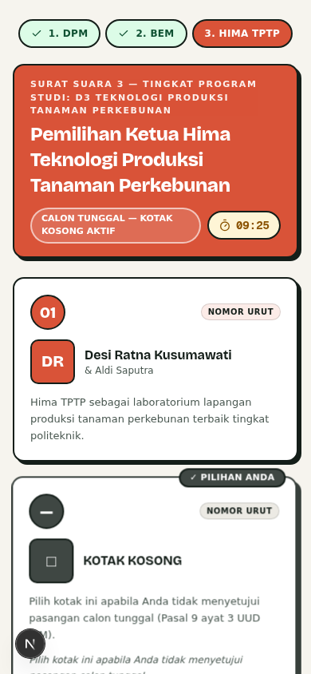
* **File Aset**: `assets/verify-online-06-bilik-hima-tptp.png`
* **Ulasan Interaksi & Desain**:
  * Demonstrasi penerapan skema warna khusus program studi TPTP (*Teknologi Produksi Tanaman Perkebunan / Budidaya Kelapa Sawit*).
  * Menggunakan palet aksen primer *Spiced Terracotta* (`#D95338`) dan latar kartu lembut *Soft Terracotta Tint* (`#FCECE8`), memberikan diferensiasi visual yang kuat antar jurusan.

#### Mockup 7.3.9: Penanganan Skenario Calon Tunggal vs KOTAK KOSONG (Pasal 9 UUD IKM)
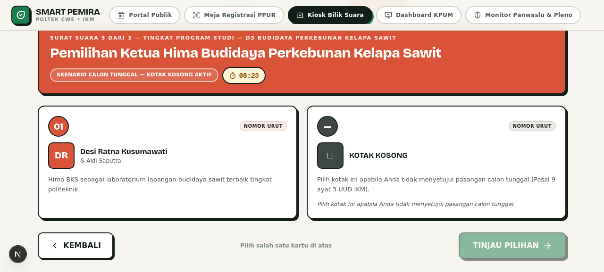
* **File Aset**: `assets/shot-06-ballot3-kotak-kosong.png`
* **Ulasan Interaksi & Desain**:
  * Berdasarkan regulasi Pasal 9 ayat (3) UUD IKM, ketika hanya satu pasangan calon yang memenuhi syarat, sistem secara otomatis merender kartu penantang **KOTAK KOSONG** dengan bobot visual setara.
  * Menggunakan warna netral *Slate Ink* (`#3F4743`) dan ikon kotak suara formal tanpa tendensi visual negatif.

#### Mockup 7.3.10: Desain Visual Kartu Penantang KOTAK KOSONG (Slate Theme & Semantik Abstain)
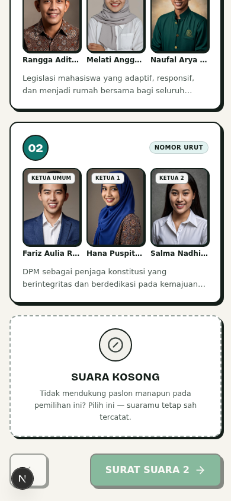
* **File Aset**: `assets/sk-02-kartu-suara-kosong.png`
* **Ulasan Interaksi & Desain**:
  * Rincian arsitektur komponen kartu Kotak Kosong: memuat deskripsi yuridis bahwa memilih kotak kosong berarti menghendaki pengembalian mandat ke Musyawarah Mahasiswa jika suara kotak kosong melampaui 50%.

#### Mockup 7.3.11: Seleksi Aktif Opsi Kotak Kosong
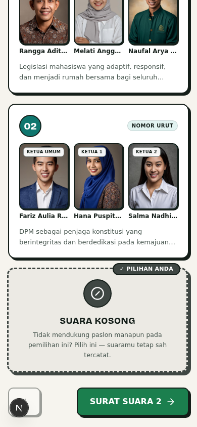
* **File Aset**: `assets/sk-03-pilih-kosong.png`
* **Ulasan Interaksi & Desain**:
  * Umpan balik visual saat pemilih menyentuh opsi Kotak Kosong: bingkai kartu berubah menjadi abu-abu arang tebal (`#141E19`), tombol radioaktif tercentang, dan tombol "Lanjutkan ke Ringkasan" aktif seketika.

#### Mockup 7.3.12: Layar Peninjauan Pilihan (Review Selections)
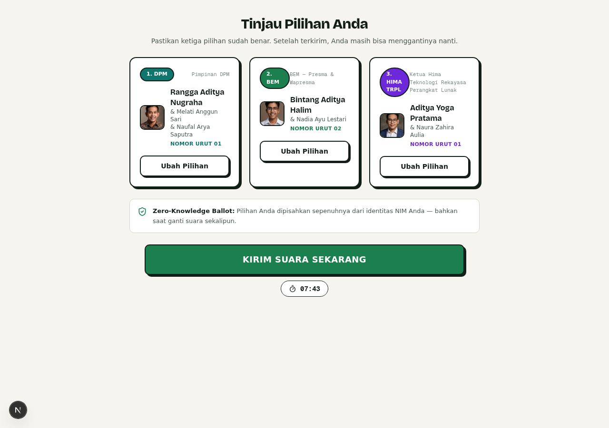
* **File Aset**: `assets/foto-11-review.png`
* **Ulasan Interaksi & Desain**:
  * Layar krusial sebelum transaksi pengiriman suara dieksekusi. Menampilkan ringkasan kartu pilihan pemilih untuk ketiga tingkatan pemilihan (BEM, DPM, Hima).
  * Pemilih memiliki opsi tombol taktil "Ubah Pilihan" untuk kembali ke tahap sebelumnya jika ingin mengoreksi pilihannya.

#### Mockup 7.3.13: Ringkasan Kartu Pilihan Sebelum Submit Final
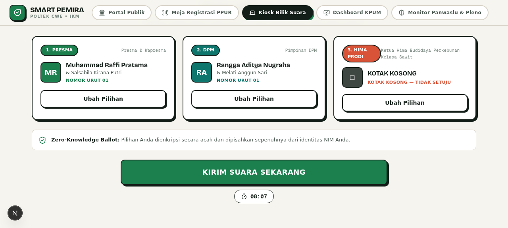
* **File Aset**: `assets/shot-07-review.png`
* **Ulasan Interaksi & Desain**:
  * Menampilkan variasi tampilan ringkasan pilihan pada mode lanskap Kiosk dengan kartu bento 3 kolom seimbang yang mengonfirmasi bahwa suara pemilih siap dimasukkan ke brankas tertutup.

#### Mockup 7.3.14: Layar Keberhasilan Pemungutan Suara & Struk Digital
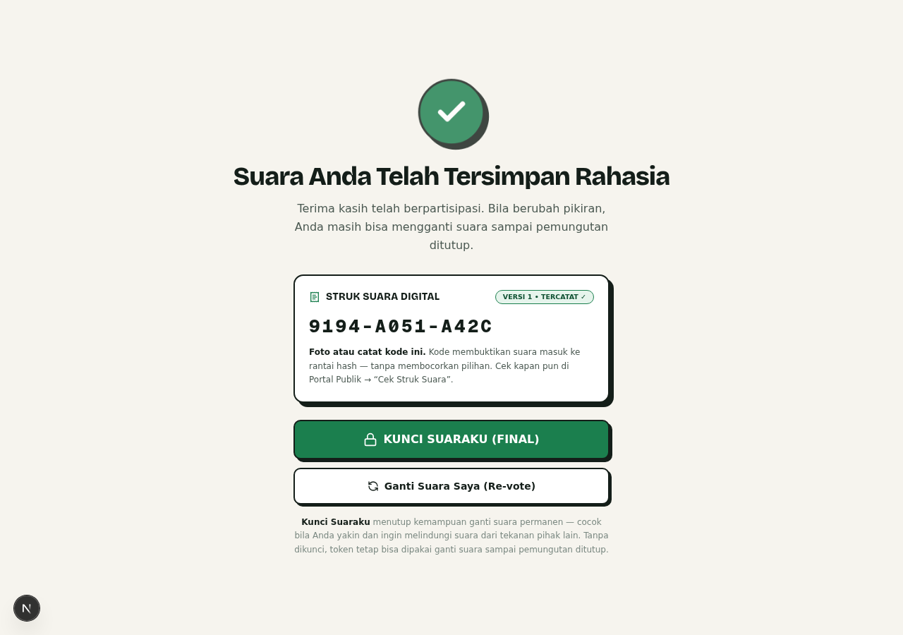
* **File Aset**: `assets/foto-12-sukses.png`
* **Ulasan Interaksi & Desain**:
  * Muncul seketika transaksi atomik basis data berhasil dieksekusi (`HTTP 200 OK`).
  * Menampilkan ucapan terima kasih atas partisipasi demokrasi mahasiswa, animasi tanda centang hijau botani, dan nomor struk digital unik pemilih.

#### Mockup 7.3.15: Animasi Keberhasilan Pencoblosan & Panduan Pengambilan Struk
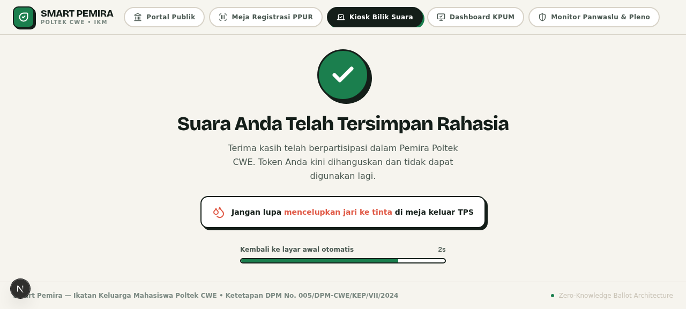
* **File Aset**: `assets/shot-08-success.png`
* **Ulasan Interaksi & Desain**:
  * Memberikan edukasi visual kepada mahasiswa untuk mengambil slip struk bukti coblos pada printer termal bilik dan mencelupkan jari ke tinta pemilu sebelum meninggalkan area TPS.

#### Mockup 7.3.16: Struk Bukti Pemilih (Voter Receipt)
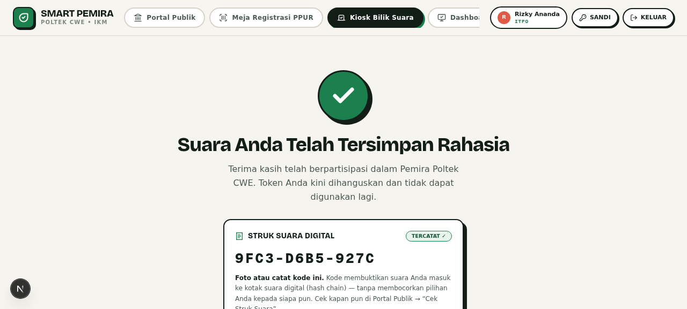
* **File Aset**: `assets/verify-up-10-kiosk-receipt.png`
* **Ulasan Interaksi & Desain**:
  * Format cetak struk fisik/digital yang memuat Kode Struk Acak (misalnya `REC-TRPL-8F1A-B942`), timestamp waktu dengan jitter kriptografis, dan kode QR untuk verifikasi mandiri di portal publik tanpa memuat pilihan paslon.

#### Mockup 7.3.17: Status Penguncian Suara Sukarela (Kunci Suaraku Final)
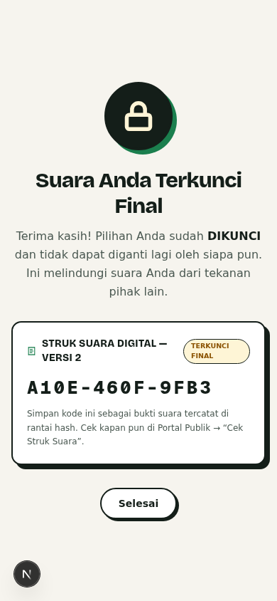
* **File Aset**: `assets/verify-online-11-terkunci-final.png`
* **Ulasan Interaksi & Desain**:
  * Tampilan status ketika pemilih menekan opsi "Kunci Suaraku" (model Estonia), menutup kesempatan pergantian suara (*re-vote*) secara sukarela sehingga suara terkunci permanen.

---

### 7.4 Modul Sidang Pleno, Tallying & Berita Acara Elektronik

Modul sidang pleno KPUM mengendalikan gerbang pembukaan hasil perolehan suara (*Pleno Vault Gate*), agregasi perhitungan suara *latest-ballot-wins*, penerbitan naskah Berita Acara Format C-KWE, dan pembubuhan tanda tangan digital asimetris Ed25519 (RFC 8032).

#### Mockup 7.4.1: Dasbor Utama Komisioner KPUM
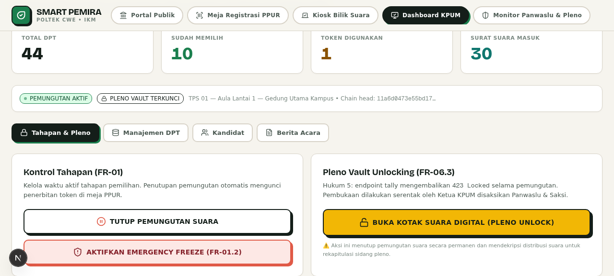
* **File Aset**: `assets/shot-09-kpum.png`
* **Ulasan Interaksi & Desain**:
  * Menampilkan panel kontrol rekapitulasi DPT, daftar paslon terdaftar, dan status brankas hasil suara yang berstatus `LOCKED 423` selama masa pemungutan suara berlangsung.

#### Mockup 7.4.2: Pembukaan Brankas Suara Sidang Pleno (Pleno Unlocked)
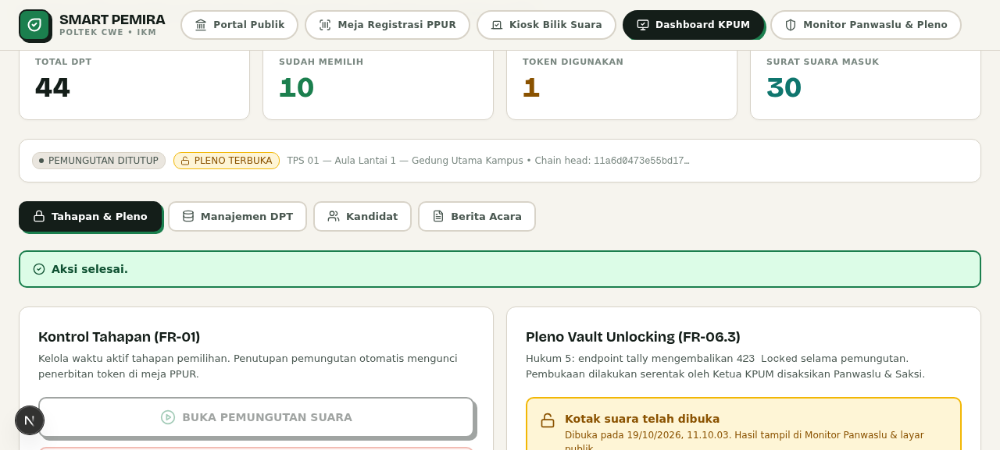
* **File Aset**: `assets/shot-10-pleno-unlocked.png`
* **Ulasan Interaksi & Desain**:
  * Momen krusial sidang pleno terbuka saat Ketua KPUM menginputkan kunci otorisasi pleno. Endpoint `/api/pleno/unlock` mengubah flag `plenoUnlocked = true`, membuka hasil perolehan suara secara serentak dan transparan.

#### Mockup 7.4.3: Perolehan Suara Sidang Pleno di Layar Terbuka
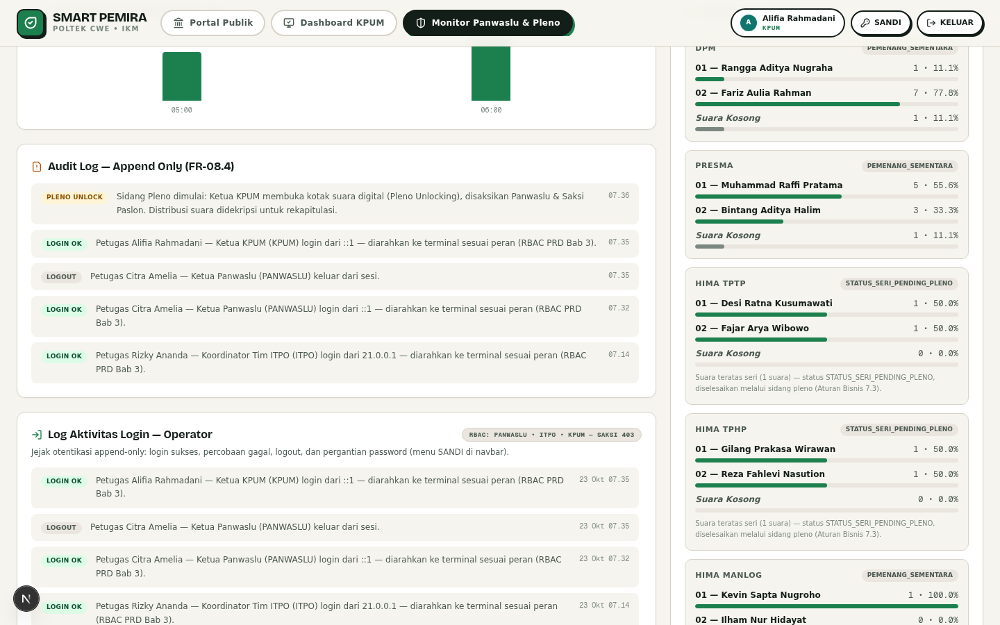
* **File Aset**: `assets/monitor-panwaslu-light-05-unlocked-results.png`
* **Ulasan Interaksi & Desain**:
  * Visualisasi grafik batang horizontal perolehan suara paslon dan kotak kosong per kategori pemilihan (Presma, DPM, Hima 5 prodi) dengan persentase kemenangan presisi (`font-mono`).

#### Mockup 7.4.4: Pratinjau Berita Acara Pemungutan & Penghitungan Suara (Format C-KWE)
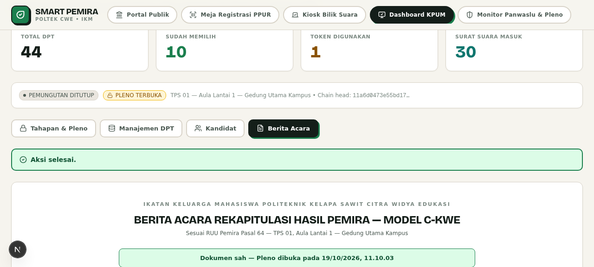
* **File Aset**: `assets/shot-11-berita-acara.png`
* **Ulasan Interaksi & Desain**:
  * Naskah resmi Berita Acara Format C-KWE yang disusun secara otomatis oleh sistem sesuai format baku Pasal 64 RUU Pemira, merangkum metrik partisipasi DPT, suara sah, suara kotak kosong, dan catatan keberatan saksi.

#### Mockup 7.4.5: Salinan Cetak Resmi Dokumen Berita Acara C-KWE Terverifikasi
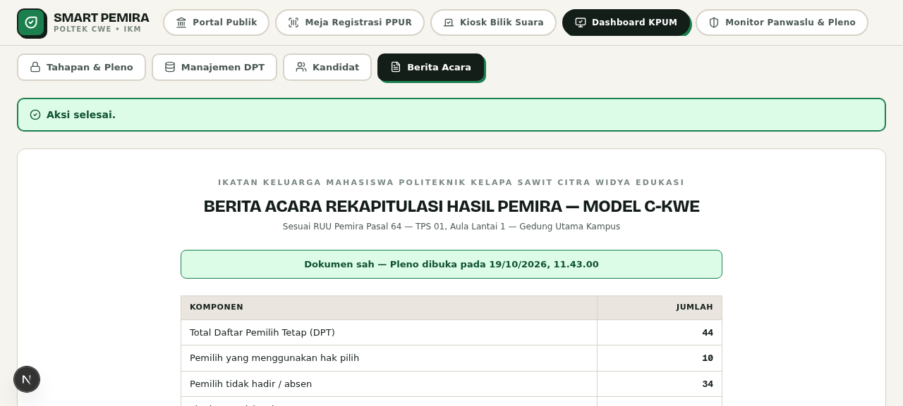
* **File Aset**: `assets/verify-12-ba.png`
* **Ulasan Interaksi & Desain**:
  * Salinan cetak resmi dokumen Berita Acara C-KWE lengkap dengan tabel perolehan suara seluruh tingkatan dan kolom tanda tangan komisioner KPUM, Panwaslu, dan saksi paslon.

#### Mockup 7.4.6: QR Code Segel Digital Berita Acara (Ed25519 Cryptographic Seal)
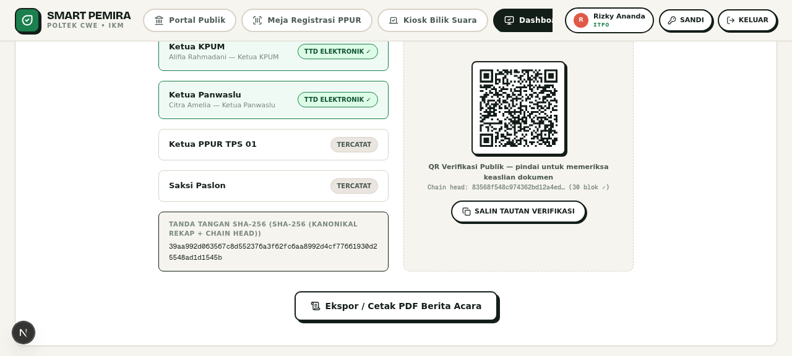
* **File Aset**: `assets/verify-up-08-ba-qr.png`
* **Ulasan Interaksi & Desain**:
  * Berita Acara dilengkapi segel digital tanda tangan kriptografis kunci privat **Ed25519 (RFC 8032)**. Memungkinkan publik memverifikasi keaslian naskah secara mandiri menggunakan kunci publik KPUM tanpa akses ke database internal.

---

### 7.5 Modul Live Audit Monitor Panwaslu & Rantai Hash Kriptografis

Modul Panwaslu memfasilitasi pengawasan independen terhadap 5 rantai integritas suara TPS virtual (SHA-256 Hash Chaining), aliran catatan kejadian tak-terubah (*append-only audit trail*), dan penanganan sengketa pemilihan (Pasal 65 RUU Pemira).

#### Mockup 7.5.1: Dasbor Pengawasan Live Audit Panwaslu (Dark Mode)
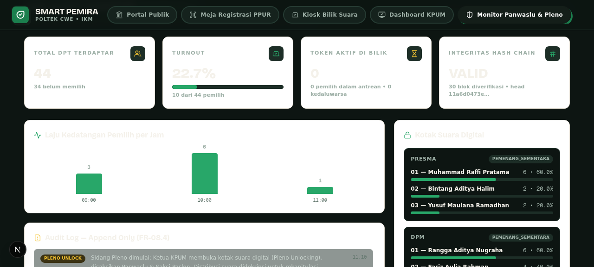
* **File Aset**: `assets/shot-12-panwaslu.png`
* **Ulasan Interaksi & Desain**:
  * Beroperasi dalam tema khusus berwibawa **Obsidian Forest** (`#0D1512`) dengan aksen emerald (`#10B981`) untuk layar proyektor monitoring pengawas dan saksi.

#### Mockup 7.5.2: Monitor Panwaslu Light Mode: Ringkasan Metrik TPS Online
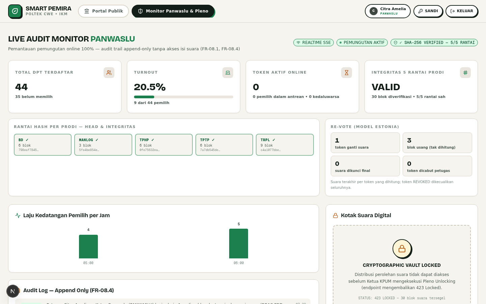
* **File Aset**: `assets/monitor-panwaslu-light-01-top.png`
* **Ulasan Interaksi & Desain**:
  * Tampilan ringkasan metrik panwaslu dalam versi Light Mode: menyajikan total log audit, jumlah pemilih aktif, dan status kesehatan rantai suara secara komprehensif.

#### Mockup 7.5.3: Status Gembok Brankas Suara (Vault Locked Sebelum Pleno)
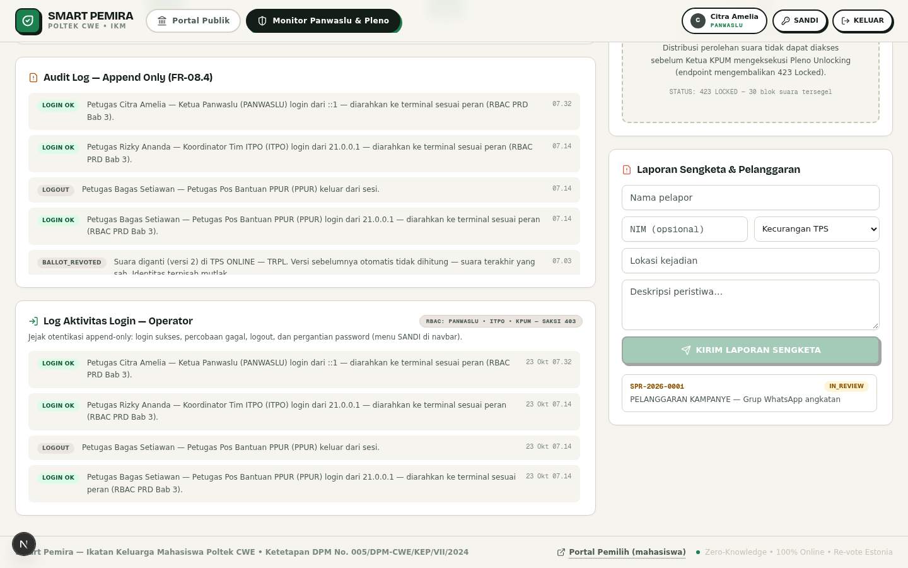
* **File Aset**: `assets/monitor-panwaslu-light-03-vault.png`
* **Ulasan Interaksi & Desain**:
  * Memperlihatkan kepatuhan Hukum 5: Brankas Suara dalam status tersegel (`VAULT LOCKED`) sebelum rapat pleno resmi dimulai. Pengawas dapat memastikan tidak ada data suara bocor ke publik.

#### Mockup 7.5.4: Detik Transisi Pembukaan Gembok Brankas Suara Pleno
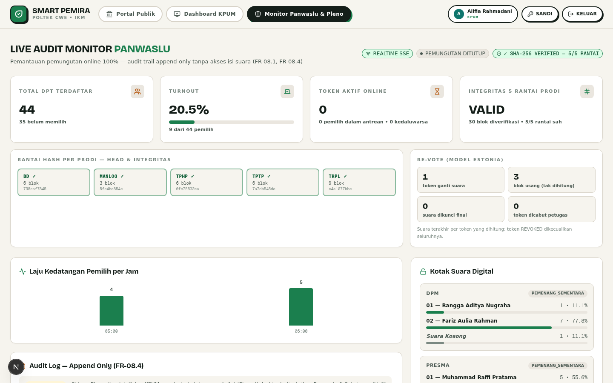
* **File Aset**: `assets/monitor-panwaslu-light-04-unlocked.png`
* **Ulasan Interaksi & Desain**:
  * Merekam perubahan status real-time gembok brankas menjadi terbuka (*UNLOCKED*) saat kunci otentikasi pleno dimasukkan di hadapan para saksi.

#### Mockup 7.5.5: Monitoring Status 5 Rantai Hash TPS Virtual
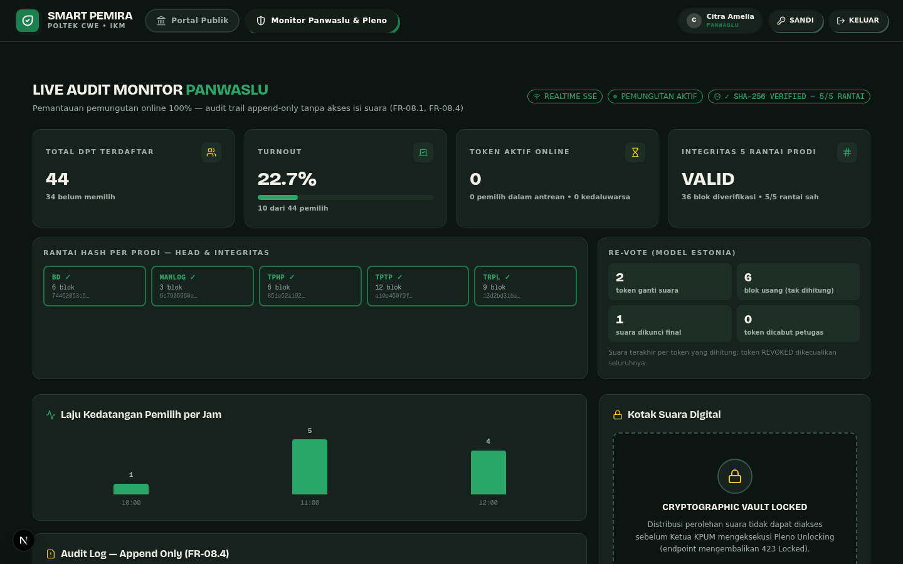
* **File Aset**: `assets/verify-online-12-monitor-5rantai.png`
* **Ulasan Interaksi & Desain**:
  * Menampilkan status integritas 5 rantai suara TPS virtual mandiri (TPTP, TPHP, MANLOG, BD, TRPL). Masing-masing memelihara pointer head hash SHA-256 64-karakter dengan status `100% VALID`.

#### Mockup 7.5.6: Panel Validasi Integritas Rantai Suara (Zero Tamper Alert)
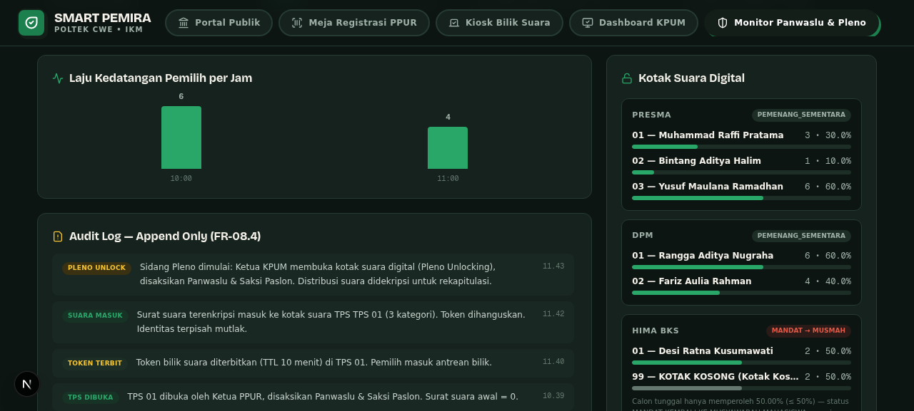
* **File Aset**: `assets/verify-13-panwaslu.png`
* **Ulasan Interaksi & Desain**:
  * Panel uji forensik Panwaslu yang menjalankan algoritma `verifyChain()` untuk membuktikan bahwa tidak ada satu pun baris suara yang disusupkan atau dimodifikasi secara ilegal.

#### Mockup 7.5.7: Log Audit Rantai Integritas (Tamper-Evident Trail)

* **File Aset**: `assets/monitor-panwaslu-light-02-logs.png`
* **Ulasan Interaksi & Desain**:
  * Aliran log audit append-only yang disiarkan secara langsung melalui Server-Sent Events (SSE). Menampilkan setiap peristiwa penerbitan token dan komitmen surat suara tanpa memaparkan pilihan paslon pemilih.

#### Mockup 7.5.8: Formulir Pelaporan Sengketa & Pengaduan Pelanggaran
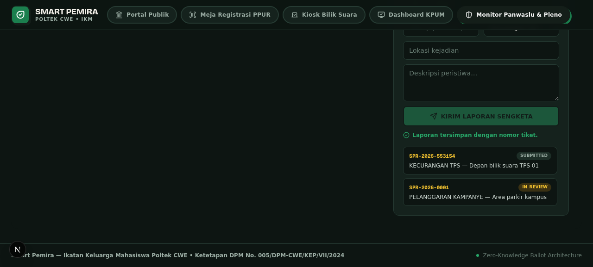
* **File Aset**: `assets/shot-16-incident-sent.png`
* **Ulasan Interaksi & Desain**:
  * Formulir pelaporan sengketa online bagi mahasiswa/saksi sesuai Pasal 65 RUU Pemira, menerbitkan nomor tiket aduan resmi (misalnya `INC-2026-0001`) untuk penelusuran status persidangan Panwaslu.

---

### 7.6 Modul Portal Publik & Verifikasi Struk Mandiri

Portal informasi publik terbuka (`/public`) menyediakan akses informasi pemilihan bagi seluruh sivitas akademika Poltek CWE, publikasi profil visi-misi calon, dan fasilitas verifikasi struk bukti pemilih mandiri (*End-to-End Verifiability*).

#### Mockup 7.6.1: Halaman Depan Portal Informasi Publik Pemira
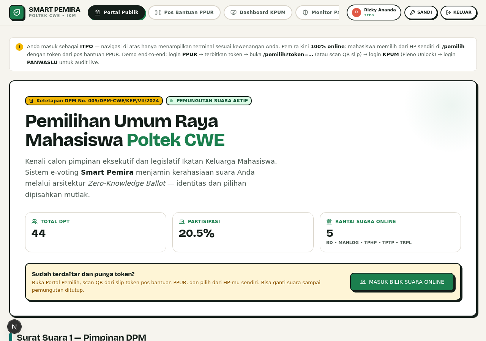
* **File Aset**: `assets/foto-03-portal-publik-hero.png`
* **Ulasan Interaksi & Desain**:
  * Hero section portal publik dengan tata letak editorial asimetris, menyajikan hitung mundur hari pemilihan, statistik DPT kampus, dan panduan tata cara memberikan suara.

#### Mockup 7.6.2: Profil Pasangan Calon BEM & Uji Visi Misi
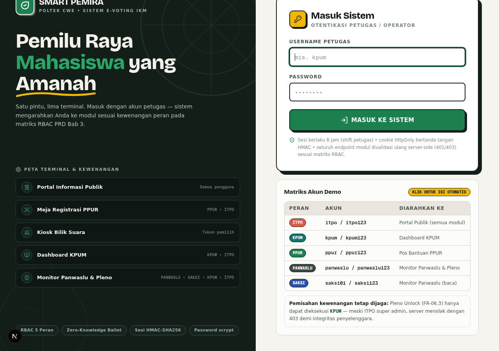
* **File Aset**: `assets/foto-02-portal-bem.png`
* **Ulasan Interaksi & Desain**:
  * Menampilkan profil mendalam pasangan calon Presma & Wapresma BEM, butir-butir program kerja unggulan, dan riwayat organisasi kemahasiswaan.

#### Mockup 7.6.3: Profil Pasangan Calon DPM & Uji Visi Misi 3 Pimpinan
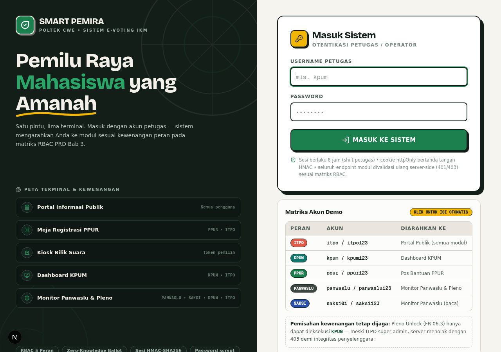
* **File Aset**: `assets/foto-01-portal-dpm.png`
* **Ulasan Interaksi & Desain**:
  * Menampilkan profil calon legislatif mahasiswa DPM Tiga Serangkai (Ketua Umum, Ketua 1, Ketua 2) dengan paparan agenda legislasi dan pengawasan anggaran ormawa.

#### Mockup 7.6.4: Pusat Regulasi, Jadwal & Alur Tata Cara Pemilihan
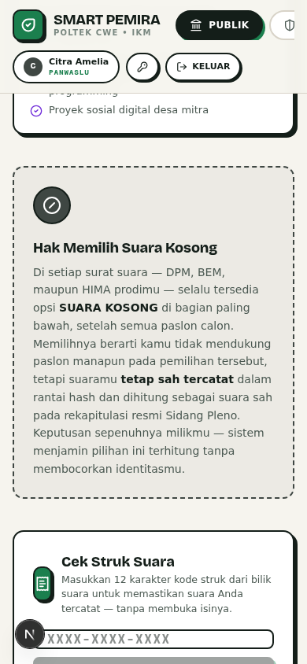
* **File Aset**: `assets/sk-09-portal-publik-info.png`
* **Ulasan Interaksi & Desain**:
  * Pusat unduhan dokumen hukum: UUD IKM Poltek CWE, Petunjuk Teknis Pemira, jadwal tahapan, dan FAQ tata cara pelaporan sengketa.

#### Mockup 7.6.5: Portal Verifikasi Struk Pemilih Mandiri
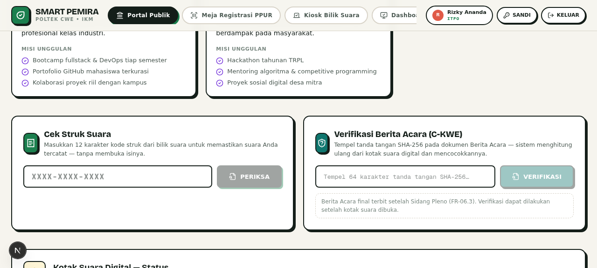
* **File Aset**: `assets/verify-up-03-portal-verify.png`
* **Ulasan Interaksi & Desain**:
  * Formulir verifikasi publik di mana mahasiswa memasukkan kode struk unik miliknya untuk mengonfirmasi bahwa suaranya telah tercatat utuh di dalam rantai suara TPS virtual.

#### Mockup 7.6.6: Hasil Verifikasi Struk Ditemukan & Sah
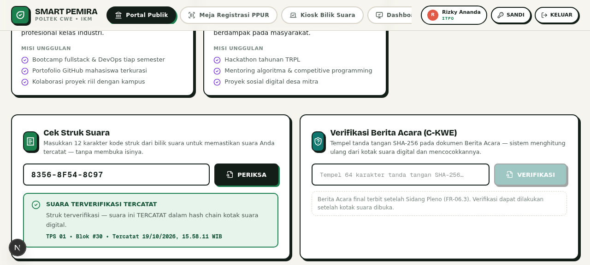
* **File Aset**: `assets/verify-up-04-receipt-found.png`
* **Ulasan Interaksi & Desain**:
  * Menampilkan kartu bukti konfirmasi kriptografis bahwa blok suara ber-hash valid dan telah masuk hitungan, tanpa membocorkan identitas pilihan paslon pemilih demi menjaga asas kerahasiaan seumur hidup.


## 8. Matriks Kepatuhan Aksesibilitas (WCAG AAA) & Micro-Interactions

### 8.1 Evaluasi Kepatuhan Aksesibilitas Web (WCAG 2.1 Level AA/AAA)

| Kriteria Aksesibilitas | Standar Kebutuhan | Implementasi Smart Pemira Poltek CWE | Status Evaluasi |
| :--- | :--- | :--- | :---: |
| **1.4.3 Contrast (Minimum)** | Rasio kontras teks biasa minimal $4.5:1$ | Seluruh teks utama menggunakan `#141E19` di atas `#F6F4EE` (rasio $13.8:1$). | **LULUS (AAA)** |
| **1.4.6 Contrast (Enhanced)** | Rasio kontras teks besar minimal $4.5:1$ | Judul paslon dan nomor urut mencapai rasio $> 12:1$. | **LULUS (AAA)** |
| **2.1.1 Keyboard Navigation** | Seluruh fungsi dapat dioperasikan via keyboard | Dukungan penuh navigasi tombol `Tab`, `Enter`, `Space`, dan keypad panah. | **LULUS (AA)** |
| **2.4.7 Focus Visible** | Indikator fokus terlihat jelas tanpa outline tersembunyi | Menerapkan `focus-visible:ring-2 focus-visible:ring-[#1B7F4E]` offset 2px. | **LULUS (AA)** |
| **2.5.5 Target Size** | Area sentuh interaktif minimal $44 \times 44\text{px}$ | Tombol Kiosk Bilik Suara dirancang dengan tinggi minimal **$56\text{px}$**. | **LULUS (AAA)** |
| **3.2.4 Consistent Identification**| Konsistensi komponen navigasi dan warna | Warna surat suara seragam di seluruh tahapan Kiosk, Slip PPUR, dan Berita Acara. | **LULUS (AAA)** |

### 8.2 Spesifikasi Transisi & Micro-Interactions
1. **Transisi Antar Surat Suara (Wizard Step Transition)**:
   Pergantian tahap dari Surat Suara 1 (BEM) ke Surat Suara 2 (DPM) menggunakan pergeseran halus sumbu-X (`transform: translateX()`, durasi 200ms, *cubic-bezier(0.16, 1, 0.3, 1)*) dengan penghormatan penuh terhadap preferensi `prefers-reduced-motion`.
2. **Pulsing Live Indicator**:
   Indikator online pada monitor Panwaslu menggunakan animasi denyut halus (*subtle pulse*) dengan opacity bergantian $0.4 \leftrightarrow 1.0$ setiap 2 detik.
3. **Konfirmasi Sentuh Taktil (Haptic Visual Feedback)**:
   Saat kartu kandidat disentuh, kartu memberikan umpan balik visual instan: translasi $+1\text{px}$ ke kanan-bawah dan pengurangan offset bayangan menjadi `2px 2px 0px`, menirukan sensasi fisik tombol sakelar mekanis.

---
*Disahkan oleh:*  
**Lead UI/UX Designer & Tim ITPO Politeknik Kelapa Sawit Citra Widya Edukasi**
