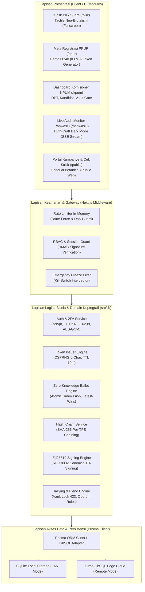
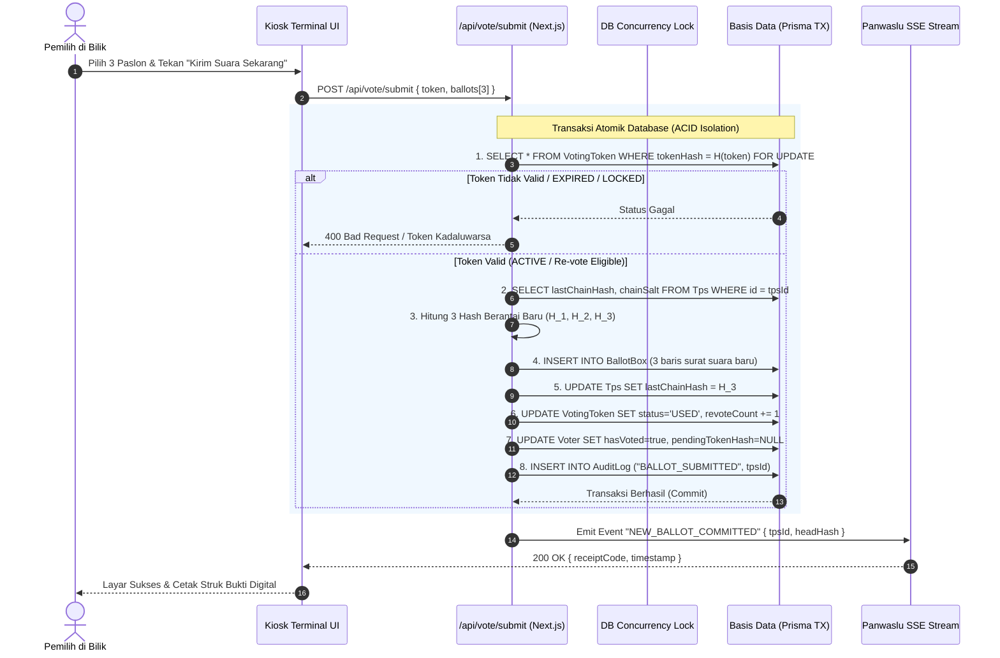

# DOKUMEN ARSITEKTUR PERANGKAT LUNAK (SOFTWARE ARCHITECTURE DOCUMENT - SAD)

## SISTEM E-VOTING SMART PEMIRA — POLITEKNIK KELAPA SAWIT CITRA WIDYA EDUKASI
**Dokumen Referensi**: SP-CWE-DOC-06  
**Klasifikasi**: Rekayasa Perangkat Lunak / Dokumen Arsitektur Sistem Produksi  
**Versi**: 1.0.0 (Master Release)  
**Model Arsitektur**: Kruchten 4+1 Architectural View Model  
**Standar Keamanan**: STRIDE Threat Modeling & Cryptographic Assurance  
**Dasar Yuridis**: UUD IKM Poltek CWE & Ketetapan DPM No. 005/DPM-CWE/KEP/VII/2024  

---

## DAFTAR ISI
1. [Pendahuluan & Sasaran Arsitektur](#1-pendahuluan--sasaran-arsitektur)
   - 1.1 [Tujuan Dokumen & Ruang Lingkup](#11-tujuan-dokumen--ruang-lingkup)
   - 1.2 [Batasan Kritis & Hukum Arsitektur Non-Negosiabel](#12-batasan-kritis--hukum-arsitektur-non-negosiabel)
2. [Model Arsitektur 4+1 View (Kruchten Model)](#2-model-arsitektur-41-view-kruchten-model)
   - 2.1 [Logical View (Struktur Logis, Layering & Dekomposisi Domain)](#21-logical-view-struktur-logis-layering--dekomposisi-domain)
   - 2.2 [Process View (Concurrency, Siklus Transaksi Atomik & Streaming SSE)](#22-process-view-concurrency-siklus-transaksi-atomik--streaming-sse)
   - 2.3 [Development View (Paket Komponen, Modularitas & Struktur Direktori)](#23-development-view-paket-komponen-modularitas--struktur-direktori)
   - 2.4 [Physical View (Topologi Jaringan LAN On-Premise vs Edge Cloud)](#24-physical-view-topologi-jaringan-lan-on-premise-vs-edge-cloud)
   - 2.5 [Scenarios (Use Case Realization & Kriptografi Alur Kunci)](#25-scenarios-use-case-realization--kriptografi-alur-kunci)
3. [Spesifikasi Kriptografi Mendalam](#3-spesifikasi-kriptografi-mendalam)
   - 3.1 [Isolasi Kriptografis Zero-Knowledge & Pemutusan Jembatan Identitas](#31-isolasi-kriptografis-zero-knowledge--pemutusan-jembatan-identitas)
   - 3.2 [Formula Matematika SHA-256 Hash Chaining per TPS](#32-formula-matematika-sha-256-hash-chaining-per-tps)
   - 3.3 [Tanda Tangan Digital Kanonikal Ed25519 (RFC 8032) untuk Berita Acara](#33-tanda-tangan-digital-kanonikal-ed25519-rfc-8032-untuk-berita-acara)
   - 3.4 [Autentikasi Dua Faktor (2FA TOTP RFC 6238) dengan Enkripsi AES-256-GCM](#34-autentikasi-dua-faktor-2fa-totp-rfc-6238-dengan-enkripsi-aes-256-gcm)
4. [Analisis Keamanan & Pemodelan Ancaman (STRIDE Threat Model)](#4-analisis-keamanan--pemodelan-ancaman-stride-threat-model)
   - 4.1 [Matriks STRIDE Komprehensif & Mitigasi Teknis](#41-matriks-stride-komprehensif--mitigasi-teknis)
   - 4.2 [Analisis Kerentanan Transien & Serangan Analisis Waktu (Side-Channel)](#42-analisis-kerentanan-transien--serangan-analisis-waktu-side-channel)
5. [Arsitektur Mesin Basis Data Dual-Mode (SQLite LAN vs Turso LibSQL Cloud)](#5-arsitektur-mesin-basis-data-dual-mode-sqlite-lan-vs-turso-libsql-cloud)
   - 5.1 [Pola Switching Dinamis Prisma Client Engine](#51-pola-switching-dinamis-prisma-client-engine)
   - 5.2 [Strategi Write-Ahead Logging (WAL) & Transaksi Bersaing](#52-strategi-write-ahead-logging-wal--transaksi-bersaing)
   - 5.3 [Ketahanan Bencana & Prosedur Segel-Reset Periode](#53-ketahanan-bencana--prosedur-segel-reset-periode)
6. [Kesimpulan Arsitektur & Rekomendasi Pemeliharaan](#6-kesimpulan-arsitektur--rekomendasi-pemeliharaan)

---

## 1. Pendahuluan & Sasaran Arsitektur

### 1.1 Tujuan Dokumen & Ruang Lingkup
Dokumen Arsitektur Perangkat Lunak (*Software Architecture Document* - SAD) ini menyajikan cetak biru teknis komprehensif bagi sistem informasi pemungutan suara terintegrasi **Smart Pemira** di Politeknik Kelapa Sawit Citra Widya Edukasi (Poltek CWE). Dokumen ini ditujukan sebagai panduan resmi bagi arsitek perangkat lunak, perekayasa keamanan sistem (*security engineer*), tim DevOps/infrastruktur, komisioner pemira, dan penguji sidang akademik tugas akhir dalam memahami setiap pertimbangan rekayasa perangkat lunak yang diimplementasikan.

### 1.2 Batasan Kritis & Hukum Arsitektur Non-Negosiabel
Sistem Smart Pemira dikembangkan di bawah 5 Hukum Arsitektur Mutlak (*Hard Constraints*) yang tidak dapat dilanggar oleh lapisan kode manapun:
1. **Hukum 1 (Zero-Knowledge Ballot Isolation)**: Tidak ada relasi kunci asing `voter_id` atau `nim` pada tabel penyimpanan suara (`ballot_boxes`) dan tabel token (`voting_tokens`). Kerahasiaan suara dijamin secara matematis seumur hidup.
2. **Hukum 2 (Atomic Ballot Submission & Single-Use Token)**: Seluruh pemrosesan suara di bilik (validasi token, pencatatan 3 surat suara berantai hash, pembaruan status pemilih, dan pencatatan log audit) wajib dieksekusi dalam satu transaksi atomik basis data (`DB Transaction`).
3. **Hukum 3 (Calon Tunggal vs Kotak Kosong)**: Jika hanya terdapat satu pasangan calon yang lolos verifikasi, sistem wajib merender opsi penantang `is_empty_box = true` (Kotak Kosong) dan memberlakukan ambang batas kemenangan $> 50\%$ suara sah sesuai Pasal 9 ayat (3) UUD IKM.
4. **Hukum 4 (Server-Side Multi-Ballot Filtering)**: Sistem secara ketat memfilter muatan data kandidat Hima program studi di sisi server sehingga pemilih jurusan tertentu tidak pernah menerima muatan data calon dari jurusan lain.
5. **Hukum 5 (Pleno Vault Lock & Emergency Freeze)**: Endpoint perolehan suara dikunci secara default (`423 Locked`) selama masa pemilihan. Akses hasil hanya dapat dibuka melalui mekanisme kriptografis pembukaan kunci sidang pleno (*Pleno Unlocking*). Seluruh sistem juga dilengkapi tombol pembekuan darurat (*Emergency Freeze*) terpusat.

---

## 2. Model Arsitektur 4+1 View (Kruchten Model)

Untuk mendokumentasikan sistem dari berbagai sudut pandang pemangku kepentingan, Smart Pemira menggunakan model standar **Kruchten 4+1 View**:

```
                      +-----------------------------+
                      |       USE CASE SCENARIOS    |
                      |   (Perilaku Sistem Kunci)   |
                      +--------------+--------------+
                                     |
         +---------------------------+---------------------------+
         |                           |                           |
         v                           v                           v
+-----------------+         +-----------------+         +-----------------+
|   LOGICAL VIEW  |         |   PROCESS VIEW  |         | DEVELOPMENT VIEW|
| (Lapisan Domain,|         |  (Konkurensi &  |         | (Paket Kode &   |
|  Abstraksi Data)|         |   Transaksi)    |         |  Dependensi)    |
+-----------------+         +-----------------+         +-----------------+
         |                           |                           |
         +---------------------------+---------------------------+
                                     |
                                     v
                            +-----------------+
                            |  PHYSICAL VIEW  |
                            | (Topologi LAN & |
                            |  Server Edge)   |
                            +-----------------+
```

---

### 2.1 Logical View (Struktur Logis, Layering & Dekomposisi Domain)

Logical View menguraikan dekomposisi sistem ke dalam lapisan-lapisan arsitektur modular (*Clean Layered Architecture*) yang memisahkan antara antarmuka pengguna, logika orkestrasi bisnis, layanan domain kriptografi, dan persistensi data.



#### Komponen Utama Logical View:
1. **Presentation Layer**: Dibangun menggunakan Next.js App Router dengan pemisahan rute berbasis kelompok otorisasi:
   * `(kiosk)`: Antarmuka bilik pemilih ergonomis layar sentuh dengan isolasi navigasi.
   * `(ppur)`: Antarmuka meja registrasi split bento untuk pencarian DPT dan pencetakan slip token.
   * `(kpum)`: Panel kontrol eksekutif pemira dan otorisasi sidang pleno.
   * `(panwaslu)`: Panel live audit stream bertema gelap (`.theme-pleno-dark`).
   * `(public)`: Portal informasi kampanye mahasiswa dan fasilitas verifikasi struk mandiri.
2. **Gateway Layer**: Bertindak sebagai garis pertahanan terluar yang memeriksa status *Emergency Freeze*, membatasi laju permintaan (*Rate Limiting* berbasis sliding window), dan memvalidasi token sesi HMAC petugas.
3. **Service Layer**: Mengimplementasikan logika pemira secara deterministik tanpa dependensi eksternal yang rentan:
   * `token-generator.ts`: Pembangkitan token CSPRNG bebas karakter ambigu.
   * `ballot-hash-chain.ts`: Pemeliharaan dan audit rantai hash SHA-256 per TPS.
   * `ba-signing.ts`: Penandatanganan digital kanonikal Berita Acara berbasis Ed25519.
   * `totp.ts`: Otentikasi dua faktor RFC 6238 dengan enkripsi at-rest AES-256-GCM.
4. **Data Access Layer**: Memanfaatkan Prisma ORM yang dipadukan dengan `@prisma/adapter-libsql` untuk menyediakan fleksibilitas penyimpanan lokal maupun cloud terdistribusi.

---

### 2.2 Process View (Concurrency, Siklus Transaksi Atomik & Streaming SSE)

Process View memodelkan aspek dinamika eksekusi sistem, konkurensi antar proses, jaminan integritas ACID, dan alur pengiriman data waktu-nyata (*real-time*).



#### Karakteristik Proses Kritis:
1. **Isolasi Transaksional Penuh (Serializable/Immediate)**:
   Setiap surat suara yang masuk mengunci pointer rantai TPS (`Tps.lastChainHash`) secara sekuensial. Hal ini mencegah terjadinya *race condition* atau *forking* rantai suara saat dua bilik suara mengirimkan coblosan pada milidetik yang sama.
2. **Pembersihan Jembatan Transien Seketika**:
   Nilai `pendingTokenHash` pada tabel `Voter` dihapus secara permanen di dalam transaksi yang sama. Tidak ada kondisi balapan (*race condition*) di mana suara tersimpan namun penanda identitas masih tertinggal.
3. **Penyebaran Data Real-Time Non-Blocking (Server-Sent Events)**:
   Setelah transaksi commit, event disiarkan ke *Memory Bus* internal (`src/lib/server/bus.ts`). Koneksi HTTP streaming SSE pada dasbor Panwaslu menerima notifikasi instan tanpa melakukan kueri berulang (*polling free*) yang membebani kinerja basis data.

---

### 2.3 Development View (Paket Komponen, Modularitas & Struktur Direktori)

Development View menyajikan tata kelola kode sumber pada repositori produksi `Smart-Pemira-PoltekCWE`, mengorganisasikan modul berdasarkan batasan domain (*bounded contexts*):

```
src/
├── app/                                # Next.js App Router (Routing & Halaman)
│   ├── (kiosk)/                        # Lingkungan Bilik Suara Mandiri
│   │   └── bilik/                      # Step 1: Gate Token -> Step 2: Ballots -> Step 3: Review -> Step 4: Success
│   ├── (ppur)/                         # Lingkungan Meja Registrasi TPS
│   │   └── ppur/                       # Pencarian DPT, Check-in KTM, & Slip Token Printer
│   ├── (kpum)/                         # Lingkungan Komisioner Penyelenggara
│   │   └── kpum/                       # Manajemen DPT, Paslon, Vault Gate, & Berita Acara
│   ├── (panwaslu)/                     # Lingkungan Badan Pengawas Pemira
│   │   └── panwaslu/                   # Live Audit Rantai Hash, Logs, & Laporan Sengketa
│   ├── (public)/                       # Lingkungan Terbuka Mahasiswa
│   │   └── verify/                     # Audit Mandiri Struk Suara oleh Pemilih
│   └── api/                            # REST API Endpoints & SSE Streams
│       ├── auth/                       # Login Petugas, Logout, Session Profile, 2FA
│       ├── bilik/                      # Validasi Token & Submit Suara Zero-Knowledge
│       ├── pleno/                      # Buka Kunci Hasil Suara & Download Berita Acara PDF
│       └── sse/                        # Real-Time Event Stream Monitor Panwaslu
├── components/                         # Pustaka Komponen Antarmuka Pengguna
│   ├── ui/                             # Komponen Primitif (TactileButton, BentoCard, Badge)
│   ├── kiosk/                          # Komponen Khusus Bilik (BallotCard, EmptyBox, Keypad)
│   ├── ppur/                           # Komponen Meja Registrasi (TokenSlipModal, QueueTable)
│   └── pleno/                          # Komponen Sidang Pleno (TurnoutBar, HashVerifier)
├── lib/                                # Core Engine & Modul Kriptografi Sistem
│   ├── crypto/                         # Algoritma Kriptografi Dasar
│   │   ├── ballot-hash-chain.ts        # SHA-256 Hash Chaining & Chain Integrity Verifier
│   │   ├── receipt.ts                  # Voter Receipt Generator & Validator
│   │   ├── time-jitter.ts              # Cryptographic Microsecond Jitter Injection
│   │   └── token-generator.ts          # CSPRNG Crockford-Base32 6-Character Token
│   ├── server/                         # Layanan Server-Side Khusus
│   │   ├── ba-signing.ts               # Ed25519 Keypair Generation, Signing & Verification
│   │   ├── ba-canonical.ts             # Deterministic Canonical C-KWE Text Normalization
│   │   ├── totp.ts                     # RFC 6238 TOTP, AES-256-GCM Secret Encryption, scrypt
│   │   ├── bus.ts                      # Internal Pub/Sub In-Memory Event Dispatcher
│   │   └── rate-limit.ts               # Sliding Window Rate Limiting Engine
│   ├── db.ts                           # Dual-Mode Prisma Client Singleton Factory
│   └── types.ts                        # Definisi Tipe Data TypeScript Statis
└── styles/
    └── globals.css                     # Variabel CSS Tema Neo-Editorial Botanical
```

---

### 2.4 Physical View (Topologi Jaringan LAN On-Premise vs Edge Cloud)

Physical View menggambarkan topologi penyebaran perangkat keras, konfigurasi server kampus, dan alokasi jaringan fisik saat hari pemungutan suara berlangsung:

```
+---------------------------------------------------------------------------------------------------+
|                           TOPOLOGI FISIK ON-PREMISE (LAN TERTUTUP KAMPUS CWE)                     |
+---------------------------------------------------------------------------------------------------+
|                                                                                                   |
|  [ ZONA BILIK TPS: VLAN 10 ]        [ ZONA REGISTRASI: VLAN 20 ]       [ ZONA MONITORING: VLAN 30]|
|  - 5-10 Tablet Kiosk Layar Sentuh   - 3-5 Laptop Meja PPUR             - Layar Monitor Panwaslu   |
|  - IP: 192.168.10.x                 - IP: 192.168.20.x                 - Layar Proyektor Pleno    |
|  - Locked Kiosk Browser             - USB Thermal Printer Slip         - IP: 192.168.30.x         |
|  - No External Internet             - Barcode/KTM Scanner              - Read-Only Dashboard      |
|             \                                    |                                    /           |
|              \                                   |                                   /            |
|               +----------------------------------+----------------------------------+             |
|                                                  |                                                |
|                                                  v                                                |
|                                   [ CISCO MANAGED GIGABIT SWITCH ]                                |
|                                                  |                                                |
|                                                  v                                                |
|                   +--------------------------------------------------------------+                |
|                   |           SERVER UTAMA ON-PREMISE ITPO (BAAK POLTEK CWE)     |                |
|                   |  - Reverse Proxy: Caddy v2 (SSL Termination & HTTP/2)        |                |
|                   |  - Application Engine: Next.js Runtime (Node.js LTS / Bun)   |                |
|                   |  - Primary DB: SQLite Local NVMe (WAL Mode Enabled)          |                |
|                   |  - Cryptographic Keystore: /keys/ba-signing-key.json (0600)  |                |
|                   +------------------------------+-------------------------------+                |
|                                                  |                                                |
|                                                  | (Optional Synchronous Replicate)               |
|                                                  v                                                |
|                   +--------------------------------------------------------------+                |
|                   |      BACKUP / EDGE CLOUD: TURSO LIBSQL DISTRIBUTED REPLICA   |                |
|                   |  - Sync Protocol: WebSocket / HTTPS TLS 1.3                  |                |
|                   |  - Target: LibSQL Cloud Cluster (Disaster Recovery Cold-Site)|                |
|                   +--------------------------------------------------------------+                |
+---------------------------------------------------------------------------------------------------+
```

#### Keunggulan Topologi Fisik Ini:
1. **Isolasi Penuh dari Ancaman Internet Luar**:
   Selama jam pemungutan suara di kampus, *managed switch* dapat memutus gateway internet publik. Kiosk dan meja PPUR berkomunikasi murni di dalam jaringan lokal (*Air-Gapped LAN*), sehingga serangan peretasan dari luar negeri, botnet, atau DDoS eksternal tidak mungkin menembus sistem.
2. **Kekebalan dari Kegagalan Internet Provider**:
   Jika jaringan kabel fiber optik kampus terputus, pemungutan suara di bilik tetap berlangsung $100\%$ normal di atas basis data lokal NVMe.
3. **Penyimpanan Kunci Privat Terisolasi**:
   Kunci privat Ed25519 (`/keys/ba-signing-key.json`) disimpan dengan izin akses berkas ketat (*permission* `0600`) dan tidak pernah dikirimkan ke klien peramban web.

---

### 2.5 Scenarios (Use Case Realization & Kriptografi Alur Kunci)

Berikut adalah realisasi terpadu skenario use case kritis yang menghubungkan seluruh view:

#### Skenario 1: Penerbitan Token & Check-In Pemilih di PPUR
1. Mahasiswa menunjukkan KTM fisik kepada petugas PPUR di meja registrasi.
2. Petugas memindai barcode NIM mahasiswa. Sistem memanggil `SELECT * FROM Voter WHERE nim = :nim`.
3. Sistem memverifikasi mahasiswa berstatus `BELUM_MEMILIH` dan `hasVoted = false`.
4. Mesin `token-generator.ts` mengeksekusi CSPRNG, menghasilkan token plaintext $T_{\text{plain}} = \texttt{"K9X2P7"}$.
5. Sistem menghitung $T_{\text{hash}} = \text{SHA-256}(T_{\text{plain}})$.
6. Dalam transaksi DB, sistem menyimpan $T_{\text{hash}}$ ke tabel `VotingToken` (status `ACTIVE`, TTL 10 menit) dan mencatat referensi transien `pendingTokenHash` pada tabel `Voter`.
7. Meja PPUR mencetak slip kertas kecil berisi $T_{\text{plain}}$, barcode QR, dan countdown waktu kedaluwarsa. Mahasiswa dipersilakan menuju bilik suara.

#### Skenario 2: Pemilihan Suara di Bilik Kiosk & Isolasi Zero-Knowledge
1. Mahasiswa mengetikkan token 6-karakter di layar sentuh Kiosk.
2. Server mencocokkan hash token. Menemukan prodi pemilih adalah `TRPL`.
3. Kiosk menampilkan 3 surat suara berurutan: Presma-Wapresma (BEM), Pimpinan DPM, dan Hima TRPL (difilter dari server).
4. Mahasiswa mencoblos pilihannya, meninjau ulang pada layar ringkasan (*Review Screen*), lalu menekan tombol konfirmasi.
5. Server mengeksekusi transaksi atomik (Hukum 2):
   * 3 surat suara disisipkan ke `BallotBox` beserta perhitungan hash berantai SHA-256 per TPS.
   * `VotingToken.status` diperbarui menjadi `USED`.
   * `Voter.pendingTokenHash` disetel menjadi `NULL` (pemutusan jembatan identitas permanen).
   * `AuditLog` mencatat rekaman kedatangan suara tanpa memuat nama calon.
6. Kiosk mencetak/menampilkan struk bukti suara (*Voter Receipt*) berkode verifikasi kriptografis.

#### Skenario 3: Pelaksanaan Re-Vote (Model Estonia / Coercion Resistance)
1. Jika seorang mahasiswa merasa dipaksa oleh pihak tertentu saat memilih di bilik, mahasiswa berhak kembali ke meja PPUR sebelum pemilihan ditutup untuk meminta pembukaan bilik ulang menggunakan token yang sama.
2. Mahasiswa memasukkan kembali token miliknya di bilik suara.
3. Kiosk mendeteksi token berstatus `USED` namun belum dikunci (`lockedAt IS NULL`). Kiosk mengizinkan pemilih mencoblos ulang.
4. Suara baru dicatat di `BallotBox` dengan nilai `voteVersion = 2`.
5. Saat perhitungan suara pleno, kueri agregasi hanya mengambil record dengan `voteVersion` tertinggi (suara terakhirlah yang dihitung sah).

#### Skenario 4: Pembukaan Kunci Sidang Pleno & Tanda Tangan Kanonikal Ed25519
1. Pemungutan suara ditutup resmi oleh Ketua KPUM melalui penutupan gerbang Kiosk (`votingOpen = false`).
2. Dalam Sidang Pleno terbuka di hadapan Panwaslu, DPM, dan Saksi Paslon, Ketua KPUM menginputkan kunci rahasia sidang pleno.
3. Endpoint `/api/pleno/unlock` mengubah flag `plenoUnlocked = true`.
4. Sistem mengeksekusi rekapitulasi suara secara transparan (*Tallying Engine*).
5. Sistem menyusun naskah Berita Acara kanonikal C-KWE deterministik (`ba-canonical.ts`).
6. Kunci privat Ed25519 menandatangani naskah kanonikal tersebut, menghasilkan string tanda tangan digital base64 yang disimpan permanen ke kolom `baSignatureEd25519`.
7. Sistem menerbitkan berkas PDF Berita Acara yang memuat QR Code tanda tangan digital untuk diverifikasi oleh publik secara mandiri.

---

## 3. Spesifikasi Kriptografi Mendalam

### 3.1 Isolasi Kriptografis Zero-Knowledge & Pemutusan Jembatan Identitas
Sistem membuktikan ketiadaan relasi antara identitas pemilih dan surat suara melalui prinsip keterpisahan kriptografis:
* **Entitas Identitas**: Menampung NIM, Nama, dan status pemilih (`hasVoted`). Identitas ini bersifat publik dan diawasi oleh saksi untuk mencegah pemilih ganda.
* **Entitas Kredensial Bilik**: Token 6 karakter acak $T_{\text{plain}} \in \Sigma^6$. Basis data hanya menyimpan $H(T_{\text{plain}})$.
* **Entitas Suara**: Menampung pilihan paslon dan tanda rantai integritas. Berdiri sendiri tanpa kunci asing ke pemilih.

$$\text{Hubungan}(Voter, BallotBox) = \emptyset$$

Satu-satunya tautan sementara adalah kolom `pendingTokenHash` pada `Voter` saat mahasiswa mengantre dari meja PPUR menuju bilik suara. Pada milidetik pengiriman suara, kolom ini di-`NULL`-kan di dalam blok transaksi atomik yang sama.

### 3.2 Formula Matematika SHA-256 Hash Chaining per TPS
Untuk mendeteksi setiap upaya manipulasi atau penyisipan baris data liar (*tampering/insertion attack*) langsung pada berkas basis data, setiap TPS memelihara rantai hash kriptografis berantai:

$$H_0 = \text{""} \quad (\text{Genesis State})$$
$$H_i = \text{SHA-256}\Big( H_{i-1} \parallel \text{ballotId} \parallel \text{category} \parallel (\text{candidateId} \lor \texttt{"NULL"}) \parallel (\text{isEmptyBox} \,?\, \texttt{"EMPTY\_BOX"} : \texttt{"CANDIDATE"}) \parallel \text{createdAt}_{\text{ISO}} \parallel \text{tpsSalt} \Big)$$

Dimana:
* $\parallel$ adalah operator penggabungan string dengan delimiter pemisah `||`.
* $H_{i-1}$ adalah nilai hash surat suara sebelumnya dalam rantai TPS terkait.
* $\text{tpsSalt}$ adalah garam rahasia 32-byte heksadesimal per TPS yang disimpan pada kolom `Tps.chainSalt`.

Jika seorang penyerang mengubah satu karakter kandidat pada baris suara ke-$k$, maka seluruh hash turunan $H_k, H_{k+1}, \dots, H_n$ akan runtuh (*avalanche effect*). Modul `HashChainVerifier` di monitor Panwaslu akan langsung membunyikan alarm integritas (`brokenAtIndex = k`).

### 3.3 Tanda Tangan Digital Kanonikal Ed25519 (RFC 8032) untuk Berita Acara
Keaslian dan keabsahan Berita Acara C-KWE dilindungi menggunakan skema tanda tangan digital kunci publik asimetris **Ed25519 (Edwards-curve Digital Signature Algorithm)** sesuai spesifikasi standar **RFC 8032**:

```
+---------------------------------------------------------------------------------------------------+
|                        ALUR TANDA TANGAN ELEKTRONIK KANONIKAL ED25519                             |
+---------------------------------------------------------------------------------------------------+
|                                                                                                   |
|  [ DATA REKAPITULASI RESMI PLENO ]                                                                |
|  - Rekapitulasi Suara BEM, DPM, HIMA                                                              |
|  - Head Rantai 5 TPS Virtual (SHA-256)                                                            |
|  - Total DPT Hadir & Suara Sah                                                                    |
|                  |                                                                                |
|                  v                                                                                |
|  [ NORMALISASI KANONIKAL DETERMINISTIK (ba-canonical.ts) ]                                        |
|  - Pembersihan whitespace & line-break LF (\n) standar                                            |
|  - Pengurutan leksikografis parameter berita acara                                                |
|                  |                                                                                |
|                  +-----------------------+                                                        |
|                  | Teks Kanonikal Murni  |                                                        |
|                  +-----------+-----------+                                                        |
|                              |                                                                    |
|                              v                                                                    |
|  [ ED25519 SIGNING WITH PRIVATE KEY (keys/ba-signing-key.json) ]                                  |
|  Signature = Ed25519_Sign(PrivateKey_ITPO, Canonical_Text)                                        |
|                              |                                                                    |
|                              v                                                                    |
|  [ OUTPUT TANDA TANGAN DIGITAL: Base64 String ]                                                   |
|  - Disimpan ke DB: ElectionSetting.baSignatureEd25519                                             |
|  - Dicetak sebagai QR Code Verifikasi pada Dokumen PDF Berita Acara                               |
|                              |                                                                    |
|                              v                                                                    |
|  [ VERIFIKASI ASIMETRIS OLEH PUBLIK / AUDITOR ]                                                   |
|  Valid = Ed25519_Verify(PublicKey_Publik, Canonical_Text, Signature)                              |
|  (Dapat diverifikasi oleh siapa saja di seluruh dunia TANPA rahasia apa pun!)                     |
+---------------------------------------------------------------------------------------------------+
```

#### Spesifikasi Kanonikal Deterministik:
Naskah kanonikal disusun secara eksak tanpa ambiguitas karakter menggunakan format:
```text
PEMIRA-POLTEK-CWE-CANONICAL-v1
PERIODE:Pemira Poltek CWE 2026
DPT:1240
HADIR:892
SUARA_SAH:892
RANTAI_TPTP:8f1a...b942
RANTAI_TPHP:c302...71e4
RANTAI_MANLOG:e549...33aa
RANTAI_BD:1290...88ff
RANTAI_TRPL:a78c...4021
WAKTU_SELESAI:2026-11-06T15:00:00.000Z
```

### 3.4 Autentikasi Dua Faktor (2FA TOTP RFC 6238) dengan Enkripsi AES-256-GCM
Akun pengelola sistem (Operator KPUM, Panwaslu, ITPO) dilindungi autentikasi dua faktor (*Two-Factor Authentication*) berbasis **Time-Based One-Time Password (TOTP RFC 6238)**:
1. **Pembangkitan Secret Base32**: Menggunakan 20 byte acak CSPRNG yang dienkode menjadi 32 karakter base32 (`A-Z2-7`).
2. **Enkripsi At-Rest (AES-256-GCM)**: Secret TOTP yang tersimpan di basis data **wajib dienkripsi secara simetris** menggunakan AES-256-GCM dengan kunci turunan dari `sessionSecret` master:
   $$K_{\text{AES}} = \text{SHA-256}(\texttt{"pemira-totp-aes:"} \parallel \text{sessionSecret})$$
   Kolom `totpSecret` pada tabel `Operator` menyimpan format gabungan:
   $$\texttt{iv (12 bytes b64)} : \texttt{authTag (16 bytes b64)} : \texttt{ciphertext (b64)}$$
   Hal ini menjamin bahwa kebocoran cadangan basis data (*database leak*) tidak akan membuka kunci faktor kedua petugas.
3. **Kode Cadangan Sekali Pakai (Backup Codes)**: Sistem menerbitkan 8 kode cadangan berformat `XXXX-XXXX`. Setiap kode cadangan di-hash menggunakan algoritma berbobot tinggi **scrypt** (`scrypt(code, salt, 32)`). Kode cadangan yang telah digunakan langsung dihapus dari array JSON.

---

## 4. Analisis Keamanan & Pemodelan Ancaman (STRIDE Threat Model)

### 4.1 Matriks STRIDE Komprehensif & Mitigasi Teknis

| Kategori Ancaman | Potensi Skenario Serangan | Dampak Risiko | Mitigasi Teknis dalam Arsitektur Smart Pemira |
| :--- | :--- | :---: | :--- |
| **Spoofing** (Pemalsuan Identitas) | Mahasiswa mencoba login ke bilik suara menggunakan NIM teman atau operator palsu mengakses modul KPUM. | **Tinggi** | 1. Pemilih di bilik tidak login dengan NIM, melainkan token 6-digit CSPRNG dari verifikasi fisik KTM di PPUR.<br>2. Operator dilindungi kata sandi scrypt, sesi HMAC bertanda tangan, dan 2FA TOTP (RFC 6238). |
| **Tampering** (Manipulasi Data) | Peretas atau oknum internal mengubah baris data perolehan suara paslon langsung pada tabel database. | **Kritis** | 1. Penerapan rantai hash SHA-256 berantai per TPS (`ballotHash`). Setiap perubahan data akan merusak rantai secara matematis.<br>2. Kanonikal Berita Acara disegel tanda tangan digital Ed25519.<br>3. Log audit bersifat *append-only*. |
| **Repudiation** (Penyangkalan) | Saksi atau komisioner menyangkal telah menyetujui hasil perhitungan suara sidang pleno. | **Sedang** | 1. Dokumen Berita Acara ditandatangani secara kriptografis menggunakan kunci privat sistem.<br>2. Setiap aksi admin dicatat dalam `AuditLog` yang mencantumkan nama operator, IP, dan timestamp server. |
| **Information Disclosure** (Kebocoran Data) | Pengawas atau DBA membongkar basis data untuk melihat siapa mencoblos siapa (pilihan politik mahasiswa). | **Kritis** | 1. Hukum 1: Ketiadaan relasi Foreign Key antara pemilih dan kotak suara.<br>2. Pembersihan jembatan transien `pendingTokenHash` seketika saat vote dikirim.<br>3. Injeksi timestamp jittering ($\pm 3-8$ dtk) untuk mencegah korelasi waktu. |
| **Denial of Service** (Kelumpuhan Layanan) | Penyerang mengirimkan jutaan request ke bilik suara atau meja PPUR untuk melumpuhkan pemilihan. | **Tinggi** | 1. Jaringan On-Premise LAN terisolasi dari internet luar kampus.<br>2. Rate Limiting sliding window in-memory pada middleware.<br>3. Engine basis data lokal NVMe WAL mode mampu melayani ribuan read/sec tanpa bottleneck jaringan. |
| **Elevation of Privilege** (Eskalasi Wewenang) | Petugas meja registrasi PPUR mencoba mengeksekusi fitur buka kunci pleno atau menghapus DPT. | **Tinggi** | 1. RBAC Middleware ketat: Pemeriksaan peran (`KPUM, PPUR, PANWASLU, SAKSI, ITPO`) pada setiap handler rute.<br>2. Kunci sesi dienkripsi HMAC dengan rahasia server. |

### 4.2 Analisis Kerentanan Transien & Serangan Analisis Waktu (Side-Channel)
Salah satu serangan paling berbahaya pada sistem e-voting anonim adalah **Side-Channel Timing Correlation Attack**:
* **Vektor Serangan**: Penyerang mengamati waktu saat mahasiswa $A$ check-in di meja PPUR (misal: `10:02:14`). Kemudian penyerang memeriksa tabel `BallotBox` dan menemukan ada suara masuk pada `10:02:35`. Penyerang menyimpulkan suara tersebut adalah milik mahasiswa $A$.
* **Mitigasi Smart Pemira**:
  1. *Randomized Time Jittering*: Modul `src/lib/crypto/time-jitter.ts` menambahkan selisih waktu acak kriptografis sebelum nilai waktu disimpan ke kolom `createdAt`.
  2. *Shuffled Transaction Order*: Urutan penulisan ketiga surat suara (Presma, DPM, Hima) diacak posisinya dalam transaksi basis data.
  3. *Independent ID Generation*: ID surat suara menggunakan `crypto.randomUUID()` murni, bukan auto-increment yang memaparkan urutan kronologis.

---

## 5. Arsitektur Mesin Basis Data Dual-Mode (SQLite LAN vs Turso LibSQL Cloud)

### 5.1 Pola Switching Dinamis Prisma Client Engine
Smart Pemira menerapkan pola arsitektur basis data adaptif di dalam `src/lib/db.ts`:

```typescript
function createPrismaClient(): PrismaClient {
  const rawDbUrl = process.env.DATABASE_URL;
  const tursoUrl = process.env.TURSO_DATABASE_URL || 
    (rawDbUrl?.startsWith('libsql:') || rawDbUrl?.startsWith('https:') ? rawDbUrl : undefined);
  const tursoAuthToken = process.env.TURSO_AUTH_TOKEN;

  // MODE B: Turso LibSQL Cloud (Edge / Replicated Distributed Network)
  if (tursoUrl) {
    const adapter = new PrismaLibSql({
      url: tursoUrl,
      authToken: tursoAuthToken,
    });
    return new PrismaClient({ adapter });
  }

  // MODE A: SQLite Local File (On-Premise Isolated LAN)
  return new PrismaClient();
}
```

#### Perbandingan Karakteristik Mode:

| Parameter Evaluasi | Mode A: SQLite On-Premise LAN | Mode B: Turso LibSQL Cloud |
| :--- | :--- | :--- |
| **Lokasi Penyimpanan** | Berkas NVMe lokal (`file:./prisma/dev.db`) | Kluster Edge terdistribusi via HTTPS/WebSocket |
| **Latensi Akses Rata-Rata**| $< 1.0\text{ milidetik}$ (Ultra Fast) | $15 - 40\text{ milidetik}$ (Bergantung latensi ISP) |
| **Ketergantungan Internet**| **Nol (0%)** — Berjalan di LAN tertutup | Memerlukan konektivitas internet stabil |
| **Ketahanan Serangan Luar**| Maksimal (Kebal serangan siber eksternal) | Memerlukan proteksi firewall cloud / Cloudflare |
| **Kasus Penggunaan Ideal**| **Hari-H Pemungutan Suara di Bilik Kampus** | **Masa Publikasi Hasil & Verifikasi Pasca-Pleno** |

### 5.2 Strategi Write-Ahead Logging (WAL) & Transaksi Bersaing
Pada mode SQLite lokal, konfigurasi mesin basis data dioptimasi dengan mode jurnal **Write-Ahead Logging (WAL)**:
* `PRAGMA journal_mode = WAL;` — Memungkinkan operasi pembacaan data (*concurrent reads*) berjalan simultan tanpa memblokir operasi penulisan (*writes*).
* `PRAGMA synchronous = NORMAL;` — Menjaga keseimbangan antara integritas penyimpanan biner ke disk dan kecepatan transaksi bilik.
* `PRAGMA busy_timeout = 5000;` — Toleransi antrean kunci transaksi hingga 5 detik sebelum melempar error.
* Modul `src/lib/server/db-retry.ts` membungkus setiap transaksi kritis dengan mekanisme *exponential backoff retry* hingga 3 kali percobaan untuk mengeliminasi potensi kegagalan transaksi akibat *concurrency lock*.

### 5.3 Ketahanan Bencana & Prosedur Segel-Reset Periode
Smart Pemira menyediakan prosedur pemulihan bencana (*Disaster Recovery*) dan siklus suksesi kepengurusan melalui mekanisme **"Segel & Reset" (Seal & Reset)**:
1. **Penyegelan Permanen**: Seluruh hasil suara, data paslon, snapshot log audit, laporan sengketa, dan 5 head rantai hash TPS dikemas ke dalam satu baris arsip pada tabel `ElectionArchive`.
2. **Penandatanganan Arsip**: Naskah arsip disegel secara kriptografis menggunakan Ed25519.
3. **Inisialisasi Lembar Baru**: Tabel transaksi aktif (`BallotBox`, `VotingToken`, `AuditLog`, `ElectionIncident`) dikosongkan untuk gelombang berikutnya, sementara riwayat masa lalu tersimpan abadi dan tidak dapat diubah (*tamper-proof cold archive*).

---

## 6. Kesimpulan Arsitektur & Rekomendasi Pemeliharaan

Arsitektur perangkat lunak Smart Pemira Poltek CWE telah dirancang dengan mengedepankan prinsip keandalan, transparansi, kepatuhan konstitusi kemahasiswaan, dan kerahasiaan kriptografis mutlak (*Zero-Knowledge Anonymity*). Sistem ini siap dioperasikan dalam skala penuh untuk pemilihan pimpinan eksekutif dan legislatif mahasiswa di Politeknik Kelapa Sawit Citra Widya Edukasi.

### Rekomendasi Operasional bagi Tim ITPO:
1. **Penyimpanan Kunci Privat**: Salinan berkas `keys/ba-signing-key.json` wajib di-backup secara aman pada media penyimpanan eksternal fisik terenkripsi (USB Flash Drive hardware-encrypted) dan disimpan di brankas Sekretariat KPUM/DPM.
2. **Gladi Resik & Uji Beban**: Lakukan simulasi gladi resik skala penuh (*Mock Voting Drill*) dengan script `scripts/load-test.ts` untuk memastikan performa throughput server minimal 50 transaksi per detik sebelum hari-H pemilihan.
3. **Penyegelan Pasca-Pleno**: Segera eksekusi fitur "Segel Periode" setelah Berita Acara ditandatangani untuk mengunci status basis data ke dalam arsip resmi permanen.

---
*Disahkan untuk Dokumen Arsitektur Perangkat Lunak Smart Pemira Poltek CWE.*  
**Lead Software Architect & Tim Teknologi Informasi Pemira Online (ITPO)**  
*Kampus Politeknik Kelapa Sawit Citra Widya Edukasi, Bekasi.*
