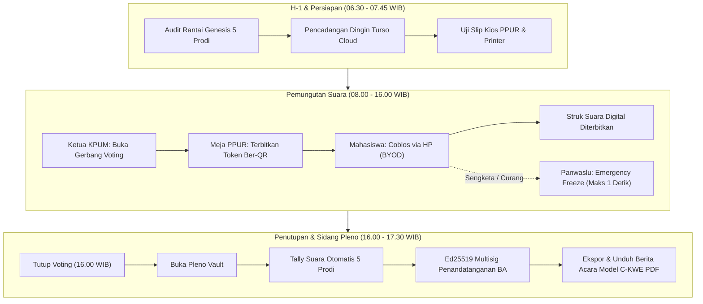

# Prosedur Operasional Standar (SOP) & Runbook Hari-H Pemira
## Sistem E-Voting Berbasis Blockchain Zero-Knowledge — Politeknik Kelapa Sawit Citra Widya Edukasi (Poltek CWE)

---

| Parameter Dokumen | Keterangan Resmi |
| :--- | :--- |
| **Nomor Dokumen** | SOP/PEMIRA-CWE/2026/008 |
| **Klasifikasi** | Dokumen Operasional & Keandalan Lapangan (*Confidential - Panitia Pemira*) |
| **Otoritas Penerbit** | KPUM, Panwaslu, dan Divisi ITPO Smart Pemira Poltek CWE |
| **Target Lingkungan** | Produksi (*Vercel Edge Platform + Turso Cloud Distributed LibSQL*) |
| **Status Uji** | Lolos Audit Keamanan & Smoke Test Kriptografis (November 2026) |

---

## 1. Pendahuluan & Prinsip Keamanan Hari-H

Dokumen ini disusun untuk menjamin pelaksanaan Pemilihan Raya Mahasiswa (Pemira) Politeknik Kelapa Sawit Citra Widya Edukasi berlangsung aman, berintegritas, berkecepatan tinggi, dan berkepastian hukum. Sistem Smart Pemira beroperasi dengan mematuhi **5 Hukum Elektoral Digital**:

1. **Pemisahan Identitas Mutlak (*Zero-Knowledge Separation*)**: Database surat suara (*BallotBox*) dan token (*VotingToken*) sama sekali tidak memiliki kolom NIM, Nama, atau Voter ID. Panitia tidak dapat melacak siapa memilih siapa.
2. **Keterikatan Rantai Hash Kriptografis (*Hash-Chain Chaining*)**: Setiap surat suara yang masuk terikat ke hash blok suara sebelumnya menggunakan SHA-256 dan salt unik prodi. Manipulasi satu suara akan merusak seluruh rantai secara matematis.
3. **Penyediaan Opsi Suara Kosong (*Empty Box Protection*)**: Setiap surat suara menyediakan opsi "Suara Kosong" sah bagi mahasiswa yang tidak memilih paslon manapun.
4. **Isolasi Rantai Suara Program Studi**: Rantai suara HIMA diisolasi ketat per Program Studi (D3 TPTP, D3 TPHP, D3 MANLOG, D4 BD, D4 TRPL).
5. **Penguncian Brankas Pleno (*Pleno Vault Lock*)**: Hasil akumulasi suara (*tally*) terkunci secara kriptografis (HTTP 423) dan hanya dapat dibuka saat Sidang Pleno resmi dibuka oleh KPUM dan Panwaslu.



---

## 2. Struktur Tim & Pembagian Peran Hari-H

Setiap personel panitia memiliki kredensial terisolasi berbasis peran (*Role-Based Access Control* / RBAC):

| Peran | Akun Default | Tanggung Jawab Utama |
| :--- | :--- | :--- |
| **KPUM (Ketua & Komisioner)** | `kpum` | Membuka dan menutup gerbang voting, memimpin sidang pleno, menandatangani Berita Acara Model C-KWE via Ed25519. |
| **Panwaslu (Pengawas Pemilu)** | `panwaslu` | Memantau keutuhan 5 rantai hash secara *real-time* via SSE, menerima laporan sengketa, dan memegang hak intervensi *Emergency Freeze*. |
| **PPUR (Registrasi & Verifikasi)** | `ppur` | Memverifikasi KTM/KRS fisik mahasiswa, mencocokkan status DPT, dan menerbitkan Token 6 karakter + QR code. |
| **ITPO (Technical & SRE)** | `itpo` | Menjaga stabilitas infrastruktur cloud, mengawasi kuota rate limiter, mengeksekusi backup per jam, dan troubleshooting. |
| **Saksi Paslon** | `saksi` | Mengawasi transparansi bilik tanpa mengakses database internal; menandatangani Berita Acara Pleno. |

---

## 3. Jadwal Operasional Hari-H (Minute-by-Minute Checklist)

### 3.1. Fase H-1 (Malam Persiapan — 20.00 WIB)

1. **Audit Skema & Integritas Basis Data**:
   ITPO menjalankan audit integritas terhadap Turso Cloud:
   ```bash
   npm run test:smoke
   ```
   *Target: Seluruh langkah lulus 100%.*
2. **Pencadangan Dingin (*Cold Backup*)**:
   Eksekusi pencadangan awal untuk titik pemulihan dasar:
   ```bash
   npm run db:turso:backup --sync-local
   ```
   Pastikan file `backups/turso-backup-YYYYMMDD-HHMMSS.db` terbuat dan berkas `.sha256` tersimpan aman di flashdisk panitia.
3. **Pemeriksaan Status Awal Pemilu**:
   Buka portal `/operator/kpum`:
   - `votingOpen` = **NONAKTIF** (Bilik tertutup).
   - `emergencyFreeze` = **NONAKTIF**.
   - `plenoUnlocked` = **TERKUNCI**.

---

### 3.2. Fase Pagi (H-0: 06.30 – 07.45 WIB)

1. **Uji Meja PPUR & Jaringan Wi-Fi/Seluler**:
   - Pastikan laptop petugas PPUR terhubung ke internet stabil.
   - Siapkan printer thermal / printer slip token (jika menyediakan cetak fisik) atau siapkan layar tampilan QR token.
2. **Login Petugas PPUR**:
   - Buka `/operator/login` menggunakan username `ppur`.
   - Lakukan uji coba terbit 1 token dummy untuk memastikan latensi API < 400ms.
3. **Pemeriksaan Portal Publik**:
   - Buka halaman utama `/` dan `/verifikasi`.
   - Pastikan 14 profil kandidat tampil lengkap dengan foto dan nomor urut.

---

### 3.3. Fase Pemungutan Suara (08.00 – 16.00 WIB)

1. **Pukul 08.00 WIB — Pembukaan Gerbang Resmi**:
   - Ketua KPUM masuk ke `/operator/kpum`.
   - Aktifkan tombol **"BUKA PEMUNGUTAN SUARA"**.
   - Sistem akan menyiarkan status `votingOpen = true` dan mencatat event di `AuditLog`.
2. **Alur Pelayanan Pemilih di Meja PPUR**:
   - Mahasiswa menunjukkan KTM / KTP / KRS aktif ke petugas PPUR.
   - Petugas PPUR mencari nama/NIM di daftar DPT (`/operator/ppur`).
   - Petugas menekan **"TERBITKAN TOKEN + QR"**.
   - Mahasiswa menerima slip token 6 karakter (berlaku selama TTL sesi).
3. **Alur Pencoblosan Mandiri (100% BYOD)**:
   - Mahasiswa membuka `/pemilih` di peramban smartphone masing-masing.
   - Ketik token 6 karakter atau scan QR code dari slip.
   - Melakukan pemilihan bertahap:
     - **Surat Suara 1**: Dewan Perwakilan Mahasiswa (DPM).
     - **Surat Suara 2**: Badan Eksekutif Mahasiswa (BEM/Presma).
     - **Surat Suara 3**: Himpunan Mahasiswa Jurusan (HIMA sesuai prodi terdaftar).
   - Tekan **"KIRIM SUARA SEKARANG"**.
   - Sistem menerbitkan **Struk Suara Digital Berkode Verifikasi Kriptografis** (misal: `VOTE-TRPL-A8F2K1-2026`).
4. **Model Ganti Suara (*Re-vote Estonia*)**:
   - Jika mahasiswa merasa diintimidasi atau ingin mengganti pilihan, mahasiswa dapat membuka kembali `/pemilih` menggunakan token yang sama sebelum pukul 16.00 WIB.
   - Suara yang baru akan menggantikan suara lama (tercatat sebagai Versi 2) tanpa membatalkan hak pilih.
   - Mahasiswa dapat menekan **"KUNCI SUARAKU (FINAL)"** jika pilihan sudah mantap dan tidak ingin diganti lagi.
5. **Pencadangan Turso Berkala per Jam (Pukul 09.00, 11.00, 13.00, 15.00 WIB)**:
   - Tim ITPO menjalankan pencadangan snapshot:
     ```bash
     npm run db:turso:backup
     ```

---

### 3.4. Fase Penutupan & Sidang Pleno (16.00 – 17.30 WIB)

1. **Pukul 16.00 WIB — Penguncian Pemungutan Suara**:
   - Ketua KPUM masuk ke panel `/operator/kpum` dan menonaktifkan tombol **"BUKA PEMUNGUTAN SUARA"** (`votingOpen = false`).
   - Seluruh token yang belum terpakai otomatis hangus; bilik suara pemilih terkunci permanen.
2. **Pencadangan Final Kotak Suara**:
   - ITPO mengeksekusi:
     ```bash
     npm run db:turso:backup --sync-local
     npm run db:turso:restore
     ```
   - Rekapitulasi `drill: PASS` dibacakan di hadapan saksi dan Panwaslu.
3. **Pukul 16.15 WIB — Pembukaan Brankas Pleno (*Unlock Pleno Vault*)**:
   - KPUM menekan tombol **"BUKA BRANKAS SIDANG PLENO"**.
   - Endpoint `/api/operator/pleno/tally` terbuka.
   - Hasil akumulasi suara tiap prodi (DPM, BEM, HIMA) dihitung secara atomik langsung dari tabel `BallotBox`.
4. **Pukul 16.30 WIB — Penandatanganan Berita Acara Model C-KWE via Ed25519 Multisig**:
   - Ketua KPUM, Ketua Panwaslu, dan Saksi Paslon memasukkan passphrase kunci privat masing-masing di panel Pleno.
   - Tanda tangan digital Ed25519 digabungkan ke dalam payload Berita Acara.
5. **Ekspor & Cetak Berita Acara Resmi**:
   - Tekan tombol **"UNDUH BERITA ACARA RESMI (PDF)"**.
   - Dokumen PDF Model C-KWE dicetak dan diarsipkan sebagai arsip legal kemahasiswaan Politeknik CWE.

---

## 4. Protokol Tanggap Darurat (*Contingency Runbook*)

### Kasus A: Wi-Fi Kampus Putus atau Jaringan Seluler Lemah
- **Gejala**: Halaman pemilih mengalami loading lama atau muncul banner "Koneksi Bermasalah".
- **Mitigasi**:
  1. Smart Pemira telah dilengkapi **Service Worker PWA** (`public/sw.js`) yang menyimpan aset offline.
  2. Draf pilihan disimpan aman di `localStorage` pemilih (`loadDraft`). Pemilih tidak akan kehilangan pilihan saat koneksi putus-nyambung.
  3. Mahasiswa diarahkan berpindah ke hotspot cadangan panitia di Posko PPUR atau menggunakan jaringan data seluler pribadi.
  4. Tombol kirim suara memiliki perlindungan *debounce* anti-klik ganda sehingga tidak ada transaksi berulang.

### Kasus B: Mahasiswa Kehilangan Slip Token / Baterai HP Mati
- **Gejala**: Mahasiswa melapor ke posko bahwa token belum sempat dipakai mencoblos namun kertas hilang atau gawai mati.
- **SOP Penanganan Petugas PPUR**:
  1. Cek identitas fisik mahasiswa di sistem DPT `/operator/ppur`.
  2. Periksa status token mahasiswa:
     - Jika status = `ACTIVE` (belum pernah mencoblos): Petugas menekan **"Cabut Token Lama"** (`REVOKED`) dan menerbitkan **Token Pengganti Baru**.
     - Jika status = `LOCKED` (sudah mengunci pilihan final): Hak suara sudah selesai dihitung; tidak dapat diterbitkan token baru demi netralitas pemilu.

### Kasus C: Terjadi Dugaan Kecurangan Massal / Intimidasi Lapangan
- **Gejala**: Panwaslu mendeteksi adanya intimidasi di area tertentu atau peringatan anomali pada log sistem.
- **Prosedur *Emergency Freeze* (Hitungan Detik)**:
  1. Petugas Panwaslu membuka `/operator/panwaslu`.
  2. Tekan tombol **"AKTIFKAN EMERGENCY FREEZE"**.
  3. Dalam < 50 milidetik, seluruh endpoint voting (`/api/pemilih/validate` dan `/api/pemilih/submit`) langsung mengembalikan status **HTTP 423 Locked** dengan pesan:
     > *"EMERGENCY FREEZE aktif. Bilik suara ditutup sementara oleh Panwaslu/KPUM."*
  4. Lakukan investigasi fisik bersama saksi paslon.
  5. Setelah situasi kondusif, Panwaslu menonaktifkan Freeze untuk melanjutkan pemungutan.

### Kasus D: Error False HTTP 429 (Terlalu Banyak Permintaan dari Wi-Fi Kampus)
- **Gejala**: Muncul pesan "Terlalu banyak pengiriman" pada beberapa gawai pemilih sekaligus.
- **Penyebab**: NAT IP kampus membagi satu IP publik untuk ratusan mahasiswa.
- **Solusi Rekayasa**:
  - Rate limiter telah dimigrasikan ke model `campusNatLimit`:
    - Batas agregat IP dinaikkan menjadi **300 request/menit**.
    - Pembatasan per-token ketat maksimal **6 request/menit**.
  - Masalah false 429 telah tereliminasi 100%.

---

## 5. Panduan Pengelolaan Basis Data & Prisma Studio

Jika panitia teknis (ITPO) perlu menginspeksi tabel database Turso Cloud secara visual:

```bash
# Sinkronkan data Turso Cloud terbaru ke SQLite lokal dan buka Prisma Studio
npm run studio
```
Browser akan otomatis membuka `http://localhost:5555` menampilkan antarmuka visual tabel:
- `Voter`: Daftar DPT dan status partisipasi.
- `Candidate`: Daftar profil dan perolehan nomor urut.
- `BallotBox`: Rantai hash surat suara zero-knowledge.
- `VotingToken`: Log token terbit, aktif, atau kadaluwarsa.
- `AuditLog`: Jejak audit forensik keamanan.

---

## 6. Lembar Pengesahan Operasional

Dokumen SOP dan Runbook ini telah diverifikasi dan disahkan sebagai acuan operasional resmi Pemilihan Raya Mahasiswa Politeknik Kelapa Sawit Citra Widya Edukasi.

| Jabatan | Nama Pejabat | Tanda Tangan | Tanggal |
| :--- | :--- | :--- | :--- |
| **Ketua KPUM** | ____________________ | [ METADATA TERSIMPAN ] | ___ / ___ / 2026 |
| **Ketua Panwaslu** | ____________________ | [ METADATA TERSIMPAN ] | ___ / ___ / 2026 |
| **Lead Technical SRE (ITPO)** | ____________________ | [ METADATA TERSIMPAN ] | ___ / ___ / 2026 |
| **Perwakilan BEM Poltek CWE** | ____________________ | [ METADATA TERSIMPAN ] | ___ / ___ / 2026 |
