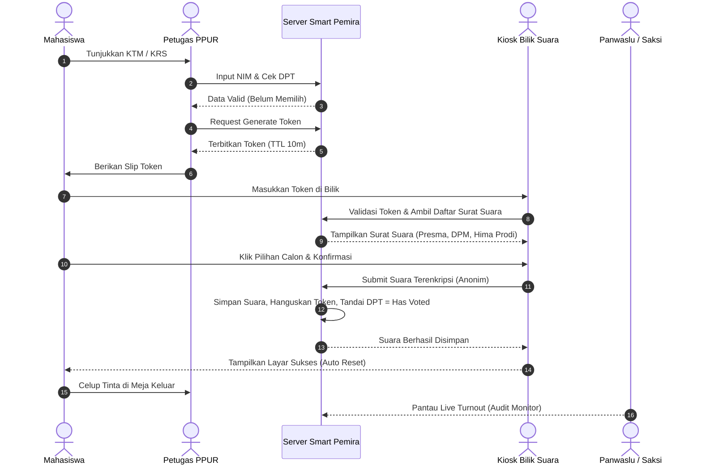
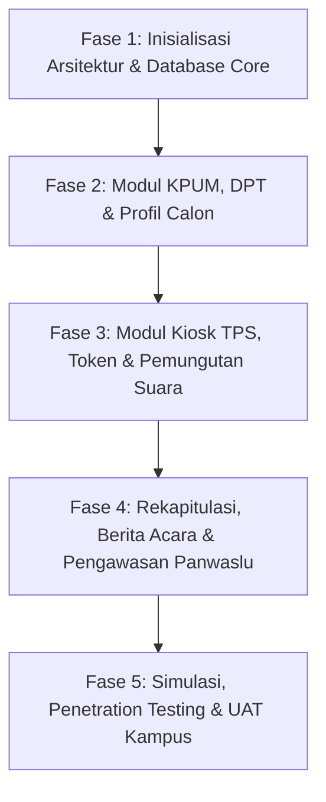

# PRODUCT REQUIREMENT DOCUMENT (PRD)
## SISTEM E-VOTING SMART PEMIRA (SMART PEMILIKAN UMUM RAYA)
### Politeknik Kelapa Sawit Citra Widya Edukasi (Poltek CWE)

---

| Dokumen | Keterangan |
| :--- | :--- |
| **Nama Proyek** | Smart Pemira (Sistem Informasi Pemilihan Umum Raya Terintegrasi) |
| **Institusi** | Ikatan Keluarga Mahasiswa Politeknik Kelapa Sawit Citra Widya Edukasi |
| **Versi Dokumen** | 1.0.0 (Master Release) |
| **Status** | Approved / Baseline Development |
| **Dasar Yuridis** | 1. Undang-Undang Dasar IKM Politeknik Kelapa Sawit Citra Widya Edukasi<br>2. Ketetapan DPM No. 005/DPM-CWE/KEP/VII/2024 (RUU Pemira) |
| **Klasifikasi Akses** | Internal Tim Pengembang (ITPO) & Penyelenggara Pemira (KPUM, DPM, Panwaslu) |

---

## DAFTAR ISI
1. [Ringkasan Eksekutif & Visi Produk](#1-ringkasan-eksekutif--visi-produk)
2. [Landasan Yuridis & Konstitusional](#2-landasan-yuridis--konstitusional)
3. [Stakeholder & Matriks Hak Akses (RBAC)](#3-stakeholder--matriks-hak-akses-rbac)
4. [Prinsip Sistem & Kebutuhan Non-Fungsional (NFR)](#4-prinsip-sistem--kebutuhan-non-fungsional-nfr)
5. [Arsitektur Alur Kerja Pemira (End-to-End Workflow)](#5-arsitektur-alur-kerja-pemira-end-to-end-workflow)
6. [Spesifikasi Kebutuhan Fungsional (Functional Requirements)](#6-spesifikasi-kebutuhan-fungsional-functional-requirements)
7. [Aturan Bisnis & Logika Pemilihan Khusus](#7-aturan-bisnis--logika-pemilihan-khusus)
8. [Arsitektur Teknis & Rekomendasi Teknologi](#8-arsitektur-teknis--rekomendasi-teknologi)
9. [Model Data Konseptual & Keamanan Suara](#9-model-data-konseptual--keamanan-suara)
10. [Rencana Implementasi & Roadmap Pengembangan](#10-rencana-implementasi--roadmap-pengembangan)

---

## 1. Ringkasan Eksekutif & Visi Produk

### 1.1 Latar Belakang
Pemilihan Umum Raya (Pemira) di lingkungan Politeknik Kelapa Sawit Citra Widya Edukasi merupakan sarana utama pelaksanaan kedaulatan mahasiswa guna memilih pimpinan eksekutif dan legislatif. Transformasi dari sistem konvensional (kertas suara manual) menuju sistem digital terpadu (**Smart Pemira**) diamanatkan oleh regulasi kemahasiswaan guna menjamin asas LUBER JURDIL (Langsung, Umum, Bebas, Rahasia, Jujur, dan Adil), menekan potensi kecurangan, mengoptimalkan transparansi, serta mempercepat proses rekapitulasi perolehan suara secara akuntabel.

### 1.2 Visi & Tujuan Produk
* **Integritas & Kerahasiaan Mutlak**: Menerapkan pemisahan mutlak antara identitas pemilih (*voter identity*) dan pilihan suara (*ballot record*) sehingga suara tidak dapat dilacak kembali ke pemilih (*Zero Knowledge Anonymity*).
* **Kepatuhan Regulasi Penuh**: Mengakomodasi seluruh amanat UUD IKM dan RUU Pemira, termasuk skema pemilihan serentak 3 kategori surat suara (Presma-Wapresma, DPM, dan Hima Prodi) serta skenario khusus (Calon Tunggal vs Kotak Kosong).
* **Model Pemungutan Suara Hibrida On-Premise (TPS Diam)**: Mengimplementasikan sistem online terkontrol di mana pemilih tetap hadir secara fisik di bilik suara TPS kampus dengan otentikasi token sekali pakai (*single-use ephemeral token*).
* **Otomasi Audit & Pelaporan**: Menghasilkan Berita Acara Pemungutan dan Penghitungan Suara secara otomatis, tersertifikasi tanda tangan digital/kriptografis para pihak (KPUM, PPUR, Panwaslu, Saksi).

---

## 2. Landasan Yuridis & Konstitusional

Sistem Smart Pemira dibangun dan wajib tunduk tanpa pengecualian pada dua instrumen hukum tertinggi mahasiswa Poltek CWE:

```
               +----------------------------------------------------+
               |           UNDANG-UNDANG DASAR IKM CWE              |
               | (Konstitusi Induk Federasi Kemahasiswaan Kampus)   |
               +-------------------------+--------------------------+
                                         |
                                         v
               +----------------------------------------------------+
               |      KETETAPAN DPM / UU PEMIRA IKM POLTEK CWE      |
               | (Regulasi Penyelenggaraan Pemilu Raya Mahasiswa)   |
               +-------------------------+--------------------------+
                                         |
                                         v
               +----------------------------------------------------+
               |           SISTEM INFORMASI SMART PEMIRA            |
               | (Implementasi Teknis Perangkat Lunak oleh ITPO)    |
               +----------------------------------------------------+
```

### 2.1 Rujukan Klausul UUD IKM Poltek CWE
1. **Pasal 1 ayat (2)**: Kedaulatan IKM berada di tangan mahasiswa dan dijalankan menurut UUD.
2. **Pasal 9 ayat (1) - (5)**: 
   * Pasangan Calon Presiden dan Wakil Presiden Mahasiswa dipilih langsung dalam satu pasangan melalui Pemira.
   * Paslon peraih suara terbanyak dilantik oleh Musyawarah Mahasiswa.
   * **Klausul Calon Tunggal**: Jika hanya ada satu pasangan calon, paslon dinyatakan terpilih jika memperoleh suara **lebih dari 50%** dari total suara sah Pemira.
3. **Pasal 13 ayat (2)**: Otonomi pemilihan eksekutif Himpunan Mahasiswa Program Studi (Gubernur/Wakil Gubernur Mahasiswa) yang difasilitasi dalam kerangka federasi.
4. **Pasal 19 ayat (2) & (4)**:
   * Pimpinan DPM (Ketua Umum, Wakil Ketua I, Wakil Ketua II) dipilih melalui Pemira.
   * Komposisi wajib menjamin keterwakilan setiap program studi di kampus.
5. **Pasal 27 ayat (1) - (6)**: 
   * Asas LUBER JURDIL, dilaksanakan sekali dalam satu tahun kepengurusan.
   * Diselenggarakan oleh Komisi Pemilihan Umum Mahasiswa (KPUM) dan diawasi oleh Badan Pengawas (Panwaslu) yang independen.

### 2.2 Rujukan Klausul RUU Pemira IKM Poltek CWE
1. **Pasal 1 & Pasal 3**: Penyelenggaraan Pemira menggunakan **sistem online** yang dikembangkan dan dioperasikan oleh **Tim Informasi dan Teknologi Pemira Online (Tim ITPO)**.
2. **Pasal 6 & Pasal 61**: Pemungutan suara diselenggarakan di **TPS Diam (berlokasi tetap)** di lingkungan kampus dengan metode *one person one vote* tanpa perwakilan.
3. **Pasal 42**: Syarat pemilih adalah mahasiswa aktif terdaftar di BAAK Poltek CWE (dibuktikan dengan KTM/KRS).
4. **Pasal 58 & 59**: Batasan dana kampanye maksimal Rp 10.000.000 (maksimal donasi perorangan Rp 1.000.000) dan larangan donor dari parpol/korporasi terlarang/asing.
5. **Pasal 64 & 67**: Tata laksana berita acara, hak saksi paslon, serta klasifikasi sanksi (ringan, pemotongan suara, diskualifikasi).

---

## 3. Stakeholder & Matriks Hak Akses (RBAC)

Sistem membagi hak akses ke dalam peran-peran spesifik (*Role-Based Access Control*):

| Peran | Deskripsi Aktor | Kewenangan Utama dalam Sistem |
| :--- | :--- | :--- |
| **Super Admin / Tim ITPO** | Tim IT resmi pemira beranggotakan pengembang & teknisi jaringan | * Konfigurasi sistem, server, database, dan kunci enkripsi.<br>* Pengaturan sesi waktu tahapan pemilihan.<br>* Monitoring throughput & health check sistem.<br>* Backup data & audit log teknis. |
| **Komisioner KPUM** | Penyelenggara Pemira tingkat politeknik & jurusan | * Manajemen master data calon & penetapan nomor urut.<br>* Pengesahan & penguncian Daftar Pemilih Tetap (DPT).<br>* Penerbitan jadwal kampanye & verifikasi berkas.<br>* Rekapitulasi suara tingkat politeknik & pengesahan hasil akhir. |
| **Petugas TPS (PPUR)** | Panitia pelaksana di meja registrasi bilik TPS | * Pencarian data mahasiswa pada DPT di TPS.<br>* Verifikasi identitas fisik mahasiswa (KTM/KRS).<br>* *Check-in* pemilih dan pen-generate-an **Token Bilik Suara** sekali pakai.<br>* Memonitor status antrean bilik suara. |
| **Pemilih (Mahasiswa)** | Seluruh mahasiswa aktif IKM Poltek CWE | * Melakukan login di Kiosk Bilik Suara menggunakan Token.<br>* Melakukan *voting* pada 3 kategori surat suara.<br>* Menerima bukti digital bahwa hak suara telah digunakan. |
| **Panwaslu (Pengawas)** | Komisioner Badan Pengawas Pemira | * Memantau *live audit trail* (waktu masuk pemilih, status TPS, tanpa melihat pilihan suara).<br>* Pencatatan dan verifikasi laporan pelanggaran digital.<br>* Menyetujui/menandatangani Berita Acara elektronik. |
| **Saksi Paslon** | Perwakilan resmi kandidat dengan surat mandat | * Mengawasi pembukaan TPS (verifikasi surat suara awal = 0).<br>* Mengawasi proses rekapitulasi suara di TPS.<br>* Menandatangani Berita Acara elektronik atau membubuhkan catatan keberatan. |
| **Publik (Mahasiswa Umum)** | Mahasiswa dan civitas akademika umum | * Mengakses portal informasi calon, profil visi-misi.<br>* Mengakses laman hitung cepat (*quick count*) setelah pemungutan suara ditutup resmi oleh KPUM. |

---

## 4. Prinsip Sistem & Kebutuhan Non-Fungsional (NFR)

### 4.1 Prinsip Rahasia & Anonimitas (Zero-Knowledge Ballot)
* **Pemisahan Identitas dan Suara**: Sistem secara arsitektural dilarang keras menyimpan relasi *foreign key* langsung antara tabel pemilih (`voters`) dan tabel rekaman suara (`votes`).
* **Mekanisme Token Blind**: Pemilih diverifikasi identitasnya di meja PPUR, kemudian sistem menerbitkan token acak terenkripsi dengan masa kedaluwarsa pendek (misal: 10 menit). Setelah token digunakan di bilik suara, token langsung dimusnahkan/ditandai *used* dan suara dilempar ke wadah agregat acak (*shuffled ballot box*).

```
   [Mahasiswa / KTM] 
          |
          v
   +--------------------+          Token Acak Sekali Pakai (TTL 10 Menit)
   | Meja PPUR:         | ------------------------------------+
   | Verifikasi DPT     |                                     |
   +--------------------+                                     v
          |                                        +--------------------+
          | Ditandai: `has_voted = TRUE`           | Kiosk Bilik Suara: |
          v                                        | Masukkan Token     |
   [Tabel DPT Terverifikasi]                       +--------------------+
   (Hanya mencatat bahwa                                      |
    NIM telah memilih, TANPA                                  v
    mencatat pilihan suaranya)                     [Surat Suara Anonim]
                                                   (Pilihan paslon dienkripsi
                                                    & masuk ke kotak suara tanpa ID)
```

### 4.2 Kebutuhan Non-Fungsional (NFR)
1. **Keamanan (Security)**:
   * Proteksi terhadap serangan Web Standard: SQL Injection, XSS, CSRF, Session Hijacking, dan MITM.
   * Seluruh lalu lintas data wajib menggunakan SSL/TLS (HTTPS).
   * Password dan token sensitif di-hash menggunakan algoritma *Argon2id* atau *Bcrypt* dengan salt unik.
   * Integritas data suara menggunakan rantai hash (*cryptographic hash chaining*) per TPS guna mendeteksi manipulasi suara pada level database.
2. **Ketersediaan & Keandalan (Availability & Reliability)**:
   * Sistem beroperasi dengan uptime 99.9% selama jam pemungutan suara berlangsung.
   * Mode *failover* lokal: Aplikasi mampu berjalan di lingkungan *Local Area Network (LAN)* tertutup antar meja PPUR dan bilik Kiosk jika koneksi internet publik kampus mengalami gangguan.
3. **Kinerja & Skalabilitas (Performance)**:
   * Waktu respon input suara di bilik Kiosk tidak melebihi **500 milidetik**.
   * Sistem sanggup melayani *concurrency* pemilih di seluruh bilik suara secara bersamaan tanpa degradasi performa.
4. **Auditabilitas (Auditability)**:
   * Sistem mencatat seluruh *audit log* kejadian (kapan pemilih check-in, kapan bilik dibuka, kapan suara masuk, siapa operator yang melayani) secara *append-only* (tidak dapat diubah atau dihapus).

---

## 5. Arsitektur Alur Kerja Pemira (End-to-End Workflow)

Proses pemira dibagi menjadi 3 fase utama:

### 5.1 Fase Pra-Pemungutan Suara (Pre-Voting)
1. **Penyusunan DPT**:
   * Admin KPUM mengunggah data master mahasiswa aktif dari BAAK (Format: CSV/XLSX mencakup NIM, Nama, Program Studi, Angkatan, Email Institusi).
   * Sistem memvalidasi duplikasi data dan mengkategorikan hak suara berdasarkan Program Studi.
   * DPT ditetapkan, diuji publik, dan dikunci (*freeze*).
2. **Pendaftaran & Penetapan Calon**:
   * Pendaftaran bakal calon (Presma-Wapresma, DPM, Ketua Hima).
   * Verifikasi berkas administrasi dan sidang penetapan nomor urut.
   * Input profil calon, visi, misi, program kerja, dan foto resmi ke sistem.
3. **Audit Kesiapan Sistem**:
   * KPUM, Panwaslu, dan Saksi memeriksa bahwa seluruh tabel suara (`votes`) berstatus **0 (Nol)** melalui fungsi uji integritas sebelum TPS dibuka.

### 5.2 Fase Hari Pemungutan Suara (Voting Day - TPS Kiosk Workflow)
1. **Tahap 1: Registrasi Pemilih di Meja PPUR**:
   * Mahasiswa datang ke TPS membawa KTM/KRS fisik.
   * Petugas PPUR mencari data mahasiswa di sistem via NIM atau scan barcode KTM.
   * Sistem memeriksa syarat:
     * Apakah mahasiswa terdaftar di DPT?
     * Apakah kolom `has_voted` masih `FALSE`?
   * Jika valid, PPUR menekan tombol *"Terbitkan Token Bilik"*. Sistem mencetak/menampilkan **Token 6 Digit** (masa berlaku 10 menit).
   * Status pemilih di DPT otomatis berubah menjadi `in_progress`.
2. **Tahap 2: Pemberian Suara di Bilik Kiosk**:
   * Pemilih memasuki bilik suara yang telah disediakan perangkat komputer/tablet dalam mode *Kiosk Browser*.
   * Layar bilik suara meminta input Token.
   * Sistem memverifikasi token dan langsung memuat antarmuka surat suara sesuai profil hak pilih mahasiswa:
     * **Surat Suara 1**: Pemilihan Presma & Wapresma (Seluruh mahasiswa).
     * **Surat Suara 2**: Pemilihan Pimpinan DPM (Seluruh mahasiswa).
     * **Surat Suara 3**: Pemilihan Ketua Hima Prodi (Hanya mahasiswa prodi yang sesuai).
   * Pemilih memilih kandidat pada masing-masing surat suara (disediakan dialog konfirmasi sebelum submit).
   * Pemilih menekan *"Kirim Suara"*.
   * Sistem mengenkripsi suara, menyimpannya ke tabel `ballots` secara acak, mematikan token (`token_status = USED`), dan mengubah status pemilih di DPT menjadi `has_voted = TRUE`.
   * Layar bilik suara menampilkan pesan *"Terima kasih, suara Anda telah tersimpan secara rahasia"* selama 3 detik, lalu kembali ke layar input token awal.
3. **Tahap 3: Pencelupan Tinta**:
   * Pemilih keluar dari bilik suara menuju meja akhir untuk mencelupkan jari ke tinta pemira sebagai tanda fisik telah memberikan suara.



### 5.3 Fase Pasca-Pemungutan Suara (Post-Voting)
1. **Penutupan TPS**:
   * KPUM menetapkan waktu pemungutan suara berakhir di sistem. Fitur generate token di PPUR otomatis terkunci.
2. **Dekripsi & Agregasi Suara (Tallying)**:
   * Sistem membuka kotak suara digital dan menghitung total suara sah, suara tidak sah/kotak kosong, serta perolehan suara masing-masing kandidat.
3. **Penerbitan Berita Acara Digital**:
   * Sistem menyusun dokumen Berita Acara Model C-KWE (lengkap dengan angka partisipasi, rekapitulasi suara per TPS dan per program studi).
   * Saksi paslon dan Panwaslu memverifikasi kesesuaian dan menandatangani secara digital via portal masing-masing.
4. **Publikasi Resmi**:
   * Hasil akhir ditayangkan di portal publik dan diekspor dalam format dokumen resmi bertandatangan untuk Sidang Pleno Penetapan oleh KPUM.

---

## 6. Spesifikasi Kebutuhan Fungsional (Functional Requirements)

### Modul 1: Manajemen Konfigurasi & Tahapan (FR-01)
* **FR-01.1**: Sistem mampu mengatur rentang waktu aktif untuk setiap tahapan (Pendaftaran, Verifikasi, Kampanye, Masa Tenang, Pemungutan Suara, Rekapitulasi).
* **FR-01.2**: Sistem mampu mengaktifkan/menonaktifkan fungsi *Emergency Freeze* oleh Super Admin jika terjadi kendala teknis atau sengketa luar biasa atas instruksi Panwaslu/KPUM.

### Modul 2: Manajemen Daftar Pemilih Tetap / DPT (FR-02)
* **FR-02.1**: Import massal data mahasiswa dari file Excel/CSV dengan field: NIM (Primary Key), Nama Lengkap, Program Studi (D3 Kelapa Sawit, D4 Manajemen Perkebunan, D4 Teknologi Pengolahan Sawit, dll), Angkatan, Status Akademik, dan Lokasi TPS yang ditugaskan.
* **FR-02.2**: Pencegahan entri ganda berbasis nomor induk mahasiswa unik.
* **FR-02.3**: Pencarian data pemilih real-time di meja PPUR berdasarkan NIM atau Nama.
* **FR-02.4**: Pelacakan status pemilih: `BELUM_MEMILIH`, `DALAM_ANTREAN` (Token terbit), dan `SUDAH_MEMILIH`.

### Modul 3: Manajemen Kandidat & Surat Suara (FR-03)
* **FR-03.1**: Sistem mendukung manajemen 3 kategori pemilihan:
  1. **Pemilihan Presma & Wapresma** (Tingkat Institusi).
  2. **Pemilihan Pimpinan DPM** (Ketua Umum, Wakil Ketua I, Wakil Ketua II).
  3. **Pemilihan Gubernur/Ketua Hima Prodi** (Tingkat Program Studi).
* **FR-03.2**: Manajemen profil kandidat: Foto resolusi tinggi, nomor urut, visi, misi, daftar program unggulan, dan berkas persyaratan terverifikasi.
* **FR-03.3**: Fitur otomatis pembuatan opsi **"Kotak Kosong" / Pilihan Tidak Setuju** jika dalam suatu kategori hanya terdapat calon tunggal.

### Modul 4: Otentikasi & Penerbitan Token TPS (FR-04)
* **FR-04.1**: Operator PPUR memiliki akun terotentikasi yang terikat dengan ID TPS tertentu.
* **FR-04.2**: Sistem men-generate token acak alphanumerik 6 karakter saat pemilih terverifikasi di meja registrasi.
* **FR-04.3**: Token memiliki masa aktif terbatas (*Time-To-Live / TTL* selama 10 menit). Jika kedaluwarsa sebelum dipakai, pemilih wajib meminta pembatalan dan token ulang di meja PPUR dengan pencatatan log alasan.
* **FR-04.4**: Token berstatus *single-use*: begitu suara dikirim di bilik suara, status token langsung berubah menjadi `EXPIRED/USED` dan tidak dapat dipakai kembali.

### Modul 5: Antarmuka Kiosk Bilik Suara (FR-05)
* **FR-05.1**: Antarmuka *full-screen*, bebas navigasi URL eksternal, anti-inspect element, dan ergonomis untuk perangkat desktop maupun tablet layar sentuh (*touchscreen*).
* **FR-05.2**: Pemilih disuguhkan alur bertahap (*step-by-step wizard*) untuk setiap surat suara yang menjadi haknya:
  * Tahap 1: Surat Suara Presma-Wapresma.
  * Tahap 2: Surat Suara Pimpinan DPM.
  * Tahap 3: Surat Suara Ketua Hima (otomatis disesuaikan dengan program studi pemilih).
* **FR-05.3**: Tombol pilihan visual yang jelas, disertai foto paslon dan nomor urut.
* **FR-05.4**: Layar konfirmasi akhir (*Review Selections*) sebelum suara disubmit secara permanen. Pemilih dapat mengubah pilihan sebelum konfirmasi akhir diklik.

### Modul 6: Kotak Suara Digital & Rekapitulasi (FR-06)
* **FR-06.1**: Suara yang masuk disimpan dalam format acak (*shuffled timestamp & ID*) untuk memutus relasi temporal dengan waktu check-in di meja PPUR.
* **FR-06.2**: Dashboard rekapitulasi terkunci secara default selama periode pemungutan suara berlangsung untuk mencegah kebocoran tren suara yang dapat memengaruhi pemilih lain.
* **FR-06.3**: Fitur pembukaan hasil suara secara serentak (*Pleno Unlocking*) oleh Ketua KPUM disaksikan oleh Panwaslu dan Saksi.
* **FR-06.4**: Perhitungan otomatis persentase suara sah, suara kotak kosong, dan penentuan pemenang berdasarkan regulasi.

### Modul 7: Berita Acara & Pelaporan Hukum (FR-07)
* **FR-07.1**: Otomasi pembuatan dokumen digital Berita Acara Hasil Pemira sesuai standar RUU Pemira Pasal 64.
* **FR-07.2**: Modul penandatanganan Berita Acara digital oleh Ketua PPUR, Ketua KPUM, Ketua Panwaslu, dan saksi masing-masing pasangan calon.
* **FR-07.3**: Fitur catatan keberatan saksi terintegrasi dalam formulir berita acara.
* **FR-07.4**: Ekspor Berita Acara ke format PDF yang dilengkapi QR Code verifikasi keaslian dokumen (*cryptographic seal*).

### Modul 8: Pengawasan, Sengketa & Audit Log (FR-08)
* **FR-08.1**: Portal khusus Panwaslu untuk memantau metrik operasional TPS: jumlah DPT hadir, sisa pemilih, laju kedatangan pemilih per jam, dan insiden token kedaluwarsa.
* **FR-08.2**: Formulir pelaporan sengketa/pelanggaran pemira secara daring (Pasal 65 RUU Pemira), mencakup: identitas pelapor, terlapor, waktu/tempat kejadian, deskripsi peristiwa, dan upload berkas bukti foto/dokumen.
* **FR-08.3**: Modul pencatatan sanksi: Jika calon dijatuhi sanksi pengurangan suara oleh Panwaslu/DKPPR (Pasal 67), sistem menyediakan fitur input pemotongan suara resmi yang terdokumentasi dalam Berita Acara.
* **FR-08.4**: Penyimpanan riwayat log aktivitas pengguna secara immutable (*tamper-evident log*).

---

## 7. Aturan Bisnis & Logika Pemilihan Khusus

### 7.1 Penanganan Skenario Calon Tunggal (UUD IKM Pasal 9 ayat 3)
* Jika hingga batas akhir masa perpanjangan pendaftaran hanya terdapat **1 (satu) pasangan calon** yang lolos verifikasi:
  1. Sistem secara otomatis membuat antarmuka surat suara tandingan berlabel **"KOTAK KOSONG"** atau opsi **"SETUJU / TIDAK SETUJU"**.
  2. Rumus Kemenangan:
     $$\text{Persentase Suara Paslon} = \frac{\text{Suara Paslon Tunggal}}{\text{Total Suara Sah (Paslon + Kotak Kosong)}} \times 100\%$$
  3. **Ambang Batas**: Paslon tunggal dinyatakan terpilih HANYA JIKA $\text{Persentase Suara} > 50\%$ dari total suara sah.
  4. Jika suara paslon $\le 50\%$, sistem menetapkan status kategori sebagai **"MANDAT KEMBALI KE MUSYAWARAH MAHASISWA"** sesuai Pasal 9 ayat (4) UUD IKM.

### 7.2 Multi-Ballot Berdasarkan Wilayah Program Studi
* Setiap mahasiswa Poltek CWE yang hadir berhak menerima kombinasi surat suara:
  $$\text{Daftar Surat Suara} = \{\text{Presma-Wapresma}\} \cup \{\text{Pimpinan DPM}\} \cup \{\text{Hima Prodi Mahasiswa Terkait}\}$$
* Mahasiswa Program Studi Budidaya Kelapa Sawit (BKS) **tidak boleh dan tidak dapat** melihat atau memilih calon Himpunan Mahasiswa Manajemen Logistik/Teknologi Pengolahan, dan sebaliknya. Sistem memfilter *options list* secara ketat di sisi server (*server-side assertion*).

### 7.3 Penanganan Skenario Suara Seri (Tie-Break)
* Apabila dua calon teratas memperoleh jumlah suara yang sama persis dalam rekapitulasi akhir, sistem menandai kategori tersebut berstatus `STATUS_SERI_PENDING_PLENO` dan menerbitkan lampiran Berita Acara Khusus untuk diselesaikan melalui mekanisme musyawarah/sidang pleno KPUM bersama DKPPR dan Musyawarah Mahasiswa.

---

## 8. Arsitektur Teknis & Rekomendasi Teknologi

Sistem dirancang dengan arsitektur modern, tangguh, dan mudah dirawat oleh Tim ITPO Poltek CWE:

```
+-----------------------------------------------------------------------------------+
|                                 CLIENT LAYER                                      |
|  +--------------------+   +--------------------+   +---------------------------+  |
|  | Meja PPUR (Admin)  |   | Kiosk Bilik Suara  |   | Portal Pengawas & Publik  |  |
|  | (Chrome/Firefox)   |   | (Kiosk App/Tablet) |   | (Responsive Web)          |  |
+--+--------------------+---+--------------------+---+---------------------------+--+
                                      |
                                      | HTTPS / WSS
                                      v
+-----------------------------------------------------------------------------------+
|                         APPLICATION LAYER (GATEWAY & API)                         |
|  +-----------------------------------------------------------------------------+  |
|  | Reverse Proxy (Nginx) + SSL Termination + Rate Limiting                     |  |
|  +-----------------------------------------------------------------------------+  |
|  | Backend Engine (Next.js / Node.js Express / NestJS / Go)                    |  |
|  |   - Auth & RBAC Service (JWT + Session Guard)                               |  |
|  |   - Voter Token Issuer (Crypto CSPRNG, TTL 10m)                             |  |
|  |   - Ballot Processing Engine (Zero-Knowledge Isolation)                     |  |
|  |   - Tally & Audit Logger (SHA-256 Hash Chained Events)                      |  |
+--+-----------------------------------------------------------------------------+--+
                                      |
                                      v
+-----------------------------------------------------------------------------------+
|                                  DATA LAYER                                       |
|  +-------------------------------------+   +-----------------------------------+  |
|  | Relational DB (PostgreSQL / MySQL)  |   | In-Memory Cache (Redis)           |  |
|  | - Data DPT, Paslon, Berita Acara    |   | - Token Ephemeral (TTL Expire)    |  |
|  | - Encrypted Shuffled Ballots        |   | - Realtime Attendance Counter     |  |
+--+-------------------------------------+---+-----------------------------------+--+
```

### 8.1 Rekomendasi Stack Teknologi
1. **Frontend**:
   * **Framework**: React / Next.js atau Vite + Tailwind CSS.
   * **UI/UX**: Mengikuti kaidah *antislop* & *web-design-guidelines* — antarmuka bersih, kontras tinggi (aksesibilitas penuh), bebas distorsi visual, responsif, dan mudah dipahami pemilih awam.
   * **State Management**: Zustand / TanStack Query untuk komunikasi server yang andal.
2. **Backend**:
   * **Runtime**: Node.js (TypeScript) dengan Express/NestJS, atau Next.js App Router API.
   * **Keamanan Kriptografi**: Node Crypto / Web Crypto API (penerbitan token acak, hashing, tanda tangan digital).
3. **Database**:
   * **Primary Database**: PostgreSQL (mendukung relasi data yang kuat, transaksi ACID, dan tipe data JSONB untuk audit trail).
   * **Caching & Queue**: Redis (untuk manajemen token antrean bilik dengan TTL otomatis).
4. **Deployment & Jaringan**:
   * Docker & Docker Compose untuk kemudahan instalasi di server lokal kampus atau VPS.
   * Dapat dijalankan pada jaringan lokal tertutup (LAN Kampus) tanpa internet publik untuk menjamin keamanan dari serangan siber eksternal pada hari-H pemilihan.

---

## 9. Model Data Konseptual & Keamanan Suara

### 9.1 Pemisahan Domain Database (Core Security Design)

Struktur tabel memisahkan secara fisik entitas data pemilih dari data hasil suara:

#### A. Domain Pemilih (Voter Identification)
* `voters`
  * `id` (UUID, PK)
  * `nim` (VARCHAR, Unique, Indexed)
  * `name` (VARCHAR)
  * `study_program_id` (FK to `study_programs`)
  * `angkatan` (INT)
  * `tps_id` (FK to `tps`)
  * `has_voted` (BOOLEAN, Default: `FALSE`)
  * `voted_at` (TIMESTAMP, Nullable)
  * `status` (ENUM: `UNREGISTERED`, `CHECKED_IN`, `COMPLETED`)

#### B. Domain Otentikasi Sesi TPS (Ephemeral Token)
* `voting_tokens`
  * `id` (UUID, PK)
  * `token_hash` (VARCHAR, Unique - SHA-256 Hash dari token asli yang dipegang pemilih)
  * `tps_id` (FK to `tps`)
  * `study_program_id` (Untuk penentuan filter surat suara prodi)
  * `status` (ENUM: `ACTIVE`, `USED`, `EXPIRED`)
  * `expires_at` (TIMESTAMP, TTL 10 Menit)
  * *Catatan: Tidak menyimpan voter_id untuk menjamin kerahasiaan pilihan.*

#### C. Domain Surat Suara & Kotak Suara (Anonymous Ballots)
* `ballot_boxes`
  * `id` (UUID, PK)
  * `category_id` (FK to `election_categories`: PRESMA / DPM / HIMA)
  * `candidate_id` (FK to `candidates` atau `NULL` untuk kotak kosong)
  * `is_empty_box` (BOOLEAN, Default: `FALSE`)
  * `tps_id` (FK to `tps`)
  * `created_at` (TIMESTAMP dengan acakan jitter mikro-detik agar urutan waktu tidak dapat disandingkan dengan urutan check-in DPT)
  * `ballot_hash` (SHA-256 hash gabungan ID + Salt TPS untuk audit integritas)

#### D. Domain Pengawasan & Laporan Sengketa
* `election_incidents`
  * `id` (UUID, PK)
  * `ticket_number` (VARCHAR, Unique)
  * `reporter_name` (VARCHAR)
  * `reporter_nim` (VARCHAR)
  * `incident_type` (ENUM: `PELANGGARAN_KAMPANYE`, `KECURANGAN_TPS`, `MALFUNGSI_SISTEM`, `LAINNYA`)
  * `location` (VARCHAR)
  * `occurred_at` (TIMESTAMP)
  * `description` (TEXT)
  * `evidence_url` (VARCHAR)
  * `status` (ENUM: `SUBMITTED`, `IN_REVIEW`, `RESOLVED`, `REJECTED`)
  * `verdict` (TEXT)

---

## 10. Rencana Implementasi & Roadmap Pengembangan

Pengembangan sistem Smart Pemira dibagi ke dalam 5 tahapan kerja terukur:



### Milestone & Jadwal
1. **Fase 1: Pondasi & Desain Basis Data (Sprint 1)**
   * Setup repositori, linter, formatting, dan arsitektur modular.
   * Perancangan skema database PostgreSQL (DPT, Kategori, Paslon, Token, Ballot Box).
   * Implementasi modul otentikasi peran (RBAC) dan enkripsi dasar.
2. **Fase 2: Manajemen Data & Portal Publik (Sprint 2)**
   * Portal Admin KPUM: Fitur import data DPT dari BAAK dan validasi filter prodi.
   * Manajemen data paslon (Presma, DPM, Hima Prodi) dan profil visi misi.
   * Portal informasi publik calon untuk masa kampanye mahasiswa.
3. **Fase 3: Mesin Bilik Suara TPS (Sprint 3)**
   * Modul Meja PPUR: Check-in pemilih, scan KTM, dan generator token bilateral (TTL 10m).
   * Modul Bilik Kiosk: Layar pemungutan suara aman (multi-ballot wizard, skenario calon tunggal vs kotak kosong, konfirmasi akhir).
   * Implementasi pemutus relasi identitas suara (*Zero-Knowledge Ballot Storage*).
4. **Fase 4: Tallying, Berita Acara & Audit Panwaslu (Sprint 4)**
   * Modul dekripsi & perhitungan suara real-time saat pleno dibuka.
   * Otomasi generator Berita Acara PDF bertanda tangan digital saksi & penyelenggara.
   * Dashboard pengawasan Panwaslu dan modul pengaduan sengketa.
5. **Fase 5: Uji Coba, Security Hardening & UAT (Sprint 5)**
   * Simulasi gladi resik pemilihan skala penuh bersama KPUM, DPM, dan perwakilan mahasiswa.
   * Uji penetrasi (*penetration test*): proteksi brute force token, SQLi, XSS, simulasi mati lampu/koneksi LAN.
   * Final sign-off oleh Penanggung Jawab Pemira (DPM Poltek CWE).

---

## 11. Kesimpulan & Rekomendasi Tindak Lanjut

Dokumen PRD ini telah mensintesis secara komprehensif seluruh prinsip, norma, dan mekanisme yang diatur dalam **Undang-Undang Dasar IKM Politeknik Kelapa Sawit Citra Widya Edukasi** serta **Ketetapan DPM No. 005/DPM-CWE/KEP/VII/2024 (RUU Pemira)**.

Dokumen ini menjadi rujukan tunggal (*Single Source of Truth*) bagi Tim Pengembang ITPO dalam mengimplementasikan basis kode aplikasi **Smart Pemira** pada direktori proyek `f:\Projects\Smart_Pemira`.

---
*Disahkan untuk pengembangan teknis Smart Pemira.*  
**Tim Teknologi Informasi Pemira Online (ITPO) & Tim Pengembang Smart Pemira.**
